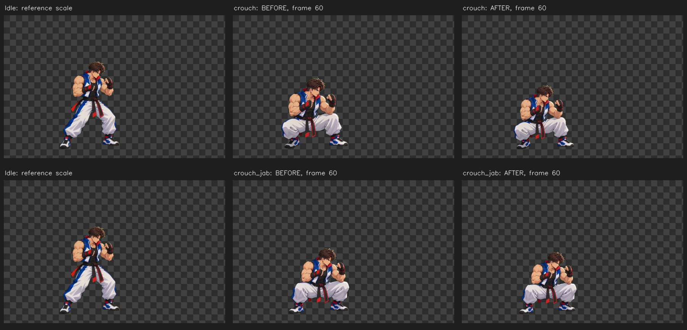

# Correção de escala durante Idle → Crouch — 15/10/2026

A versão anterior calibrava o vídeo pelo Idle inicial. No restante do vídeo, o desenho aumentava de tamanho: o segmento aproximado do topo da cabeça ao queixo crescia até **13,0% no Crouch** e **8,4% no Jab agachado**. Essa diferença já existe nos vídeos de entrada e era preservada pela transformação constante.



Cada linha mostra **Idle / antes / depois**. O agachamento continua mais baixo pela postura. A correção conserva a medida da cabeça da pose inicial, aplica escala uniforme ao frame inteiro e mantém o apoio vertical anotado. Não se usa a altura total do personagem para forçar poses diferentes a terem o mesmo tamanho.

## Medições

| Clip | Segmento antes, nas marcações | Segmento após correção | Apoio nos PNGs finais |
|---|---|---|---|
| Crouch | 82,12–92,80 px | 82,12 px | Y 652–654 px |
| Jab agachado | 80,65–87,52 px | 80,76 px | Y 654–655 px |

As duas marcações manuais adicionais nos frames **40 e 80 do Crouch**, que não foram usadas para calcular a curva, diferem **0,43%** da medida inicial após a correção. Esses pontos conferem a interpolação entre keyframes; não constituem avaliação anatômica automática de todos os pixels.

Os **944 frames e seus PTS originais** foram mantidos. O canvas permanece **1080 × 699**, com root **[417,654]**. Todos os PNGs de Idle, Jab, Jab em meia resolução, Dash, Jump e Crouch pequeno foram comparados pixel a pixel com o lote anterior e permanecem iguais.

- [Marcações na fonte, incluindo apoio no chão](evidence/crouch-scale-landmarks.png).
- [Coordenadas e SHA-256 dos vídeos usados](../examples/real-scale-corrections.json).
- [Medições e verificações reproduzíveis](evidence/crouch-scale-checks.json).
- [Prévia portátil com todos os frames atualizados](evidence/preview.html).
- [APK Android atualizado](../dist/sprites-visualizador.apk).

## Implementação e validação

`scale_correction` é explícito na configuração de cada clip. O comprimento do mesmo segmento é interpolado pelos timestamps originais; a escala aplicada é inversamente proporcional a esse comprimento. `ground_y` interpola somente o apoio vertical anotado em clips apoiados. X conserva o root fixo de calibração. Jump e Dash recusam correção de chão.

O manifesto v3 registra a escala e a matriz em cada frame. Os clips corrigidos também incluem todas as marcações, fatores, hash da fonte e método de interpolação. Nenhum consumidor precisa inferir a correção pela resolução do PNG. Sem marcações, o modo constante continua sendo utilizado.

Foram aprovados **42 testes**, incluindo 11 de integração com os vídeos reais, a medição nos pontos fora da calibração, estabilidade do chão, rejeição de anotações inválidas ou de outro vídeo, atlas, movimento e preservação das fontes. A sequência **Idle → Crouch → Idle** também foi adicionada e verificada no visualizador desktop e móvel. Os resultados estão em [test-results.txt](evidence/test-results.txt), [browser-checks.json](evidence/browser-checks.json) e [mobile-checks.json](../android/mobile-checks.json).

Para reproduzir os dois lotes em pastas novas:

```bash
python scripts/validate_real.py --inputs /caminho/originais --output /caminho/antes --without-scale-correction
python scripts/validate_real.py --inputs /caminho/originais --output /caminho/depois
python scripts/check_crouch_scale.py --before /caminho/antes/run --after /caminho/depois/run --output /caminho/evidencias
SPRITE_REAL_RESULT=/caminho/depois/run python -m unittest discover -s tests -v
```

As marcações são aproximadas e usam um segmento da cabeça. A correção trata a variação global de escala, sem redesenhar o personagem ou remover diferenças internas de proporção. O lote continua disponível para revisão visual. Cortes e efeitos existentes nas fontes permanecem sinalizados.
