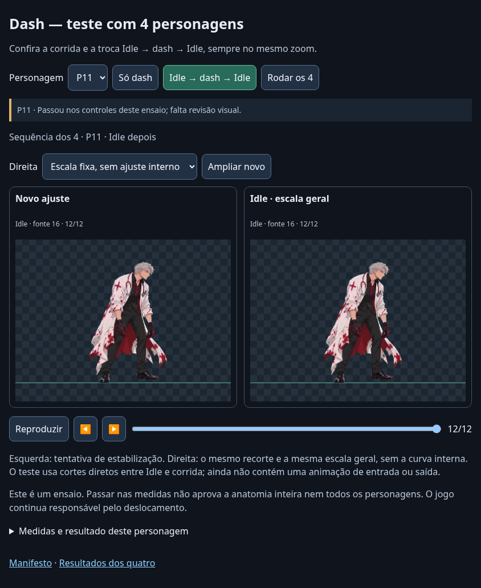

# Dash — ensaio com P02, P06, P08 e P11

**Atualização:** o usuário aceitou visualmente este ensaio (“Deu certo”). A [triagem seletiva seguinte](TRIAGEM-SELETIVA.md) preserva estes quatro personagens sem alterar seus arquivos. Os resultados técnicos abaixo continuam registrados.

O mesmo método foi aplicado aos quatro personagens pedidos, antes de ampliar o lote. **O resultado ainda não permite adotar a técnica como padrão automático para todos:** P02 e P11 passam nos controles definidos; P06 tem um frame sem registro confiável e P08 mantém oscilação acima do limite.

[APK do ensaio — 8,1 MB](https://github.com/dggokb/Game-luta-gpt/raw/refs/heads/padronizacao-sprites/dist/sprites-dash-4-personagens.apk). Atualiza o app de teste da P02, com o mesmo pacote e certificado: **Sprites — Dash (4 personagens)**, versão `1.7-dash-4personagens`, versionCode 8. O visualizador completo permanece sem alterações.

Toque **Rodar os 4** para reproduzir Idle → dash → dash → Idle em P02, P06, P08 e P11. Cada passagem usa dois ciclos de corrida e avança ao próximo personagem; para depois da P11. Os botões **Só dash** e **Idle → dash → Idle** permitem repetir um caso. **Ampliar novo** aumenta o painel e o seletor da direita permite comparar com Idle. Os cortes entre as poses são diretos: este ensaio não cria animações de entrada e saída.

A esquerda mostra a tentativa de estabilização; a direita usa o mesmo recorte, escala geral e posição horizontal, mas mantém escala constante dentro da ação. Essa referência foi criada para o ensaio, **não é o APK anterior da coleção**. Na P06, a tentativa foi bloqueada e os dois lados usam a mesma referência fixa, sem exportar uma curva parcial ou interpolar o frame incerto.

## Resultados

Os índices de fonte abaixo começam em zero. A oscilação é pico a pico, relativa à mediana da escala medida na região registrada. Não mede todos os membros do corpo.

| Personagem | Frames de corrida | Antes, escala fixa | Após tentativa | Controle separado do tronco | Resultado |
| --- | --- | --- | --- | --- | --- |
| P02 | 14–37, 24 frames | 2,50% | 1,54% | 4,63% | Passa nos controles do ensaio |
| P06 | 44–61, 18 frames | — | Curva bloqueada | Não aprova o caso | Registro incerto na fonte 44 |
| P08 | 20–43, 24 frames | 4,11% | 3,57% | 1,62% | Falha no resíduo de escala |
| P11 | 40–63, 24 frames | 2,38% | 0,64% | 2,84% | Passa nos controles do ensaio |

O limite é **2% de resíduo local**, com **correlação mínima de 0,8 em todos os frames selecionados** e até **6% de diferença no controle corporal separado**. P02, P08 e P11 têm correlações mínimas de aproximadamente 0,824, 0,829 e 0,841. Na P06, o frame 44 fica em aproximadamente 0,727. Ele permanece no recorte e impede aplicar a curva; os outros 17 frames desse intervalo passam no registro. Duas regiões alternativas, evitando partes da máscara ou do cabelo, também não atingiram o limite no frame 44. O limite não foi relaxado para aprovar o personagem.

P08 já havia sido rejeitada pela calibração anterior de pose. O ensaio permite examinar uma tentativa com ajuste geral manual aproximado, preservando essa rejeição no relatório. Isso não promove a P08 a saída aprovada para o jogo.



## Método comum aos quatro

A implementação é a mesma da revisão do ciclo da P02: região aproximadamente rígida da cabeça durante a corrida; registro de similaridade por frame; mediana circular de três frames; escala uniforme; posição horizontal registrada; movimento vertical preservado. A rotação é medida para não confundi-la com escala, mas não é aplicada ao sprite. Idle não determina a curva interna.

O raio de busca passou a ser configurável: neste ensaio é **600 px nos quatro casos**, para comportar o deslocamento na imagem da P06. O padrão anterior de 25 px permanece para os outros usos. Intervalo, região e referências anatômicas são marcações manuais próprias de cada personagem; não são detecção automática de poses.

A escala geral é **uma única constante por personagem**, obtida pela comparação aproximada do eixo crânio–queixo da corrida com o próprio vídeo Idle já calibrado. Os fatores são aproximadamente 0,7768 para P02, 0,9171 para P06, 0,5278 para P08 e 0,7668 para P11, relativos à escala-base de cada vídeo. Para a P08, cuja escala-base anterior não foi aprovada, a base de cálculo é explicitamente 1 em unidades de fonte. As coordenadas e fatores exatos estão no relatório.

Isso também muda a escala geral da P02 em relação ao teste anterior de fator 0,85: agora o alvo é o **Idle do próprio personagem na sequência**, em vez de reaproveitar o ajuste aproximado do ensaio anterior. A constante não oscila durante o dash. Na corrida, um deslocamento horizontal fixo representa a distância entre a região registrada e uma referência manual do quadril; assim, registrar o rosto não coloca necessariamente a cabeça sobre a origem do personagem.

Os controles do tronco usam dois frames de poses equivalentes em cada personagem, fora da região que determina a correção. São eixos projetados e marcações aproximadas; não comprovam anatomia estável em todas as poses. O próprio resíduo da região registrada não é uma validação anatômica independente. Os casos aprovados continuam exigindo avaliação visual, incluindo pernas, braços, deformações locais e emenda da passada. Os ciclos não são anunciados como loops perfeitos.

## Arquivos e reprodução

[ZIP de 71,4 MB — PNGs, HTML portátil e os oito vídeos originais](https://drive.google.com/file/d/1rJCRvPQlrmBHeZzJ-0bbXsve263VkNbk/view).

Há **228 PNGs**, com canvas comum de 1800 × 900 e root `[1100, 760]`: duas versões dos 90 frames de corrida selecionados e 12 frames Idle por personagem. `normalized/<personagem>/adjusted` contém a tentativa; `fixed` é a referência sem curva interna; `idle` mantém os pixels da saída anterior, apenas transladados em coordenadas inteiras para o canvas comum. **Na P06, `adjusted` é igual a `fixed`, pois a correção foi bloqueada.** Nenhuma dessas pastas representa aprovação automática para uso no jogo.

Nenhum frame dentro de um intervalo foi retirado, inventado ou retemporizado. Os PTS, durações e índices originais permanecem no manifesto. Apenas a origem do relógio de reprodução do recorte é colocada em zero, explicitamente registrada. Os vídeos originais permanecem inalterados. A repetição na sequência é apenas reprodução do mesmo clip, sem duplicar ou sintetizar PNGs.

```bash
pip install -r requirements-review.txt
python scripts/review_dash_trial.py \
  --sources /originais --baseline /colecao-1.5/processed \
  --output /ensaio-dash-novo
python scripts/check_dash_trial.py /ensaio-dash-novo \
  --sources /originais --baseline /colecao-1.5/processed \
  --evidence /conferencia-dash
```

As marcações e os limites estão em [dash-standard-trial.json](../examples/collection/dash-standard-trial.json). O processamento da coleção não lê esse arquivo automaticamente; este é um ensaio separado.

## Verificação

**77 testes passaram**, incluindo tradução grande da fonte, separação da escala geral e interna, rejeição de registro incerto e reprovação por crescimento do tronco mesmo quando a cabeça está estável. A conferência do artefato verifica os 228 PNGs, matrizes uniformes, caixas, offsets, canvas/root, transformações de referência, PTS e durações; também compara pixels reais de fonte com a saída e prova que nenhuma curva foi aplicada à P06.

O visualizador e o HTML portátil passaram em retrato e paisagem, incluindo os quatro seletores, ampliação, comparação com Idle, retorno ao primeiro frame e a sequência completa dos quatro personagens. Os painéis estão alinhados e foram comparados com os PNGs integrais. Não houve erro JavaScript, requisição externa ou imagem ausente. O HTML e o manifesto dentro do APK correspondem aos arquivos conferidos; assinatura e alinhamento foram verificados. A instalação em aparelho físico não foi testada neste ambiente.

[Métricas e sequência](evidence/dash-trial-checks.json) · [77 testes](evidence/dash-trial-tests.txt) · [Entrega e hashes](evidence/dash-trial-delivery.json) · [Registro inicial](evidence/dash-trial-initial-registration.json) · [Regiões alternativas da P06](evidence/dash-trial-p06-region-checks.json).
