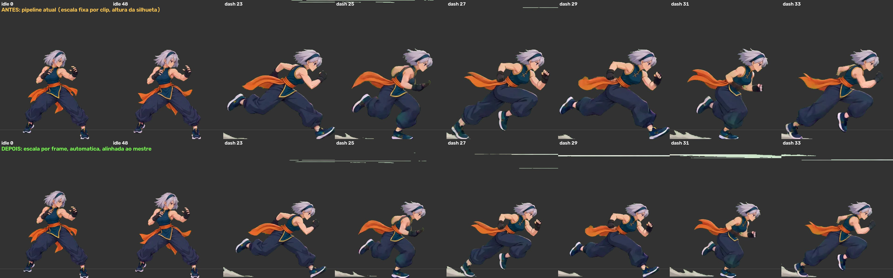
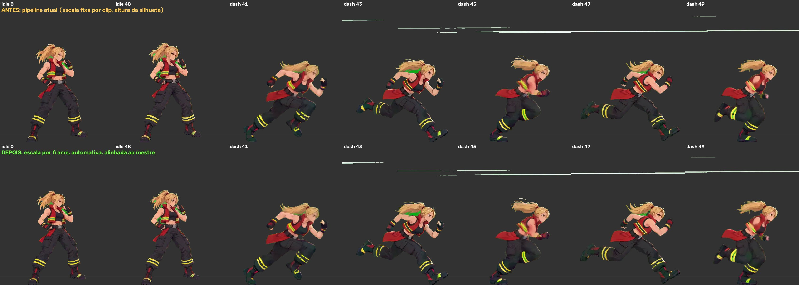

# Escala automática por frame — prova de conceito (P02 e P10)

**Resultado:** a correção automática leva o tamanho do corpo de todos os frames de Idle e dash para 0,95 a 1,05 do mestre, sem nenhuma marcação manual. No pipeline atual, a corrida da P02 chega a 1,31 do mestre e o dash da P10 varia de 0,79 a 1,07 dentro do mesmo clip.

| Caso | Pipeline atual (mín. a máx. do mestre) | Automático (p5 a p95) | Cortes detectados | Ciclo escolhido |
| --- | --- | --- | --- | --- |
| P02 idle | 1,00 a 1,08 | 0,98 a 1,03 | nenhum | — |
| P02 dash | 0,83 a 1,31 | 0,95 a 1,05 | após 9 e 41 | fontes 23 a 34, 12 frames |
| P10 idle | 1,01 a 1,10 | 0,96 a 1,03 | nenhum | — |
| P10 dash | 0,79 a 1,07 | 0,96 a 1,04 | após 38, 39, 40, 59 e 60 | fontes 41 a 50, 10 frames |





GIFs Idle → dash → Idle, antes à esquerda e depois à direita: [P02](evidence/autoscale/p02-sequencia-idle-dash-idle.gif) · [P10](evidence/autoscale/p10-sequencia-idle-dash-idle.gif). Relatórios por frame: [P02](evidence/autoscale/p02-report.json) · [P10](evidence/autoscale/p10-report.json).

## Conferência com as marcações manuais da P02

As 26 medidas manuais do eixo crânio–queixo em [motion-landmarks/p02.json](../examples/collection/motion-landmarks/p02.json) servem de gabarito. A curva automática tem **erro absoluto médio de 4,8%** em relação a elas. Durante a corrida (fontes 14 a 40) a diferença fica entre 0 e 7%. Os maiores erros estão na preparação agachada (fontes 4 a 10, até 21%): o MediaPipe estima mal o corpo 3D nessa pose e o corte do vídeo no frame 9 impede o registro entre frames de segurar o nível. Esses frames ficam fora do ciclo de corrida exportado.

```bash
python autoscale/compare_manual.py docs/evidence/autoscale/p02-report.json dash examples/collection/motion-landmarks/p02.json
```

Para comparar: a altura da caixa da silhueta, que o `calibrate()` atual usa, erra em média 27% nos mesmos frames, porque braços, poeira e linhas de velocidade entram na caixa.

## Como funciona

1. **Chroma e silhueta** usam o `sprite_pipeline.imaging` existente, sem mudança.
2. **Tamanho absoluto por frame.** O MediaPipe Pose Landmarker (modelo `full`, CPU, cerca de 0,15 s por frame) devolve 33 pontos em pixels e os mesmos pontos em metros, num corpo 3D estimado. A mediana, sobre 16 ossos, de `comprimento em pixels / comprimento em metros` é o tamanho do corpo na imagem. Como o 3D absorve a perspectiva, uma perna encurtada por estar de frente não muda a medida. Foi a única medida que concordou com as marcações manuais; distâncias 2D entre pontos (tronco, cabeça–ombro, orelhas) erram de 17% a 45%.
3. **Zoom relativo entre frames.** SIFT + RANSAC (similaridade) na cabeça e no tronco, com as linhas de velocidade removidas por abertura morfológica, para pares a 1, 2, 3, 4, 6 e 8 frames de distância.
4. **Fusão.** Um só ajuste de mínimos quadrados em escala logarítmica: os pares dão a forma da curva dentro de cada trecho; a medida absoluta dá o nível. Cortes do vídeo (sobreposição do corpo abaixo de 0,45 entre frames vizinhos, ou salto de tamanho com sobreposição baixa) separam os trechos. Mediana de 5 e Savitzky–Golay de 9 dentro de cada trecho.
5. **Referência.** Cada frame é escalado para ter o mesmo `px/m` que a imagem mestre do personagem, medida pelo mesmo detector. Isso iguala os frames dentro do clip e os clips entre si de uma vez, sem anotar segmentos nos mestres.
6. **Posição.** X no lugar pelo centro do quadril; chão pelo tornozelo mais baixo numa janela de 21 frames, suavizado. O balanço vertical da corrida é preservado.
7. **Ciclo.** No trecho com mais movimento, procura o período e o início com melhor autossimilaridade das silhuetas e melhor emenda (IoU entre o primeiro frame e o frame seguinte ao último). Registra `periodicity_iou`, `seam_iou` e `motion` no relatório.
8. **Conferência.** O relatório traz, por frame, tamanho antes, escala aplicada, quadril, chão e os cortes. `size_after_rel_to_master_p5_p95` fora de 0,93 a 1,07 deve marcar o clip para revisão.

## O que ainda não está resolvido

- A medida absoluta oscila cerca de 6% entre frames na corrida; a suavização reduz isso, e o ciclo exportado ficou com 0,95 a 1,05. Um resíduo de 2 a 3% ainda pode ser visível e deve ser avaliado no aparelho.
- Poses agachadas e de transição erram mais (até 21% na preparação da P02). Para Crouch e golpes agachados é preciso testar, e talvez ancorar nesses trechos pelo registro entre frames em vez da medida absoluta.
- A emenda do ciclo da P10 é fraca (`seam_iou` 0,64): a corrida tem só 19 frames contínuos na fonte e o personagem muda de desenho entre frames. A ferramenta mede e informa isso; não inventa frames.
- Saltos e golpes aéreos precisam de outra âncora vertical: o chão pelo tornozelo não vale no ar.
- O MediaPipe foi treinado com pessoas reais. Funcionou em P02 e P10; outros estilos (capangas, Dafu) precisam de teste. Frames sem pose são interpolados pelos vizinhos e contados no relatório.
- Entre personagens, o tamanho relativo continua definido pelos mestres, como hoje.

## Reproduzir

Python 3.10+, FFmpeg no PATH, e no Linux as bibliotecas `libegl1` e `libgles2` para o MediaPipe.

```bash
python -m pip install -r requirements-autoscale.txt
mkdir -p models && curl -L -o models/pose_landmarker_full.task \
  https://storage.googleapis.com/mediapipe-models/pose_landmarker/pose_landmarker_full/float16/1/pose_landmarker_full.task
python autoscale/standardize.py --sources /originais/p02 --master inicio_centro.png --clips idle dash --out /saida/p02
python autoscale/standardize.py --sources /originais/p10 --master inicio.png --clips idle dash --protect-green --out /saida/p10
```

A pasta de saída tem `idle/` e `dash/` com os PNGs normalizados (canvas 1100 × 800, root em 550 × 740), `report.json`, `comparacao.jpg`, tiras antes/depois e os GIFs. Os vídeos originais vêm da pasta `animations` do Drive, como no inventário da coleção.

## Próximo passo proposto

Rodar o mesmo comando nos 37 clips de locomoção dos 16 personagens, com o limiar de 0,93 a 1,07 marcando o que precisa de olho humano, e comparar no aparelho com o APK 1.5. Se passar, estender a Crouch, golpes e saltos com as âncoras adequadas, e só então substituir a calibração por silhueta do `sprite_pipeline`.
