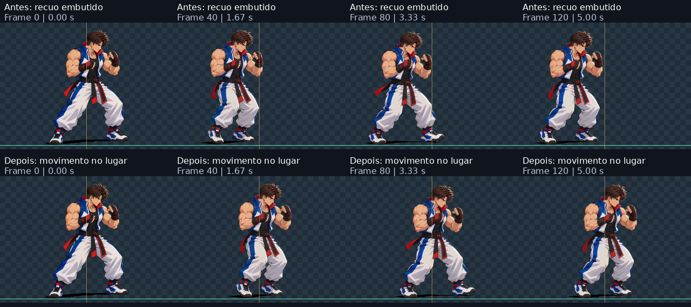
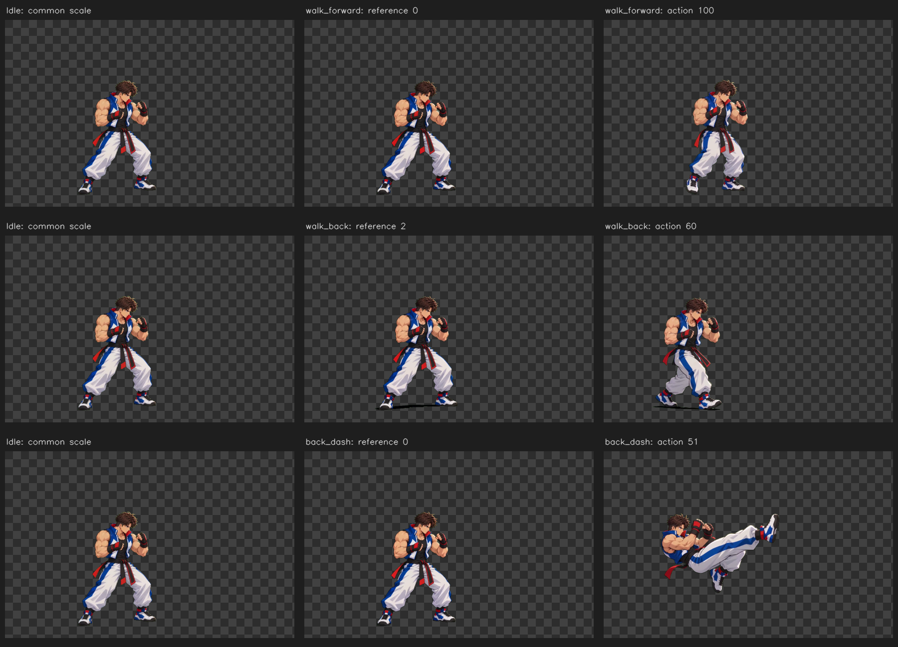
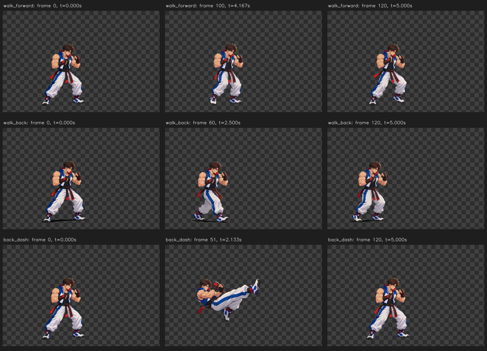

# Movimentação no lugar — 15/10/2026

O lote atual retira o deslocamento horizontal de `walk_forward`, `walk_back`, `dash` e `back_dash`. A posição no cenário fica a cargo do jogo. Os originais, poses, proporções e PTS são conservados.

O registro mede o centro da faixa do tronco entre 15% e 45% da altura da silhueta. Cada frame recebe somente uma translação horizontal adicional, depois da calibração de escala. A ferramenta não usa o centro da bbox inteira: um pé estendido não deve empurrar a raiz. A fase vertical de saltos continua nesta prévia; a integração com a física do motor deve tratá-la explicitamente.

```json
"root_motion": {"mode": "in_place_x", "anchor": "torso_band"}
```

O manifesto registra a medida em `root_motion.anchor_x_source_px`, a trajetória retirada em `root_motion.removed_x_output_px` e a matriz final em cada frame. A trajetória retirada serve para auditoria e não é aplicada automaticamente pelo visualizador. Na sequência Walk Back → Idle, a posição não acompanha o recuo que foi retirado.

A revisão mede o tronco nos PNGs efetivamente exportados, além de conferir canal alpha, tempos e escala. Um teste específico cobre o compartilhamento da matriz constante entre frames, evitando acumular offsets.



O tronco nos 121 PNGs exportados varia **0,28 px** em X, contra **128,68 px** antes. O deslocamento entre primeiro e último frame passou de −128,58 px para −0,06 px. Foram aprovados **53 testes**, **14 verificações desktop** e **17 verificações móveis**, incluindo retorno ao Idle sem acumular deslocamento.

[Medidas nos PNGs](evidence/in-place-checks.json) · [Testes](evidence/in-place-test-results.txt) · [Interface desktop](evidence/in-place-browser-checks.json)

## Reprodução

```bash
python scripts/validate_real.py --inputs /caminho/originais --output /caminho/movimentacao --include-movement
SPRITE_REAL_RESULT=/caminho/movimentacao/run SPRITE_MOVEMENT_BASELINE=/caminho/lote-anterior/run python -m unittest discover -s tests -v
python scripts/prepare_mobile.py /caminho/movimentacao/run --output /caminho/assets
python scripts/check_mobile.py /caminho/assets --screenshots /caminho/checks
```

O andar para frente mantém o início parado e os passos finais. Backdash mantém o aviso de corte da fonte nos frames 22 a 30; nenhuma parte cortada é reconstruída. As correções anotadas do Crouch continuam presentes. A extensão a todas as fontes está descrita em [COLECAO.md](COLECAO.md).

## Histórico: prévia 1.3

O relatório abaixo documenta a versão anterior, que conservava a translação. Seus gráficos e números de deslocamento descrevem a fonte e aquela versão; a configuração atual usa registro no lugar.

# Lote de movimentação — 15/10/2026

O visualizador passa a incluir **andar para frente**, **andar para trás** e **backdash**, junto com os oito clips do lote anterior. São **11 clips e 1.307 frames** no total, com os 363 frames das três fontes novas preservados.



| Clip no visualizador | Arquivo original | Frame de calibração | Altura fonte → saída | Fator uniforme |
|---|---|---:|---:|---:|
| `walk_forward` | `walk_fward.mp4` | 0 | 700 → 429 px | 0,6128571 |
| `walk_back` | `walk_back.mp4` | 2 | 700 → 429 px | 0,6128571 |
| `back_dash` | `back_dash.mp4` | 0 | 700 → 429 px | 0,6128571 |

As fontes são os arquivos existentes da [pasta de entradas documentada](VALIDACAO.md). Os hashes e as medições ficam em [movement-checks.json](evidence/movement-checks.json). O programa conserva o vídeo completo, seus PTS, proporções e deslocamentos; nenhum movimento novo é sintetizado.

## Movimento observado



- **Andar para frente:** o vídeo começa com um trecho longo em pé. Os passos aparecem no final, quase no lugar. O apoio da silhueta varia cerca de 22 px em X, terminando aproximadamente na posição inicial. A ferramenta não inventa avanço ausente na fonte.
- **Andar para trás:** o recuo é visível e foi preservado, com deslocamento líquido aproximado de **−134 px em X**.
- **Backdash:** o arquivo com esse nome contém uma fase aérea com a perna estendida. O apoio da silhueta sobe cerca de **125 px**; por isso o clip é classificado como `airborne`, sem correção de chão. Há corte no topo da fonte nos frames **22 a 30**. Esse limite é sinalizado no visualizador, sem reconstruir a arte cortada.

Esses valores usam o centro inferior da bbox da silhueta. A mudança dos pés e da postura também move esse indicador; ele não equivale a uma articulação rastreada ou a root motion de um esqueleto.

Os candidatos a ciclos continuam sendo propostas para revisão, sem descarte de frames. A detecção exige variação temporal em ambas as repetições. No andar para frente, `loop_start_frame: 85` limita a busca ao trecho dos passos; os 121 frames continuam presentes na animação completa.

## Como conferir

No APK **1.3-preview**, escolha `walk_forward`, `walk_back` ou `back_dash` em **Animação**. Compare com `idle` e use o frame fixo da direita para conferir as proporções. Os botões em **Sequências, ciclos, mestre e zoom** encadeiam Idle → cada movimento → Idle.

O APK mantém a assinatura das versões 1.1 e 1.2, permitindo atualização direta. A instalação em aparelho físico ainda depende da conferência do usuário; os controles são verificados em navegador móvel.

Para reproduzir o lote em uma pasta nova, forneça as entradas do lote anterior e os três vídeos acima:

```bash
python scripts/validate_real.py --inputs /caminho/originais --output /caminho/movimentacao --include-movement
SPRITE_REAL_RESULT=/caminho/movimentacao/run SPRITE_MOVEMENT_BASELINE=/caminho/lote-anterior/run python -m unittest discover -s tests -v
python scripts/make_movement_evidence.py /caminho/movimentacao/run --output /caminho/evidencias
```

Foram aprovados **48 testes**, **14 verificações desktop** e **17 verificações móveis**, sem erros JavaScript. As verificações abrangem os PNGs reais, a continuidade de escala com Idle, a preservação da fase aérea e do recuo, os atlas, os PTS e a igualdade das imagens do lote anterior. A posição foi conferida pelo canal alpha completo e pelo centro de massa da silhueta, evitando confundir a reamostragem de uma extremidade fina com mudança de escala.

[Log dos testes](evidence/movement-test-results.txt) · [Verificações desktop](evidence/browser-checks.json) · [Verificações móveis](../android/mobile-checks.json) · [Calibração](evidence/movement-calibration-report.json) · [Procedência e hashes](evidence/movement-provenance.json).

Os oito clips anteriores mantêm PNGs e timestamps idênticos, com o mesmo canvas **1080 × 699** e root **[417,654]**. As 1.888 imagens WebP desses clips também foram conferidas como idênticas no novo pacote. Os resultados visuais permanecem disponíveis para revisão.
