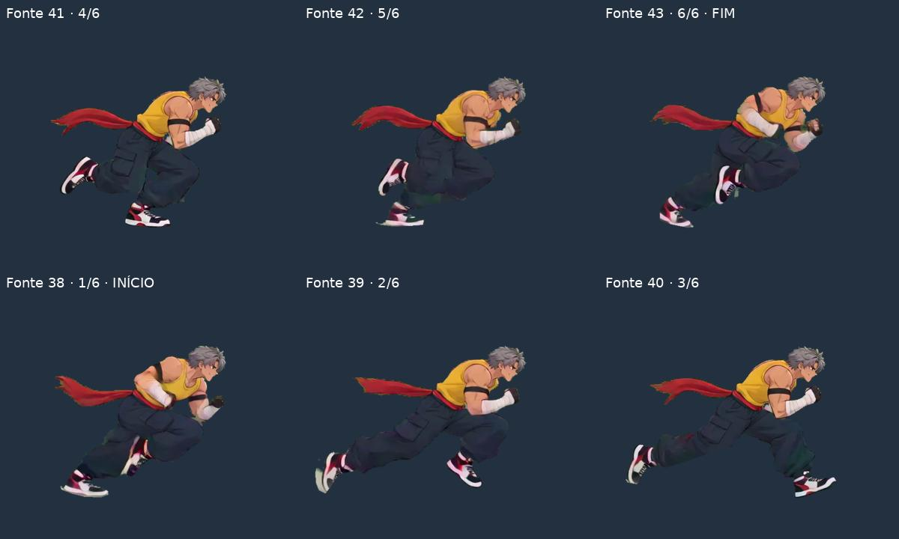

# P04 — correção assistida da passada

Esta revisão trata o caso de P04 apontado pelo usuário como corrida quebrada. O trabalho foi limitado a esse movimento: seleção manual de uma passada, recorte da poeira e conferência das poses. É um candidato para revisão visual, sem aprovação automática dos outros personagens.

[Vídeo de comparação — 10 segundos, 1,7 MB](https://drive.google.com/file/d/1NJcrXA-ZnYsgW1i7c2D6Q4URpfOJlnaK/view?usp=drivesdk). Os quatro primeiros segundos usam velocidade normal e os seis restantes mostram câmera lenta a ¼. Cada lado exibe o número do frame da fonte. O vídeo é uma prévia a 60 FPS; os PNGs e o manifesto conservam os tempos originais.

[APK — cerca de 4,1 MB](https://github.com/dggokb/Game-luta-gpt/raw/refs/heads/padronizacao-sprites/dist/sprites-p04-corrida.apk). Instala como **Sprites — P04 corrida**, pacote `org.spriteviewer.p04review`, versão `1.0-p04-corrida`. É separado do aplicativo de triagem e não o substitui. Funciona offline. A instalação em Android físico não foi testada nesta execução.

[ZIP — 11,6 MB](https://drive.google.com/file/d/1JOj8fXqEI3ZjcYL4lot4_AqwrSaPuT65/view?usp=drivesdk), com PNGs, HTML portátil, configuração e verificação. `normalized/body` contém os seis PNGs do corpo; `normalized/full` conserva os efeitos originais nos mesmos frames e transformações; `normalized/effects` contém a região exterior separada. `before` e `idle` são referências copiadas das saídas anteriores. A camada de efeito exportada não é um sistema de partículas pronto para o jogo.

## Diferença em relação à triagem anterior

O recorte anterior repetia os frames **35–46** da fonte, sem conferir a sequência de fases da passada. A inspeção dos desenhos mostrou repetição de uma posição na volta e uma mudança de fase no trecho posterior. Estar em ordem cronológica não tornava o recorte uma passada completa.

O novo trecho usa **37–42**, seis frames consecutivos, totalizando **0,25 s**. Não houve inversão, espelhamento, interpolação, reordenação interna nem criação de poses. A volta é 42 → 37. Os índices desta seção começam em zero; a interface e o vídeo mostram 38–43.

A poeira crescente e um rastro de calçado foram separados por **máscaras manuais próprias desses seis frames**. Os pixels RGB do corpo são derivados da fonte, com alteração de alpha nas regiões recortadas. A versão integral foi conservada para comparação. O recorte pode deixar pequenos resíduos junto aos calçados, onde o desenho e a poeira estão misturados; não houve reconstrução da arte oculta.

A escala geral anterior foi **preservada** e é constante nos seis frames. Duas tentativas foram descartadas durante a revisão:

- A curva ajustada somente pela cabeça aumentava a variação do segmento anotado no tronco. O controle aproximado do tronco varia cerca de 0,5% na fonte; com aquela curva, variaria cerca de 1,5%. Essas são medidas dos pontos marcados, com incerteza de alguns pixels, e não precisão anatômica de 0,5%.
- Um fator geral baseado no braço projetado no Idle e na corrida encolhia demais a cabeça na comparação. As duas projeções do braço não sustentavam essa redução. O fator avaliado está registrado como **não aplicado** na configuração.

A região da cabeça ainda varia aproximadamente 3,8% no registro local, acompanhando a mudança de desenho/pose. Esta revisão **não anuncia correção dessa variação local** nem igualdade de todas as proporções. O objetivo concreto deste candidato é reparar o ciclo da passada e separar o efeito que saltava ao repetir, sem introduzir uma curva de escala no corpo inteiro.

## Como conferir

O APK abre a corrida nova ampliada. **Comparar** mostra o recorte anterior; **Referência → Parado · Idle** permite conferir o tamanho geral. **Ver emenda** reproduz os dois últimos e os dois primeiros frames em câmera lenta. As setas e a barra permitem inspecionar os seis frames; em pausa, a referência anterior acompanha o mesmo frame da fonte. Em reprodução contínua, cada recorte repete em seu próprio tempo.

**Mostrar → Com poeira original** exibe o mesmo novo trecho com o efeito integral, para distinguir a passada da mudança da poeira. Todos os painéis usam o mesmo zoom e ponto de apoio. Os recortes PNG da prévia removem apenas margens com alpha zero, sem reduzir resolução, e conservam os destinos no canvas original.



## Verificação e reprodução

Foram conferidos os **31 PNGs** do pacote (18 derivados novos, 12 referências anteriores e um Idle), com **18 reconstruções a partir dos pixels da fonte**. A separação corpo/efeito preserva a soma dos alphas da fonte antes da transformação. Todos os PNGs de referência conservaram seus hashes. As posições, caixas, escala uniforme, PTS e durações foram verificadas.

A prévia normal e o HTML portátil foram exercitados em Chromium móvel, em retrato e paisagem, com comparação, Idle, corpo/efeito, avanço manual e emenda. Os registros de reprodução normal percorrem 0 → 1 → 2 → 3 → 4 → 5 → 0, e a emenda percorre 4 → 5 → 0 → 1. Os painéis foram comparados aos PNGs integrais e não houve erro JavaScript ou acesso à rede. Isso verifica a entrega e a ordem de reprodução; a qualidade percebida da corrida ainda exige avaliação visual.

[Verificação](evidence/p04-repair/validation.json) · [Pontos do controle manual](evidence/p04-repair/manual-body-controls.jpg) · [Compilação e SHA-256](../dist/sprites-p04-corrida.json) · [Entrega e hashes](evidence/p04-repair/delivery.json) · [Configuração](../examples/collection/p04-dash-repair.json).

```bash
python scripts/repair_p04_dash.py \
  --sources /caminho/fontes \
  --baseline /caminho/colecao-anterior/processed \
  --previous /caminho/triagem-anterior \
  --output /caminho/p04-nova
python scripts/check_p04_repair.py \
  --folder /caminho/p04-nova \
  --sources /caminho/fontes \
  --baseline /caminho/colecao-anterior/processed \
  --previous /caminho/triagem-anterior \
  --evidence /caminho/evidencias
python scripts/render_p04_review.py \
  --folder /caminho/p04-nova --output /caminho/comparacao.mp4
```

Os originais, o APK completo e os demais personagens permanecem preservados. A reprovação da triagem anterior e o retorno sobre P11 continuam válidos. Esta revisão não reclassifica a coleção como aprovada.
