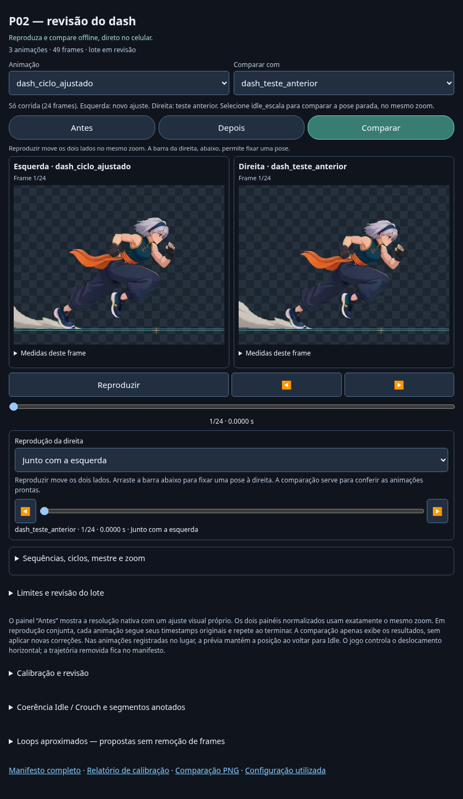
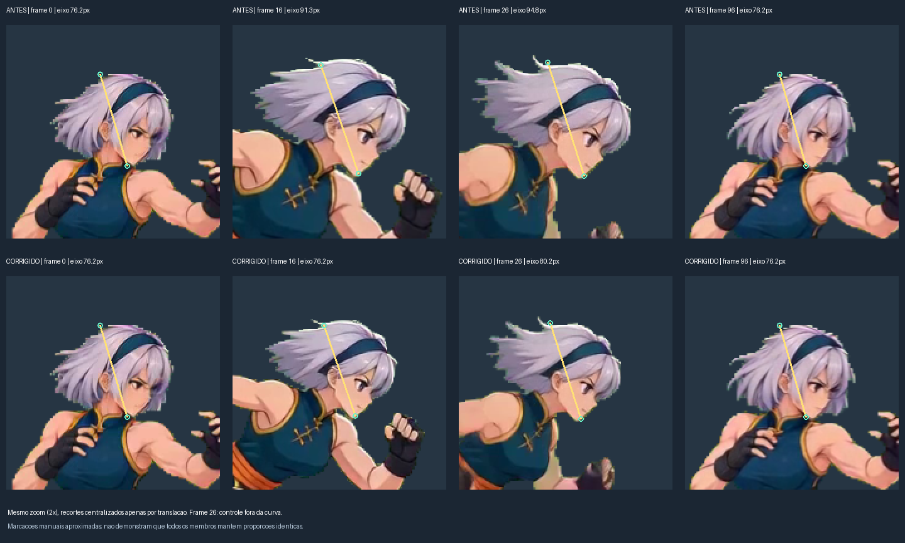
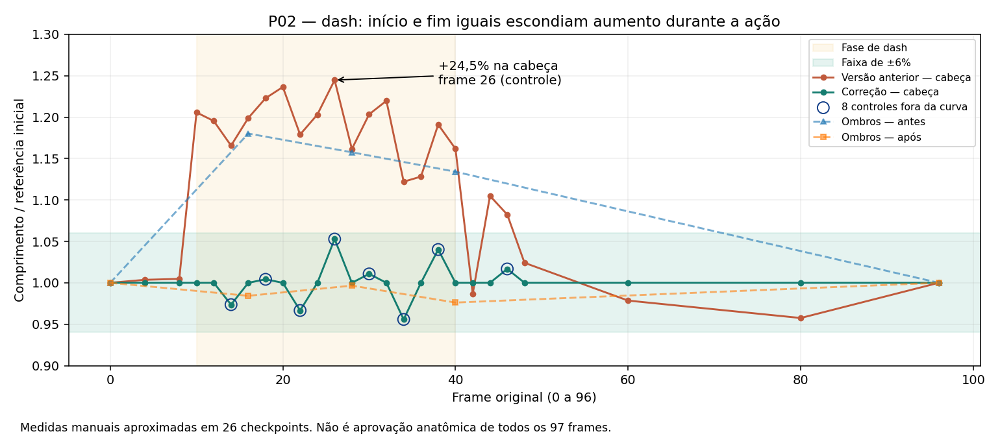

# P02 — ciclo de dash com escala independente do Idle

## Revisão 2: somente corrida

A primeira tentativa melhorou o tamanho geral, mas ainda oscilava. A curva ligava marcações aproximadas do crânio entre Idle, preparação e corrida; parte da mudança na forma do cabelo e da orientação virava uma mudança artificial de escala.

[APK atualizado de teste — 4,3 MB](https://github.com/dggokb/Game-luta-gpt/raw/refs/heads/padronizacao-sprites/dist/sprites-p02-dash-teste.apk). Atualiza o app separado **Sprites — P02 Dash (teste)**: mesmo pacote e certificado, versionCode 7 / `1.6-dash-ciclo`. Abre o novo ciclo à esquerda e o recorte do teste anterior à direita, sincronizados e no mesmo zoom. O seletor `idle_escala` permite comparar a pose parada. O APK completo 1.5 permanece sem esta revisão.

O novo clip contém **24 frames originais de corrida, índices 14–37 inclusive** (15–38 na contagem a partir de um). A entrada, a recuperação e o Idle foram deixados fora desse ciclo; continuam no vídeo original, que acompanha o ZIP sem alterações. Nenhum frame dentro do intervalo foi removido ou sintetizado. Os PTS e as durações originais foram preservados; o relógio de reprodução do recorte começa em zero, explicitamente registrado como uma mudança de origem temporal.

A região central do rosto da pose de corrida no frame 16 fornece a referência interna. O registro compara essa região em todos os 24 frames, mede escala uniforme, rotação e translação e rejeita correlação abaixo de 0,8. A rotação serve para medir a escala e **não é aplicada ao sprite**. Uma mediana circular de três frames reduz ruído isolado. A correção local resultante varia de +0,06% a +1,69%; não há interpolação até uma pose Idle nas extremidades.

Depois, **um único fator geral de 0,85** é aplicado ao ciclo inteiro, escolhido pela comparação aproximada de cabeça e ombros com a pose parada. Esse fator não muda ao longo da corrida. A posição horizontal usa o centro da região registrada, sem a poeira e as linhas de velocidade que contaminavam a caixa geral. O movimento vertical das poses permanece. Os PNGs mantêm o mesmo canvas e root da coleção; os recortes compactos do atlas não reajustam o zoom por pose.

| Conferência | Teste anterior, mesmo recorte | Novo ciclo |
| --- | --- | --- |
| Oscilação pico a pico da escala da região registrada, relativa à mediana | 8,50% | 1,54% |
| Diferença dos ombros entre duas poses equivalentes (fontes 16 e 28), fora da região usada no ajuste | — | 2,09% |
| Espalhamento horizontal do centro registrado nos PNGs | — | < 0,000001 px |

A primeira linha é um resíduo do próprio registro, **não uma verificação independente da anatomia inteira**. Os ombros são um controle separado em duas poses. A fonte contém mudanças de desenho e de projeção; os demais membros ainda exigem revisão e o corte não garante uma emenda de passada perfeita. Poeira e efeitos são preservados, mas não determinam a escala. Não foi aplicado alongamento diferente na largura e na altura.



[PNGs, HTML portátil, manifesto e vídeo original — ZIP de 17,4 MB](https://drive.google.com/file/d/140XUC0HMgNkquz-D4Ud_waspUPthJvE9/view). A pasta `normalized/dash_ciclo_ajustado` contém o resultado novo. `dash_teste_anterior` é somente a comparação; `idle_escala` contém uma pose parada. A aplicação ainda precisa ser revisada visualmente antes de estender o método aos outros movimentos e personagens.

### Reproduzir a revisão 2

```bash
pip install -r requirements-review.txt
python scripts/review_p02_cycle.py \
  --source /originais/p02/dash.mp4 \
  --baseline /colecao-1.5/p02 \
  --previous /revisao-1-p02 --output /revisao-2-p02
python scripts/check_p02_cycle.py /revisao-2-p02 \
  --source /originais/p02/dash.mp4 --evidence /conferencia-2
```

As configurações ficam em [p02-dash-cycle.json](../examples/collection/motion-landmarks/p02-dash-cycle.json), separadas da curva anterior para não aplicar silenciosamente o recorte ao lote inteiro. O arquivo vincula o vídeo por SHA-256, intervalo, região de registro e escala geral. O teste anterior pode ser obtido no ZIP histórico abaixo.

**73 testes passaram**, incluindo medição de crescimento conhecido em imagens sintéticas, rejeição de registro incerto, separação da escala local/geral e integridade dos PTS após o recorte. Foram conferidos os 49 PNGs, dimensões, caixas, matrizes uniformes e posição horizontal. A página com arquivos externos e o HTML portátil passaram em retrato e paisagem, com reprodução, retorno ao início, seleção de Idle, comparação com PNGs integrais e nenhuma requisição externa ou erro JavaScript. O HTML e o manifesto no APK são idênticos aos conferidos; assinatura e alinhamento foram verificados. Não houve teste em aparelho físico.

[Métricas](evidence/p02-cycle-checks.json) · [73 testes](evidence/p02-cycle-tests.txt) · [Entrega, hashes e versão](evidence/p02-cycle-delivery.json).

## Primeira tentativa — histórico de 97 frames

O dash da P02 cresce durante a ação e volta ao tamanho inicial. A versão 1.5 exportou essa variação: a pose inicial tinha similaridade de 0,9766 com Idle e as dez poses equivalentes encontradas tinham variação de altura zero. Isso não conferia a anatomia das poses de corrida.

[APK de teste da P02 — aproximadamente 5,9 MB](https://github.com/dggokb/Game-luta-gpt/raw/55ee60550af7bea131def1da6a8b2a2a136e36e7/dist/sprites-p02-dash-teste.apk). Instala como **Sprites — P02 Dash (teste)**, separado do visualizador completo. Abre no frame 27/97: correção experimental à esquerda e versão anterior à direita, com o mesmo zoom. Reproduza para ver a entrada, a corrida e o retorno. A versão completa 1.5 permanece sem essa correção.



## O que foi medido

As marcações aproximadas estão em [motion-landmarks/p02.json](../examples/collection/motion-landmarks/p02.json), vinculadas ao SHA-256 do vídeo. O eixo aproxima crânio–queixo, evitando as pontas do cabelo ao vento. Os centros dos ombros são um controle auxiliar, com incerteza de marcação e de projeção.

| Medida | Versão anterior | Correção experimental |
| --- | --- | --- |
| Eixo da cabeça nos frames 0 e 96 | 76,2 px | 76,2 px |
| Eixo da cabeça no frame 26 | 94,8 px (+24,5%) | 80,2 px (+5,3%) |
| Maior diferença absoluta nas oito amostras de controle da cabeça | fora da tolerância | 5,3% |
| Referência de tamanho | Idle inicial | 18 marcações de correção ao longo das fases |

Há 26 checkpoints entre preparação, dash, recuperação e Idle. **Oito medidas da cabeça ficaram fora da curva usada na correção** e servem de controle. Há cinco medidas dos ombros, incluindo a referência inicial/final e três durante a ação; elas não determinam a curva. A tolerância usada para cabeça é 6%; para ombros, 12%, considerando a projeção e a marcação aproximada.



A curva aplica uma escala uniforme ao frame inteiro, interpolada pelos timestamps originais; não iguala a altura de uma pose agachada com a de uma pose em pé. O fator varia de 0,8088 a 1,0444 em relação à calibração inicial. Os 97 frames e seus tempos foram conservados. Os pixels normalizados do primeiro e do último frame permanecem idênticos aos da versão anterior.

Isso **não é uma validação anatômica de todos os frames ou de todos os membros**. As marcações são manuais, comprimentos projetados variam com a orientação, e as amostras intermediárias restantes exigem revisão. Poeira e linhas de velocidade da fonte permanecem; elas inflavam a caixa geral e também limitam a confiabilidade de medidas baseadas nessa caixa. O APK de teste aproxima a câmera sobre uma região fixa do corpo, igualmente nos dois painéis; isso não altera os PNGs nem seus fatores de escala.

## Nova conferência

`scale_audit` mede segmentos nomeados nas fases declaradas, antes de liberar a exportação normalizada. Uma mudança acima da tolerância nos pontos conferidos rejeita o clip com o frame e o segmento responsáveis, mesmo que a comparação com Idle tenha passado. Sem essas anotações, o estado é **not_checked** e o visualizador informa que o tamanho nas outras poses ainda não foi conferido. `within_annotation_tolerance` vale para as amostras, sem aprovação automática dos demais frames.

O processamento em lote aceita `--motion-annotations`, com padrão em `examples/collection/motion-landmarks`. A P02 tem anotações para dash; os outros movimentos não receberam essa conferência adicional. Quando esse arquivo é adicionado ou alterado, uma saída antiga concluída é recusada: use outro diretório para reprocessar. Isso evita colocar medidas novas e receber silenciosamente o resultado antigo.

## Reproduzir

```bash
python scripts/review_p02_dash.py \
  --source /caminho/originais/p02/dash.mp4 \
  --baseline /caminho/colecao-1.5/p02 --output /caminho/revisao-nova
python scripts/check_p02_review.py /caminho/revisao-nova \
  --source /caminho/originais/p02/dash.mp4 --evidence /caminho/conferencia
SPRITE_P02_RESULT=/caminho/colecao-1.5/p02 python -m unittest tests.test_scale_audit -v
```

[Baixar a revisão com PNGs integrais e HTML portátil — 36,2 MB](https://drive.google.com/file/d/1igx60I8nuW-yHxNpjO1PHRPp1BX52NTq/view).

O resultado inclui `assets/index.html`, uma prévia portátil `p02-dash-comparacao.html` com imagens incorporadas e os PNGs integrais das duas versões em `normalized/`. Para a correção experimental, use a pasta `dash_corrigido` e sua matriz por frame no manifesto. A versão anterior acompanha o resultado exclusivamente para comparação.

O APK separado é compilado pelo mesmo wrapper, usando `--application-id org.spriteviewer.p02review --application-label 'Sprites — P02 Dash (teste)'`. O Java permanece no pacote original; o manifesto registra a Activity pelo nome completo. A chave continua fora do Git e nenhuma permissão Android é solicitada.

## Validação

**69 testes passaram**, incluindo a regressão real da P02, controles que não participaram da curva e invalidação de resultados antigos quando as anotações mudam. O processamento normal de um lote isolado com Idle e Dash também aplicou a correção, registrou o hash das medidas e preservou as fontes.

Foram conferidos os 194 PNGs (97 de cada versão), dimensões, limites, PTS, escala uniforme, comparação com os PNGs integrais, reprodução, fim da animação e navegação em retrato/paisagem. Tanto a página com arquivos externos quanto a página portátil passaram sem erros JavaScript ou requisições externas. O HTML dentro do APK confere byte a byte com o testado. A instalação em aparelho físico não foi testada neste ambiente.

[Métricas da revisão](evidence/p02-dash-checks.json) · [Log dos 69 testes](evidence/p02-dash-test-results.txt) · [APK e assinatura](https://github.com/dggokb/Game-luta-gpt/raw/55ee60550af7bea131def1da6a8b2a2a136e36e7/dist/sprites-p02-dash-teste.json).
