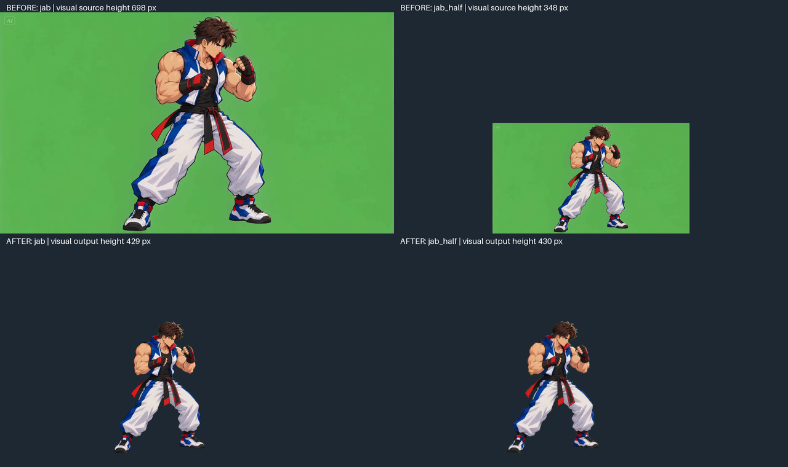

# Validação com entradas reais — 15/10/2026

Base remota inspecionada antes do trabalho: `padronizacao-sprites` em `6ec6b10e3d9d20dd09b0e8ef6a11043d727acf70`. Nenhuma outra branch foi incorporada. Código, configuração principal e módulos são independentes de qualquer jogo. Os arquivos abaixo são entradas externas de teste, não personagens ou dependências da ferramenta.

## Evidência principal

**Jab com personagem de 698 px e sua cópia controlada com 348 px produzem poses de 429 e 430 px.** A comparação também verifica largura e seções internas da silhueta. A diferença de 1 px é de rasterização, não uma segunda escala aplicada a um frame.

- [Prévia portátil interativa](evidence/preview.html): baixe/abra localmente. Contém todos os 944 frames normalizados do lote, em imagens de prévia reduzidas, com os tempos de apresentação. Não precisa das entradas ou de serviços externos para reproduzir.
- [Comparação de todas as referências calibradas](evidence/calibration-comparison.png).
- [Antes/depois e comparação no navegador](evidence/different-scales.png).
- [Deslocamento de Dash e Jump](evidence/motion-comparison.png).
- [Vídeo que começa agachado](evidence/crouch-native-scale.png).
- [Relatório de métricas e alertas](evidence/calibration-report.json).
- [Procedência e SHA-256 das fontes](evidence/provenance.json).

A derivada de meia resolução é **o mesmo vídeo real com todos os frames reamostrados geometricamente**, não uma segunda geração independente. Não foram criados personagens, poses ou movimentos. O comando é registrado na procedência. Os tempos relativos dos 121 frames coincidem com o original, com diferença máxima numérica de `8.9e-16 s`. O cabeçalho NUT/FFV1 dessa derivada anuncia 60 FPS; os PTS preservados continuam determinando a reprodução (~24 FPS). Os MP4 originais não foram regravados.

Existe também comparação entre fontes **nativas** com escala anatômica diferente: vídeos em pé com fator próximo de `0.61` e o vídeo que começa agachado com fator próximo de `0.99`. As alturas de poses distintas não são igualadas. A relação anatômica vem dos respectivos mestres e das anotações, cuja incerteza está descrita abaixo.

## Lote e medições

Idle Master: bbox `[497,220,783,649]`, altura visual **429 px**. Crouch Master: altura visual **298 px**. Nenhuma altura alvo foi solicitada: a resolução nativa dos mestres foi preservada. Canvas global **1080 × 699**, root **[417,654]**. O canvas cresceu para acomodar os movimentos e extensões sem reduzir a escala dos personagens.

| Clip de teste | Fonte existente | Frames | Pose de calibração | Altura visual fonte → saída | Fator único |
|---|---|---:|---|---:|---:|
| idle | idle.mp4 | 121 | Idle, frame 0 | 702 → 429 | 0.6111111 |
| jab | L(jab).mp4 | 121 | Idle, frame 0 | 698 → 429 | 0.6146132 |
| jab_half | derivada integral do Jab | 121 | Idle, frame 0 | 348 → 430 | 1.2327586 |
| dash | dash.mp4 | 121 | Idle, frame 102 | 702 → 429 | 0.6111111 |
| jump | jump.mp4 | 121 | Idle, frame 0 | 698 → 429 | 0.6146132 |
| crouch | crounch.mp4 | 121 | Idle, frame 0 | 700 → 429 | 0.6128571 |
| crouch_jab | l2(jab).mp4 | 121 | Idle, frame 0 | 698 → 429 | 0.6146132 |
| crouch_small | dano_baixo.mp4 | 97 | Crouch, frame 7 | 300 → 298 | 0.9933333 |

Total: **944 frames brutos e 944 normalizados**, sem redução temporal. Cada clip também tem atlas paginado com todos os frames. O lote completo ocupa aproximadamente 676 MiB, fora do repositório; a pasta completa da execução é `/workspace/validated-delivery/run` no ambiente de trabalho. O repositório guarda evidências reduzidas e os scripts de reprodução.

Entradas consultadas somente para leitura: [pasta real no Drive](https://drive.google.com/drive/folders/1vV0lIA_8ecw9ZK8nuXgkK8YpcXlJjWHF). Para reproduzir, coloque `inicio_centro.png`, `inicio_agachado.png`, `idle.mp4`, `L(jab).mp4`, `dash.mp4`, `jump.mp4`, `crounch.mp4`, `l2(jab).mp4` e `dano_baixo.mp4` numa pasta local e execute os comandos do README. Nenhum vídeo de entrada é incluído no Git.

## Testes executados

- **18 testes unitários aprovados**: escala visual, preservação de translação X/Y, alpha pré-multiplicado, fundo residual, coerência anatômica, ambiguidade de zoom, pose incorreta, ciclos, segurança do HTML e preservação das fontes/saídas. [Log](evidence/unit-results.txt).
- **9 testes de integração real aprovados**, em conjunto com os 15 testes unitários então existentes: 24 aprovações, sem testes ignorados nessa execução. [Log](evidence/test-results.txt). As três verificações adicionais de proteção da saída e nomes foram executadas depois na suíte de 18 testes unitários.
- **6 verificações do navegador aprovadas**, sem erro JavaScript: avanço/pausa, zoom comum antes/depois, Idle → Jab → Idle, Idle → Dash → Idle, inspeção de Jump e reprodução do ciclo por timestamps. [Resultado](evidence/browser-checks.json).
- **2 casos reais de rejeição confirmados**: usar Crouch Master no vídeo com pose incompatível e forçar o frame 30 do Jab como Idle. Ambos ficaram sem fator aprovado e sem PNGs normalizados; os **242 frames brutos** foram preservados. [Relatório](evidence/rejections-report.json).
- Conferência independente por FFprobe/FFmpeg: PTS de todos os frames, resolução original, pixels do primeiro frame e SHA-256 das fontes.
- Atlas conferido contra PNGs, pixel a pixel, em início/meio/fim de cada clip. Testes de movimento verificam os frames com a matriz constante e o deslocamento observado, não apenas a resolução dos PNGs.
- `compileall`, `git diff --check` e `pip check` passaram.

## Inspeção e limites encontrados

A comparação visual das poses de referência mostra a escala geral e o chão consistentes entre Idle, Jab e a derivada em meia resolução. A inspeção também confirma movimento vertical no Jump e deslocamento horizontal no Dash. O apoio observado percorre aproximadamente **132.6 px** no eixo X do Dash e **114.3 px** no eixo Y do Jump. São medidas da silhueta: braços, efeitos e câmera podem influenciar esse indicador.

Os mestres foram anotados manualmente com um segmento aproximado do topo da cabeça ao queixo: **88.53 px** no Idle e **86.59 px** no Crouch, diferença de **2.19%**, dentro da tolerância declarada de 8%. O relatório mostra os pontos e não aplica correção oculta. Uma anotação aproximada de um único segmento não certifica toda a anatomia; mais segmentos ou marcos aprovados são o próximo reforço de calibração.

Os vídeos `crounch.mp4` e `l2(jab).mp4` começam em pé. As poses agachadas encontradas no interior não correspondem suficientemente ao Crouch Master: scores de aproximadamente 0.728 e 0.834, com discrepâncias de aparência/proporção. Foram rejeitadas nessa configuração, sem afrouxar os critérios. A calibração válida desses vídeos usa a pose Idle real do início. `dano_baixo.mp4` começa de fato agachado e foi calibrado diretamente pelo Crouch Master.

No vídeo que começa agachado, o primeiro frame tem altura de 304 px e o candidato escolhido tem 300 px. A variação é preservada pela escala única; não se força cada frame para 298 px. Há também pequenas diferenças de proporção entre os mestres e as fontes, geradas na arte original. A padronização uniforme não pode removê-las sem deformar o desenho.

Foram sinalizados problemas de silhueta/fundo em 2 frames do Jab, 2 da derivada, 76 do Dash, 22 do Jump, 3 do Jab agachado e 11 do vídeo pequeno. Alguns são efeitos desconectados legítimos; há também cortes no topo do Jump. Nenhum componente foi apagado por filtragem automática. Uma região de fundo `[0,0,64,50]`, reduzida à metade na derivada, foi excluída explicitamente para não medir a marca no canto como parte do personagem. Essa alteração existe somente nos derivados e está registrada no manifesto.

O Idle gerou hipóteses próximas de 36–40 frames, com uma proposta de 38 frames a partir do frame 45 e similaridade aproximada de 98.1%. Essas alternativas não comprovam um período único; o usuário deve comparar o movimento e a emenda. Nenhum frame foi cortado.

**Estado final do lote: `needs_review`; `visual_approval: false`.** Os testes e a demonstração sustentam a escala uniforme e a preservação de coordenadas nos casos examinados. Não eliminam a incerteza anatômica, as deformações, o corte da fonte, o fundo residual ou a ambiguidade do ciclo. A ferramenta está implementada e demonstrada neste lote; a validação artística universal permanece aberta.

Próximos problemas técnicos: medir mais segmentos rígidos entre os mestres, separar melhor efeitos/sombras sem apagar arte, validar outros personagens e perspectivas, distinguir deslocamento corporal de câmera, e resolver a escolha de período entre ciclos quase equivalentes.
