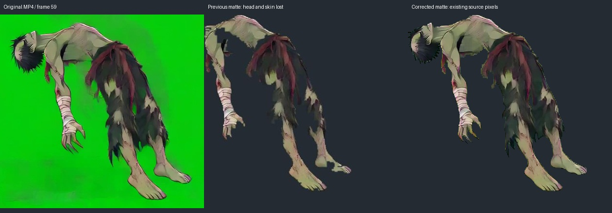

# P12: correção do recorte de GETUP

O frame 59 de derruba_levanta.mp4 contém cabeça e pele esverdeada intactas.
O recorte HSV compartilhado removia essas áreas e descartava a cabeça como
componente separado. A correção recupera somente alpha em uma região medida;
o RGB produzido pelo keyer permanece idêntico, incluindo seu despill existente.
Não há desenho, preenchimento, interpolação ou reconstrução de partes ocultas.

A aplicação exige SHA256 do MP4 completo, SHA256 do RGB decodificado e região
válida [272,270,662,650]. O registro de extração inclui a política e os hashes
da política e da implementação. Cache inválido é refeito apenas para esse vídeo.

Verificação local: 41 testes passaram; a reprodução dos 12 estados integrados,
o alpha de SR e o contrato de combate continuam válidos. Os 33 MP4s recuperados
conferem com os hashes anteriores. Dos 3201 registros de extração, somente o
frame 59 mudou; os demais 3200 mantêm os mesmos pixels e timestamps.

Esta correção não aprova GETUP nem aumenta o total de estados integrados.
O próximo lote ainda precisa de revisão visual, SR, CharacterPack e auditoria.
