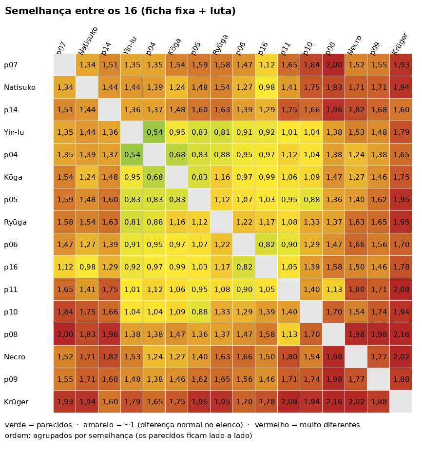

# Perfis dos 16: o quanto são iguais ou diferentes (01/11)

Pedido: simular os 16 e ver as características de luta de cada um, e o quanto estão iguais ou
diferentes.

**Como foi medido:**
- `BateriaPerfis` (nova): cada um contra os outros 15, em 1x1, CPU nível 8.
  - 20 sementes por confronto, dos dois lados: 4800 lutas, 600 por lutador.
  - O kit inteiro está ligado (SHINKAI e Ultra incluídos).
- **Ficha fixa** (o que está no pacote): 23 colunas.
- **Ficha de luta** (o que ele faz na simulação): 22 colunas.
- **Semelhança:** cada coluna vira nota z, ou seja, a distância até a média do elenco em desvios.
  - A distância entre dois lutadores é a diferença média das notas.
  - **0** = iguais; **~1** = diferença normal no elenco; **~2** = opostos.
- **Piso de ruído:** a mesma bateria com outras sementes dá ao mesmo lutador 0,08–0,22 de
  distância dele mesmo. Abaixo disso, dois lutadores não se distinguem pelo que fazem na luta.
- **Ressalva:** quem joga é a CPU, então a ficha de luta mostra como a CPU usa cada um.
- **Saída completa:** [perfis/saida-bateria.md](perfis/saida-bateria.md), com as duas fichas
  inteiras, as três matrizes e as marcas.

```
gradle -q -I <init com rodarBateria> :pc:rodarBateria -Dclasse=com.gamelutagpt.BateriaPerfis "-Dargs=20 8 <pasta dos CSV>"
python3 tools/balanco/mapa_perfis.py <pasta dos CSV> docs/balanco/perfis     # os mapas de calor
```



Mapas separados: [ficha fixa](perfis/semelhanca-fixa.png) e [jeito de lutar](perfis/semelhanca-luta.png).

## Resposta curta

- **O corpo é igual para quase todos.** 13 dos 16 andam, correm, dão backdash e pulam igual.
- **Os golpes também.**
  - A vantagem de cada botão (na defesa e no acerto) é a mesma para o elenco inteiro.
  - A pausa no acerto e o número de especiais (3) também são iguais.
  - O agarrão é igual para 15.
- **O que muda é o tamanho dos golpes e o projétil:**
  - o alcance do H vai de 126 a 398 px;
  - o do 2M, de 158 a 306 px;
  - o projétil, de 480 a 1100 px/s e de 150 a 900 px;
  - a vida, de 12600 a 16100.
- **Na luta, a identidade vem de onde sai o dano.** O projétil vai de 0% a 69% do dano, os
  especiais de 7% a 57% e os normais de 10% a 69%. É por aí que dá para dizer quem é quem.
- **Ninguém usa o ar** (0,1–1,6% do dano) e **só o p09 agarra** (7%; os outros, 0–1%).
- **Há um núcleo de 6 lutadores parecidos:** Yin-lu, p04, Kōga, p05, Ryūga e p10.
  - Todos são projétil e normais, com o mesmo corpo.
  - O par mais próximo é Yin-lu e p04: 0,54 no total e 0,53 na ficha fixa.
  - Logo em volta ficam p06, p16 e p11.
- **Únicos de verdade:** Krüger (lento com couraça), p09 (agarrador), p08 (zoner de alcance),
  Necro (especiais e fúria), p07 (defensivo, sem projétil) e p14 (só normais, anda devagar).
- **Balanço:** as vitórias vão de 14,5% (Natisuko) a 74% (p08). Quatro ficam abaixo de 30%:
  Natisuko, p14, p16 e p07.

## O que é igual para os 16

| Item | Valor | Exceções |
|---|---|---|
| Andar (frente/trás) | 300 / 220 px/s | Krüger 170, p14 200/140 |
| Dash | 207 px em 20 quadros | Krüger 65% |
| Backdash | ~160 px | Krüger 136 |
| Pulo, super pulo | 47 quadros; ~104 no ar | nenhuma |
| Air dash | 1 | p10: 2 |
| Vantagem na defesa L / M / H / 2M / 2H | 0 / −2 / −5 / −10 / −7 | 2–3 lutadores 1–2 quadros abaixo |
| Vantagem no acerto L / M / H; 2M e 2H | +5 / +4 / +5; derrubam | nenhuma |
| Pausa no acerto | 8 / 10 / 12 | nenhuma |
| Especiais de comando | 3, mais o projétil, o Super e o Ultra | nenhuma |
| Agarrão | 5 quadros, 1200 de dano | p09: 2200 e +40 px |
| SHINKAI | ~1 por luta | nenhuma |

**Comparação:** no SF6 cada personagem tem o próprio corpo e os próprios quadros.

| | Ryu | JP |
|---|---|---|
| Andar | 0,047 | 0,037 (−21%) |
| Dash | 19 quadros | 22 quadros |
| Jab | sai em 4, −1 na defesa | sai em 6, −2 na defesa |
| 2MK na defesa | −6 | −3 |

Aqui, a "personalidade" do quadro e do movimento não existe: só o alcance e o projétil mudam.

## O que varia (e quanto)

**Ficha fixa:**

| Coluna | Mín | Mediana | Máx | Fora da mediana (±10%) |
|---|---|---|---|---|
| Alcance do H | 126 (Necro) | 210 | 398 (p08) | 12 de 16 |
| Alcance do 2M | 158 (p07) | 244 | 306 (p06) | 11 de 16 |
| Projétil: alcance | 150 (p07, Necro) | 720 | 900 (7 lutadores) | 13 de 16 |
| Projétil: velocidade | 480 (p06) | 730 | 1100 (p08) | 11 de 16 |
| Início do M | 4 (Ryūga) | 6 | 9 (p14) | 10 de 16 |
| Início do 2M | 6 | 7 | 16 (Natisuko) | 9 de 16 |
| Vida | 12600 (p11) | 13580 | 16100 (p09, Krüger) | 3 de 16 |
| Dano L+M+H | 10,2% | 11,4% | 13,2% (Necro) | 4 de 16 |

**Ficha de luta:**

| Coluna | Mín | Mediana | Máx | Fora da mediana (±10%) |
|---|---|---|---|---|
| Dano de projétil | 0% (p07, Necro, p14) | 33% | 69% (p11) | 14 de 16 |
| Dano de especial | 7% (p08) | 13% | 57% (Necro) | 13 de 16 |
| Dano de normal no chão | 10% (p11) | 37% | 69% (p14) | 12 de 16 |
| Dano de Super | 6% (Natisuko) | 14% | 26% (Ryūga) | 8 de 16 |
| Dano de agarrão | 0% | 0,4% | 7,4% (p09) | só o p09 |
| Dano de normal no ar | 0,1% | 0,3% | 1,6% (p10) | ninguém usa |
| Distância no neutro | 231 px (Necro) | 268 | 359 (p08) | 4 de 16 |
| Avança / recua no neutro | 22–32% / 16–25% | 28% / 20% | | quase iguais |
| Combos de 3+ por minuto | 0,8 (p11) | 1,7 | 3,1 (p10) | 16 de 16 |
| Dano médio do combo de 3+ | 12% (Krüger) | 16% | 21% (Ryūga) | 9 de 16 |
| Pulos por minuto | 4,9 | 6,2 | 11,1 (Necro) | |
| Vitórias | 14,5% (Natisuko) | 58% | 74% (p08) | 8 de 16 |

## Grupos (pela semelhança total)

| Grupo | Quem | Como luta (na simulação) |
|---|---|---|
| **Núcleo "projétil + normais"** | Yin-lu, p04, Kōga, p05, Ryūga, p10 | Mesmo corpo; dano dividido entre projétil (22–41%) e normais (21–47%). Entre si: 0,54–1,33. O Ryūga se separa pelo Super (26% do dano) e pelo L de 2 quadros; o p10, pelos 2 air dashes e pelos combos. |
| **Zoners de média distância** | p06, p16, p11 | Projétil de 40–69%; neutro mais longe (276–340 px). p06 e p16 ficam a 0,82. |
| **Zoner de longe** | p08 | H de 398 px e projétil a 1100 px/s; neutro a 359 px; vence 74%. |
| **Fora da curva** | Natisuko, p14, p07 | Natisuko: H e 2M lentos (17/16 quadros), vence 14,5%. p14: só normais (69%), anda devagar, vence 25%. p07: sem projétil, defende muito, contra-golpe alto (42%), vence 29%. |
| **Únicos** | Necro, p09, Krüger | Necro: especiais (57%) e fúria. p09: o único agarrador (7% de agarrão, vida 16100). Krüger: lento, com couraça, ataca 39% do tempo. |

**Pares mais parecidos:**

| Par | Total | Fixa | Luta |
|---|---|---|---|
| Yin-lu e p04 | 0,54 | 0,53 | 0,56 |
| Kōga e p04 | 0,68 | 0,55 | 0,79 |
| Ryūga e Yin-lu | 0,81 | 0,88 | 0,73 |
| p06 e p16 | 0,82 | 0,60 | 0,99 |
| p05 e Kōga | 0,83 | 0,89 | 0,75 |
| Natisuko e p16 | — | 1,26 | 0,56 |

Natisuko e p16 têm pacotes diferentes, mas a CPU os joga do mesmo jeito.

## O que deixaria cada um mais diferente

São sugestões; nenhuma foi aplicada:

1. **Corpo por arquétipo:**
   - andar, dash, backdash e pulo próprios: o rushdown (p10, Kōga) anda e corre mais rápido;
   - os zoners (p06, p08, p11) andam mais devagar;
   - o grappler (p09) tem o dash mais curto e o pulo mais lento.

   Hoje 13 dos 16 têm o mesmo corpo.
2. **Quadros por personagem:** hoje a vantagem de cada botão é igual para todos. Alguns exemplos
   do que daria identidade:
   - o rushdown com L em +1 e M em 0;
   - o zoner com M mais seguro de longe;
   - o tanque com H mais lento e positivo.
3. **O núcleo de 6:** cada um precisa de uma ferramenta que só ele tem. Hoje o que os diferencia
   é só o alcance e a velocidade do projétil.
4. **O ar existe para quase ninguém** (≤1,6% do dano). Golpe aéreo próprio para alguns daria
   outro tipo de personagem: mergulho, pulo mais baixo, air dash que ataca.
5. **Projétil que não é projétil:** p07, Necro e p14 têm S de alcance 150 e nunca acertam com ele.
   Vale assumir isso no pacote (S corpo a corpo) ou dar alcance de verdade.
6. **Balanço:** Natisuko (14,5%), p14 (25,5%), p16 (26,8%) e p07 (28,7%) contra p08 (74%) e
   Ryūga, p09 e Kōga (61–62%). Antes de mexer, conferir quanto disso é a CPU jogando mal
   (Natisuko com H de 17 quadros e 2M de 16 é lenta para a CPU de nível 8).
