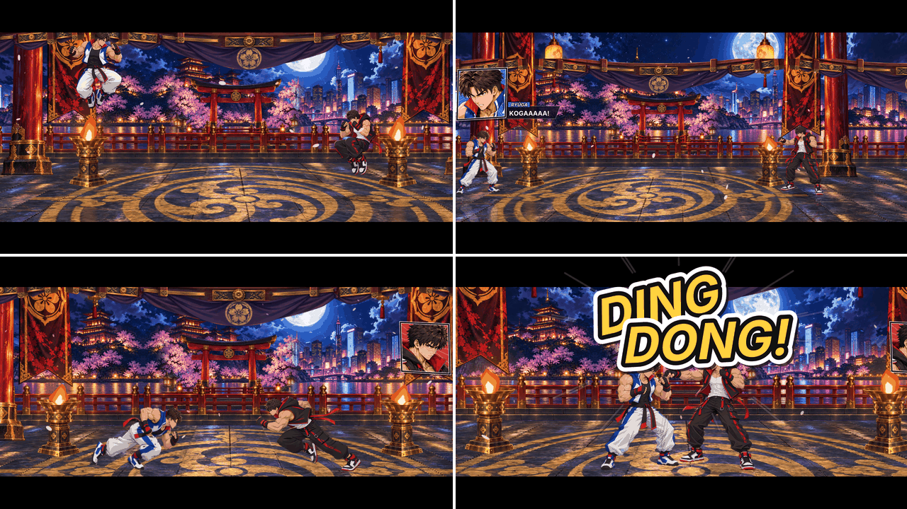

# Motor de cinemáticas na luta — padrão do modo história

Este é o terceiro motor da história, ao lado do [motor de páginas](motor-paginas.md) e do
[motor de conversas](motor-conversas.md). As páginas contam a história **entre** as lutas; as
conversas falam **durante** a luta, sem parar nada; a cinemática **transforma a luta em cena**
num momento certo: faixas pretas de cinema entram, o jogador perde o controle e um roteiro guia
os dois lutadores, põe falas nos quadros laterais, estoura onomatopeias de mangá na tela e pode
encerrar a luta ali. A estreia é o treino do Episódio 1 (jogador × rival, no dojo Shūshinkan); em qualquer outra
luta é o mesmo motor com outro arquivo.

A cena também pode **pintar a tela de tinta**, ler uma **página de mangá** da história (quadro a
quadro, no mesmo motor das páginas entre as lutas) e pedir
**quick time events (QTE)**: o jogador toca, martela, desliza ou acerta o tempo, e cada acerto é
um golpe de verdade do lutador dele que tira um pedaço de vida do roteiro. O teste disso é o
convite do Episódio 2 (Ryūga × Yin-lu, [abaixo](#o-teste-dos-qte-convite-do-episódio-2)).

## Como aparece na tela (o treino do Episódio 1)

1. Um dos dois chega a **25% de vida**: a cena começa. O controle trava, o golpe que levou
   aos 25% termina em **câmera lenta** com a câmera chegando perto, e as **faixas pretas**
   entram devagar em cima e embaixo (o quadro vira um 2,39:1 de cinema); o HUD e o controle de
   toque somem junto.
2. No 2x2, quem estiver na vez **troca com o irmão** (a troca de verdade, sai um e entra o
   outro), para a cena ser entre Ryūga e Kōga.
3. Os dois **pulam para trás** e **recuam**, se afastando, e **se encaram** em silêncio.
4. A câmera faz um **close no Ryūga** (plano médio, o rosto na tela) e ele grita
   **"KOGAAAAA!"**; desliza até o **Kōga**, que responde **"RYŪGAAAAA!"**. Cada um fala no
   quadro do **lado da tela onde está**: se o Ryūga está à esquerda, o quadro dele é o da
   esquerda; se os dois trocaram de lado na luta, os quadros trocam junto (e o rosto espelha
   para olhar o centro). Vale para as duas campanhas.
5. A câmera abre e os dois **saem correndo** um na direção do outro; perto do encontro, a
   corrida entra em **câmera lenta**.
6. Antes de se encontrarem, a campainha: **"DING DONG!"** estoura grande no meio da tela
   (linhas de som, tremor, as palavras em escada) e a luta **congela** com um tranco de zoom;
   depois os dois param e a câmera volta devagar.
7. As faixas saem devagar e a luta termina **interrompida**: a história segue nas páginas
   prontas `pag7` a `pag11` do episódio (a corrida e o DING DONG em mangá, o mensageiro com as
   duas cartas, a regra das equipes, o Kōga indo embora e o Ryūga decidindo participar).

A cena toda leva uns 15 segundos.

Quem está apanhando, caído ou no meio de um golpe quando a cena começa termina isso antes de
obedecer (o pulo sai quando o lutador pode agir). Enquanto o gatilho de vida espera, **o lado
que ele olha não cai** (no treino, sem `lado`, os dois): o jogo segura o último ponto de vida,
para um golpe grande não pular a cena indo direto ao KO. Com `"lado"`, o outro lado pode perder
normalmente antes da cena. Enquanto a cena roda, **ninguém cai**.



## O arquivo da cinemática

Cada luta da história aponta o arquivo dela no passo de luta do `episodio.json`, com o caminho
dentro de `historia/` (como a `conversa`). A cinemática fica na pasta do episódio:

```json
{ "tipo": "luta", "rotulo": "TREINO", "cenario": "dojo_shinshinkan", "dupla": "jogador", "cpu": "rival",
  "repetirSeDerrota": false, "cinematica": "ep01/cinematica_treino.json" }
```

O arquivo tem o **gatilho** e a lista de **ações**, que rodam em sequência. Cada ação espera
terminar antes da próxima; com `"semEsperar": true` a próxima começa na hora (as duas rodam
juntas). O treino do Episódio 1, pronto, é `historia/ep01/cinematica_treino.json`:

```json
{
  "gatilho": { "vida": 0.25 },
  "acoes": [
    { "acao": "controle", "travar": true },
    { "acao": "velocidade", "valor": 0.3, "segundos": 0.2, "semEsperar": true },
    { "acao": "faixas", "entrar": true, "segundos": 1.0, "semEsperar": true },
    { "acao": "camera", "zoom": 1.1, "segundos": 1.0, "semEsperar": true },
    { "acao": "esperar", "segundos": 1.1 },
    { "acao": "velocidade", "valor": 1.0, "segundos": 0.5, "semEsperar": true },
    { "acao": "camera", "zoom": 1.0, "segundos": 0.8, "semEsperar": true },
    { "acao": "mover", "quem": "ambos", "movimento": "titular" },
    { "acao": "mover", "quem": "ambos", "movimento": "pular-tras" },
    { "acao": "mover", "quem": "ambos", "movimento": "recuar" },
    { "acao": "esperar", "segundos": 1.2 },

    { "acao": "camera", "zoom": 1.7, "foco": "ryuga", "segundos": 0.7 },
    { "acao": "fala", "quem": "ryuga", "expressao": "bravo", "texto": "KOGAAAAA!", "segura": 1.1 },
    { "acao": "esperar", "segundos": 0.25 },
    { "acao": "camera", "zoom": 1.7, "foco": "koga", "segundos": 0.8 },
    { "acao": "fala", "quem": "koga", "expressao": "bravo", "texto": "RYŪGAAAAA!", "segura": 1.1 },
    { "acao": "esperar", "segundos": 0.25 },
    { "acao": "camera", "zoom": 1.0, "foco": "centro", "segundos": 0.6 },
    { "acao": "esperar", "segundos": 0.5 },

    { "acao": "mover", "quem": "ambos", "movimento": "correr", "distancia": 420 },
    { "acao": "velocidade", "valor": 0.3, "segundos": 0.25, "semEsperar": true },
    { "acao": "camera", "zoom": 1.15, "segundos": 1.2, "semEsperar": true },
    { "acao": "mover", "quem": "ambos", "movimento": "correr", "distancia": 120, "segundos": 6 },
    { "acao": "velocidade", "valor": 0.0, "segundos": 0.0, "semEsperar": true },
    { "acao": "onomatopeia", "texto": "DING DONG!", "pos": [0.5, 0.34], "tamanho": 150, "tremor": 14, "rotacao": -8, "segundos": 3.2, "semEsperar": true },
    { "acao": "camera", "zoom": 1.12, "segundos": 0.15 },
    { "acao": "esperar", "segundos": 1.1 },
    { "acao": "mover", "quem": "ambos", "movimento": "parar" },
    { "acao": "velocidade", "valor": 1.0, "segundos": 0.3, "semEsperar": true },
    { "acao": "camera", "zoom": 1.0, "segundos": 1.2, "semEsperar": true },
    { "acao": "esperar", "segundos": 1.4 },
    { "acao": "faixas", "entrar": false, "segundos": 0.9 },
    { "acao": "terminarLuta", "vencedor": "interrompida" }
  ]
}
```

### Gatilho

| `gatilho` | Quando a cena começa |
|---|---|
| `{"vida": 0.25}` | o lutador da vez de qualquer lado chega a 25% da vida. `"lado": "jogador"` ou `"rival"` olha só um lado. Enquanto espera, o lado que o gatilho olha não cai (os dois, sem `lado`); o outro pode perder normalmente |
| `{"vida": 0.25, "lado": "rival", "ultimo": true}` | igual, mas só para o **último de pé** do lado: no 2x2, o titular cai normalmente e a cena espera o parceiro entrar e chegar a 25%. É o gatilho das histórias das duplas do torneio ([torneio.md](torneio.md#a-história-da-dupla-adversária)) |
| `"inicio"` | logo depois do "LUTEM!" (a intro e o READY/GO tocam normalmente) |
| `{"tempo": 20}` | 20 segundos de luta depois do "LUTEM!" |
| `"ko"` | a luta acabou (KO): a cena toca antes do resultado, e o resultado espera ela |

A cena nunca começa por cima de um Super, de um Ultra, de uma troca ou da Página Final: espera
eles terminarem. Cada cinemática toca uma vez por luta (se a derrota repete a luta, ela arma de
novo).

### Ações

| `acao` | Campos | O que faz | Espera |
|---|---|---|---|
| `controle` | `travar` (true/false) | trava ou devolve o controle do jogador; travado, o pad e a IA ficam de fora e só o roteiro move os lutadores | — |
| `faixas` | `entrar` (true/false), `altura` (px, padrão 92), `segundos` (padrão 0,45) | as faixas pretas entram ou saem; com elas o HUD e o controle de toque somem | a animação |
| `mover` | `quem` (`jogador`, `rival`, `ambos`, `ryuga`, `koga`), `movimento`, `distancia`, `segundos` | um movimento dos lutadores (tabela abaixo); um irmão é o time dele na campanha | os dois terminarem |
| `fala` | `quem`, `expressao`, `texto`, `lado`, `segura` | uma fala nos quadros da conversa ([motor-conversas.md](motor-conversas.md)) | a fala sair da tela |
| `onomatopeia` | `texto`, `pos`, `tamanho`, `tremor`, `rotacao`, `cor`, `segundos` | um letreiro de mangá grande na tela (abaixo) | `segundos` |
| `esperar` | `segundos` | só o tempo passa (a luta segue parada no roteiro) | `segundos` |
| `camera` | `zoom` (0,8 a 2; 1 = o da luta), `foco` (`centro`, `jogador`, `rival`, `ryuga`, `koga`), `segundos` | zoom extra sobre a câmera da luta. Sem foco, ancorado no chão (os pés não somem na faixa); com foco, o centro vai até o lutador e o zoom se apoia no peito dele (close: o rosto fica, os pés podem sair). `foco` fica até outra `camera` mudar (`centro` volta) | a transição |
| `velocidade` | `valor` (0 a 1), `segundos` (padrão 0,25) | velocidade da luta: 1 normal, 0,3 câmera lenta, 0 congela. Só a luta muda: a cena, as falas, as faixas e as onomatopeias andam no tempo normal. Volta a 1 sozinha no fim da cena | a transição |
| `terminarLuta` | `vencedor` (`interrompida`, `jogador`, `rival`) | encerra a luta pela cena: `interrompida` e `jogador`, a história segue; `rival` conta como derrota (repete a luta se o passo pedir) | — |
| `tinta` | `cobrir` (true/false), `segundos` (padrão 0,9), `cor` (padrão `#FFFFFF`) | pinceladas largas atravessam a tela até cobrir tudo (cobrir) ou saem na ordem contrária mostrando a luta (descobrir). Coberta, a tela fica lisa na cor da tinta, por cima até do HUD; uma página na tela some debaixo da tinta nova | a animação |
| `pagina` | `imagem` ou `imagens` (lista de `<episódio>/<imagem>`, ex.: `ep02/pag1_ryuga.jpg`) | uma página pronta da história, lida no motor de mangá das páginas ([motor-paginas.md](motor-paginas.md)): a página inteira, depois cada quadro isolado com o resto escurecido, os balões digitados e os efeitos do quadro, com os quadros e balões do passo dela no `episodio.json`. Um toque (ou botão) segue, como na história. Com `imagens`, uma é sorteada a cada luta (já abre ao carregar a luta). Uma página feita só para a cena (fora dos episódios) leva os `quadros` no próprio arquivo, no formato dos episódios ([abaixo](#página-feita-para-a-cena)). A página fica parada no último quadro até a próxima `tinta` cobrir; duas `pagina` seguidas são lidas uma depois da outra | o último toque |
| `qte` | `tipo`, `texto`, `golpe`, `dano`, `final`, `erro`, `impacto`... ([abaixo](#qte)) | um quick time event | o jogador acertar e o golpe acabar |
| `trocar` | `segundos`, `lances` | os dois trocam golpes sem acertar, lance a lance ([abaixo](#troca-de-golpes)), com a câmera viva. Ninguém perde vida nem guarda. Com `semEsperar`, roda por baixo das falas; um `mover`, `golpe` ou o golpe de um QTE interrompe. Precisa do controle travado | `segundos` (no tempo da luta) e a vez em andamento acabar |
| `golpe` | `quem` (padrão `jogador`), `golpe`, `dano`, `final`, `impacto` | um golpe do roteiro, sem QTE: quem bate corre até o outro e bate de verdade, com o dano do roteiro (ex.: o rival ataca primeiro e o QTE seguinte é o revide). Precisa do controle travado | o golpe acabar |
| `clarao` | `segundos` (padrão 0,3), `cor` (padrão `#FFFFFF`) | clarão de impacto: a tela fica da cor e volta à luta (some mais rápido no começo). Esconde um corte, como o golpe que pega no anime | `segundos` |
| `video` | `clipe` (`<episódio>/<nome>`), `repetir`, `esquerda`, `emendar`, ou `parar` ([abaixo](#cena-em-vídeo)) | os dois lutadores num vídeo só, no chão da luta e no lugar deles | `repetir`: nada; senão o vídeo acabar (com `emendar` + `semEsperar`: o vídeo começar) |

Toda ação aceita `"semEsperar": true` (menos o `qte` e o `golpe`, que sempre esperam). Um movimento ou uma fala nunca seguram a cena mais de
8 s (um lutador preso numa queda não trava o jogo).

Se o roteiro acaba **sem** `terminarLuta`, a luta continua: o controle volta, as faixas saem e
a câmera volta ao normal sozinhas.

### Movimentos

Os movimentos saem do **motor de luta de verdade**: o roteiro aperta os comandos (pulo para
trás, backdash, dash para frente, troca), como as demos antigas (`DemoDirector`). A animação, a
física e as paredes são as da luta.

| `movimento` | O que faz | Acaba quando |
|---|---|---|
| `titular` | no 2x2, quem estiver na vez troca com o titular da dupla (o primeiro do passo de luta, o irmão nas duplas da história), sem esperar a recarga da troca | o titular está na vez (logo, se já estava) |
| `pular-tras` | pulo para trás, segurando para trás no ar (~155 px cada um) | pousar |
| `recuar` | backdash (~175 px cada um) | o recuo acabar |
| `correr` | dash para frente, segurando | o vão entre os dois corpos chegar a `distancia` (px) ou passar `segundos` (padrão 3, contados no tempo da luta: a câmera lenta estica) |
| `andar` | anda para frente | igual a `correr` |
| `parar` | solta tudo (cancela o movimento em andamento) | na hora |

### Falas

Usam os quadros laterais da conversa, com a mesma legenda digitada, os mesmos rostos e as
mesmas expressões (`historia/retratos/<quem>_<expressao>.png`). A luta não precisa ter arquivo
de conversa.

- **Quem está em campo**: `"quem": "rival"` (ou `"jogador"`) fala por quem estiver lutando
  desse lado na hora, com o rosto da seleção. Serve para a dupla em que qualquer um dos dois
  pode ser o último de pé (Lars ou Fenna).
- **Lado**: os irmãos (`ryuga`, `koga`) não dizem o lado: cada um fala no quadro do **lado da
  tela onde o lutador do time dele está** na hora da fala (se os dois trocaram de lado na luta,
  os quadros trocam junto), nas duas campanhas. Qualquer outro personagem diz o lado:
  `"lado": "jogador"` ou `"rival"` (segue o lutador desse time na tela) ou `"esquerda"` /
  `"direita"` (fixo).
- **Rosto**: o rosto de lado espelha para olhar o centro da tela (`historia/retratos/olhar.json`,
  [motor-conversas.md](motor-conversas.md)), então a mesma imagem serve dos dois lados.
- `segura`: segundos na tela depois de digitada (padrão: a conta da conversa, 1,6 s ou mais
  para fala longa). Grito curto fica bem com 0,5.
- Quando a cena começa, a conversa da luta se cala (os quadros saem deslizando) e nenhuma
  reação ("impacto", "levou") fala por cima.

### Onomatopeias

Letreiro de mangá: miolo colorido, contorno preto e outro branco por fora, sombra, linhas de
som estourando do centro. Bate grande e assenta (cada palavra um pouco depois da anterior, em
escada: "DING" em cima, "DONG!" embaixo à direita), treme forte no começo e some no fim.

| Campo | Padrão | O que é |
|---|---|---|
| `texto` | — | o letreiro; cada palavra entra separada |
| `pos` | `[0.5, 0.42]` | centro na tela: `[0, 0]` topo esquerdo, `[1, 1]` base direita |
| `tamanho` | 140 | altura da letra (px da tela 1280x720) |
| `tremor` | 8 | tremor no começo (px) |
| `rotacao` | -6 | inclinação (graus); as palavras alternam ±5° em volta dela |
| `cor` | `#FFD23F` | cor do miolo |
| `segundos` | 1,6 | tempo na tela (os últimos 0,25 s somem) |

### Troca de golpes

Cada vez da troca é um **lance**. `"lances": ["choque", "salto"]` diz os primeiros, em ordem; o
resto é sorteado. A vez quase sempre passa para o outro (nunca três seguidas do mesmo).

Para coreografar, o lance diz também **quem ataca** e **os golpes**, em ordem:
`"bloqueio:rival:L,H"` (a Yin-lu solta o fraco e o forte e o outro defende), `"esquiva:rival:2H"`
(a rasteira, e o outro pula para trás), `"salto:jogador:H"` (ele pula e desce com o forte; o que
sobrar da lista é o combo no chão). Os golpes são os do QTE (`L`, `M`, `H`, `2L`..., `S2`...).
O lance `"fim"` encerra a troca ali, sem sortear mais nada: `["vento:rival:L", "bloqueio:rival:H", "fim"]`
é exatamente um soco que passa no vento e um chute defendido.

| Lance | O que acontece |
|---|---|
| `bloqueio` | quem ataca corre (longe) ou anda (perto) até encostar e solta de 1 a 3 golpes normais em pé; o outro defende |
| `vento` | para pouco antes e o golpe passa raspando |
| `esquiva` | solta o forte e o outro pula para trás no mesmo instante: o golpe passa no vento |
| `salto` | pula por cima e desce com o forte; o outro defende e ainda leva o combo defendido no chão (colados, sem espaço para pular, vira `bloqueio`) |
| `choque` | os dois correm um para o outro e soltam o médio de modo que os golpes fiquem ativos no mesmo quadro: **punho contra punho**. Um letreiro estoura (KRAKOOM!, BAKOOM!, DOOM!), a luta congela um instante e a câmera dá um tranco |

**Câmera viva**: enquanto a troca roda, a câmera chega mais perto (zoom 1,2) e puxa para o lado de
quem ataca (somada à câmera do roteiro, que continua valendo); cada defesa dá um tranquinho e
cada choque, um tranco. Quando a troca acaba ela volta.

### Página feita para a cena

Uma página que não está no fluxo do episódio (a lembrança do convite do Episódio 2) fica na
pasta do episódio e os quadros e balões vão na própria ação, iguais aos de um passo de página
do `episodio.json` ([motor-paginas.md](motor-paginas.md)):

```json
{ "acao": "pagina", "imagem": "ep02/lembranca1.jpg", "quadros": [
  { "area": [...], "efeitos": ["zoom"],
    "baloes": [ { "texto": "Vamos brincar, Kōga...", "caixa": [...], "area": [...] } ] }
] }
```

O recorte é o mesmo das páginas da história (`tools/historia/recortar_pagina.py`): ele grava a
página e imprime os quadros e balões. Os balões espetados (onomatopeias e gritos com os nomes)
ficam na arte; as falas precisam de tradução como as da cena.

### QTE

O botão redondo aparece no meio da tela (a luta escurece um pouco), com o nome do golpe em
letreiro em cima e a dica embaixo, que segue o controle em uso: **TOQUE!** no toque, **APERTE!**
no teclado ou controle. No toque vale a tela inteira; no teclado/controle, qualquer botão (o
deslize, o direcional). Acertou: **BOA!**, o anel estoura e o lutador do jogador corre até o
rival e dá o `golpe`. Errou (ou o tempo acabou): **ERROU!**, o rival dá o golpe do `erro` e o
mesmo QTE pede de novo. O HUD fica na tela (sem faixas), então a barra de vida desce a cada golpe.

| `tipo` | O que o jogador faz | `segundos` (padrão) |
|---|---|---|
| `toque` | toca uma vez (o anel em volta é o tempo que falta) | tempo para tocar (1,8) |
| `martelar` | toca `vezes` vezes (padrão 8); o número no botão é quanto falta, o anel enche | tempo para tudo (2,6) |
| `deslizar` | desliza o dedo (90 px) na `direcao`: `frente` (para o rival), `tras`, `cima`, `baixo`; no teclado, o direcional. Para o lado contrário é erro | tempo para deslizar (1,8) |
| `tempo` | toca quando o anel que fecha encosta no botão (folga de 0,17 s para cada lado). Cedo ou tarde é erro | quanto o anel leva para fechar (1,3) |

| Campo | Padrão | O que é |
|---|---|---|
| `texto` | — | o nome do golpe em cima do botão ("SOCO!"); precisa de tradução |
| `quem` | `jogador` | quem bate no acerto (`jogador`, `rival`, `ryuga`, `koga`); no erro bate o outro |
| `golpe` | `H` | o botão do golpe: `L`, `M`, `H`, agachado (`2L`, `2M`, `2H`), `A` (o agarrão) ou um especial (`S` = a energia, `S2`, `S3`...) |
| `dano` | 0,15 | quanto da vida **máxima** do alvo o golpe tira (no lugar do dano do golpe; nunca o último ponto) |
| `final` | false | o golpe derruba de vez: o alvo cai (KO) com a vida que tiver |
| `erro` | nenhum | `{"golpe": "M", "dano": 0.05}`: o contra-ataque de quem errou. Sem ele, o erro só pede de novo |
| `pos` | `[0.5, 0.6]` | centro do botão na tela |
| `impacto` | nenhum | o que acontece quando o golpe do acerto pega (abaixo) |

**Impacto** (no `qte` e no `golpe`): `{"texto": "POW!", "congela": 0.2, "zoom": 1.2}` mais os campos
de uma onomatopeia (`pos`, `tamanho`, `tremor`, `rotacao`, `cor`, `segundos`, padrão 1,2). Quando o
golpe pega, o letreiro estoura, a luta **congela** `congela` segundos (padrão 0,15) e a câmera
dá um **tranco** de zoom até `zoom` (padrão 1,15) e volta. O letreiro precisa de tradução.

Para o final ficar com cara de cinema, o roteiro junta as ações em volta dos QTE: `trocar`
entre um QTE e outro (os dois se movimentando e trocando golpes defendidos, às vezes por baixo
das falas), faixas e closes (`camera` com `foco`) nas falas, `mover` os dois `correr` um para o outro com
`velocidade` 0,3 logo antes do QTE (o QTE pede em câmera lenta), um `golpe` do rival antes de
um QTE de revide e, no golpe final, faixas, câmera lenta e um impacto grande com `congela` 0,7.

- O QTE precisa do controle travado antes (`{"acao": "controle", "travar": true}`): quem bate é o
  roteiro. O arquivo que pede QTE com o controle solto não abre.
- O golpe sai do motor de luta de verdade: quem bate espera o alvo ficar de pé (levantando de uma
  queda), corre até ele e aperta o botão; o alvo não defende. O dano é o do roteiro, entra uma vez
  só (as outras batidas do golpe não tiram mais) e, se o golpe não pegar, entra assim mesmo.
- Depois do QTE `final`, se o roteiro acaba sem `terminarLuta`, a luta segue no fluxo normal do
  KO: a fala de vitória, a tela de vitória e a história continuam.

### Cena em vídeo

Para a cena com cara de anime, os dois lutadores podem virar **um vídeo só** (gerado com os
dois juntos no verde): enquanto o vídeo está na tela, o jogo esconde os lutadores de verdade (e
as sombras) e desenha o quadro do vídeo no chão da luta, no meio deles (`CenaVideo`). A câmera,
as faixas, a tinta, os letreiros e o QTE continuam por cima.

```json
{ "acao": "video", "clipe": "ep00/qt1", "repetir": true, "esquerda": "koga", "semEsperar": true }
```

| Campo | O que é |
|---|---|
| `clipe` | a pasta do vídeo dentro de `historia/` (`ep00/qt1` = `historia/ep00/qt1/folha.webp` e `efeito.json`) |
| `repetir` | em loop (a ação não espera: o QTE seguinte pede por cima do vídeo) |
| `esquerda` | quem está à esquerda no vídeo (`ryuga`, `koga`, `jogador`, `rival`): o vídeo espelha quando esse lutador está à direita na luta, então a mesma cena vale para as duas campanhas |
| `emendar` | com um loop na tela, o vídeo novo espera a volta do loop acabar (os vídeos começam e acabam na mesma pose: a troca não pula). Com `semEsperar`, a cena segue quando ele começa (os letreiros marcam os golpes pelo tempo do vídeo) |
| `ritmo` | quantas vezes mais rápido que o vídeo ele toca (padrão 1; na briga dos irmãos a troca de golpes toca a 1,8 e a queda a 1,7) |
| `parar` | tira o vídeo (os lutadores voltam) |

O vídeo anda no ritmo da luta: para na congelada de um impacto, fica lento na câmera lenta e
congela com `velocidade` 0. O que toca uma vez fica no último quadro até outro vídeo, `parar` ou
o fim da cena. A troca entre a luta e o vídeo (os lutadores podem estar em outro lugar) fica
bonita atrás de uma `tinta` rápida (cobrir, o vídeo, descobrir).

**QTE sem golpe:** `"golpe": "nenhum"` no QTE: o acerto não bate na luta (o golpe é o vídeo que
vem depois); o `impacto` sai na hora do BOA!. O erro (sem `erro`) só pede de novo.

**Fazer o vídeo:** os dois juntos no verde, 1344×768, com a câmera das imagens iniciais (os
pés em y ≈ 735). Cada vídeo começa e acaba na guarda dos dois, para emendar. Converter com o
`efeito_video.py` para a pasta do episódio, com a origem no chão no meio dos dois no primeiro
quadro e a escala dos sprites (0,3 px do mundo por px do vídeo nas crianças):

```bash
python3 tools/sprites/efeito_video.py qt1.mp4 --nome qt1 --origem 665,735 --escala-mundo 0.3 \
    --resolucao 1.2 --passo 2 --saida android/app/src/main/assets/historia/ep00
```

A folha precisa caber em 4096 px (GPUs antigas): `--passo 2` (12 por segundo) e `--resolucao`
1,2 deixam os 5 s de vídeo em ~2000×3800. As folhas são lidas numa thread à parte quando a luta
carrega a cinemática e soltas no fim dela.

### A briga dos irmãos (Prólogo): o teste da cena em vídeo

`historia/ep00/cinematica_briga.json`, na luta IRMÃOS das duas campanhas (depois do treino),
com os vídeos dos meninos do Drive (`ryuga_8/qt1`, `qt2`, `qt3`) e o do Kōga se levantando (`levanta`, que emenda o qt2 no qt3):

| Momento | O que acontece |
|---|---|
| Um dos dois com 50% | câmera lenta, faixas; a tinta cobre e sai com o **qt1** em loop (os dois trocando golpes e errando); o Dafu: "Ei, ei! Devagar, meninos!" |
| TROCA DE GOLPES! (martelar 14, em 4,2 s; o qt1 toca a 1,8x e repete enquanto o QTE espera; o qt2 a 1,7x) | PÁ! PÁ! PÁ!; no fim da volta do loop entra o **qt2** (se acertam e caem), com PAH!, POW!, BAM!, TUM! nos golpes do vídeo |
| GOLPE FINAL! (tempo) | o Kōga se levanta e avança num soco que assusta o Ryūga (**levanta**, que começa no último quadro do qt2 e acaba no primeiro do qt3: sem corte), PAH!; com os dois em guarda o QTE pede, e o acerto vira o **qt3**: o Ryūga avança, câmera lenta, e o soco pega o Kōga na cara: a luta congela, POW! grande, e a tinta cobre. A pag5 começa nesse soco |

A cena é a mesma nas duas campanhas: o Kōga é quem está à esquerda nos vídeos, e o vídeo
espelha quando ele está à direita (campanha do Ryūga). Para ver no PC:

```bash
cd android
gradle :pc:testeCena -Pepisodio=ep00 -Pmarca=briga-irmaos [-Pirmao=koga]
```

O `testeCena` abre só aquela luta da história, tira a vida até o gatilho, acerta todos os QTE
e grava um PNG a cada 6 quadros em `android/pc/build/cena/`. Serve para qualquer luta da
história com cinemática (`-Pvida` muda a vida do gatilho).

### O teste dos QTE (convite do Episódio 2)

`historia/ep02/cinematica_convite_ryuga.json`, na luta CONVITE da campanha do Ryūga (Ryūga ×
Yin-lu, no dojo dela):

1. A Yin-lu já perdeu **80%** da vida, ficando com **20%** (`{"vida": 0.20, "lado": "rival"}`): o
   controle trava, o golpe termina em câmera lenta e a **tinta branca** cobre a tela.
2. As **duas páginas da lembrança** (Ryūga, Kōga e Yin-lu crianças no dojo) são lidas quadro a
   quadro, no toque (`ep02/lembranca1.jpg` e `lembranca2.jpg`).
3. A tinta pinta de novo por cima da segunda página, os dois recuam atrás dela e a tinta sai: a luta volta.
4. A **coreografia do dono (13/11)**, em quatro sequências, só com os movimentos que os dois já têm
   (o que não existe foi adaptado). Os QTE não batem por conta própria (`"golpe": "nenhum"`): o
   acerto libera a troca de golpes do roteiro, com quem ataca e os golpes em ordem.

| Sequência | O que acontece | QTE |
|---|---|---|
| 1. Retomada | ela avança: "Vamos ver o quanto você melhorou!"; o soco dela passa no vento, o chute ele defende; a rasteira ele pula, desce com o chute e ela defende; DOOOM! | ESQUIVA! (deslizar para cima) |
| 2. Alta velocidade | troca de golpes com a câmera alternando nele, nela e no meio (inclui um choque punho contra punho); o soco baixo, o gancho e o chute giratório (S3) dele ela defende, mas o chute a empurra e ela recua deslizando: "Nada mal!"; ele corre para cima | COMBO! (martelar 8) |
| 3. A superioridade dela | SHUN!: ela vem no dash e acerta a palma (S1); ele defende o golpe seguinte e ela o projeta com o agarrão; "Você continua sendo um monstro!" / "E você continua falando demais!", trocando golpes no vento | DEFESA! (tempo) |
| 4. O último confronto | recuam ofegantes (HAH... HAH...); "Eu não vim até aqui pra perder!"; correm um para o outro: o soco dele ela desvia e o chute alto dela passa no vento; o uppercut (S2) ela pula para trás; ele pula e desce com o golpe e ela defende: IMPACTO!, clarão de dois quadros, a câmera volta devagar e os dois recuam ofegantes | SOCO! (toque), CONTRA-ATAQUE! (deslizar para cima), GOLPE FINAL! (tempo) |

Ninguém cai: a luta acaba **interrompida** (`terminarLuta`) e a história segue. Pegam só a palma
e o agarrão dela (−5% cada dele); os golpes dele ela defende todos.

Errar qualquer QTE faz a Yin-lu contra-atacar (−4% do Ryūga) e o QTE pede de novo. A Yin-lu
fala com o rosto da seleção (não tem retrato da história): quem luta ganha sempre esse rosto de
reserva na cena.

Na campanha do Kōga, o convite é **Kōga × Brucy** (beco do Brucy), com a mesma estrutura
(`historia/ep02/cinematica_convite_koga.json`): o Brucy com 20%, as duas páginas da lembrança do
beco (`ep02/lembranca_koga1.jpg` e `lembranca_koga2.jpg`: o Kōga sozinho contra a gangue, o Brucy
chega e os dois derrubam todo mundo) e um final diferente, de briga de rua:

| Momento | O que acontece | Golpe do Kōga | Vida do Brucy |
|---|---|---|---|
| O beco | faixas e closes: "Igual naquele beco... só que agora eu tô do outro lado." / "Melhor ainda! Vem, Brucy!" | — | 20% |
| REVIDA! (toque) | trocam golpes no beco até o Brucy bater primeiro (golpe do roteiro: a cabeçada, TUM!); "Heh... essa doeu. Minha vez!"; POW! | H | −5% |
| INVESTIDA! (deslizar para frente) | trocam golpes; o Brucy recua e provoca: "Só isso, Líder?"; BAM BAM BAM! | S3 (avanço em três) | −5% |
| FÚRIA! (martelar 14) | trocam golpes ("Você não cansa, não?" / "Nunca!"); a câmera perto dele, câmera lenta; TATATATA! | S2 (punho em sequência) | −5% |
| GOLPE FINAL! (tempo) | trocam golpes durante "Para de se exibir!" / "Eu dava conta... lembra?"; pulam para trás, faixas, correm um para o outro em câmera lenta; DOOOOM! | S4 (mergulho) | KO |
| Depois | o Brucy caído: "Eu sei, eu sei..." (como no beco); "Heh... com essa dupla, ninguém segura a gente." | — | — |

Para ver no PC sem jogar: `gradle :pc:testeQte` (a do Kōga: `-Pirmao=koga`) joga a luta inteira de verdade (passa as páginas,
deixa a Yin-lu com 19%, lê as duas páginas, erra o primeiro QTE de propósito e acerta os outros, pelo toque e pelo
teclado) e grava os quadros em `android/pc/build/qte/`.

## Idiomas

Igual às páginas e às conversas: o texto em português é a chave da tradução em
`historia/idiomas/<idioma>.json`. Falas e onomatopeias de toda cinemática precisam da tradução
em todos os idiomas (o teste `traducoesCobremOsEpisodiosEOMenu` e o `CinematicaLutaTest`
avisam a que falta). Onomatopeia pode ficar igual em todos (`"DING DONG!": "DING DONG!"`). O
nome de cada QTE também, e os textos fixos do QTE (dicas, BOA!, ERROU!) já estão traduzidos
(`CinematicaLuta.TEXTOS_QTE`).

## Passo a passo de uma cinemática nova

1. Escreva o roteiro no `ep<NN>/cinematica_<luta>.json` (gatilho e ações).
2. Aponte o arquivo no passo de luta: `"cinematica": "ep<NN>/cinematica_<luta>.json"`.
3. Personagem novo falando? Elenco do `temporada.json` e pelo menos o
   `historia/retratos/<id>_normal.png` ([motor-conversas.md](motor-conversas.md)).
4. Traduza falas e onomatopeias em `historia/idiomas/`.
5. Confira no PC:
   ```bash
   cd android
   gradle :story-core:test                 # arquivo, elenco, rostos e traduções
   gradle :pc-preview:runCinematica -Pcinematica=ep<NN>/cinematica_<luta>.json
   ```
   O `runCinematica` grava `build/cinematica/quadro_NNN.png` (10 por segundo) e `folha.png`
   (resumo), com o cenário, bonecos nas cores dos irmãos, faixas, falas e onomatopeias, e
   escreve no terminal a linha do tempo (quando cada movimento começa). `-Pirmao=koga` toca a
   campanha do Kōga, `-Pidioma=en` outro idioma, `-Pcenario=<pasta>` outro cenário. O
   movimento de verdade (com os sprites) se vê no jogo: `gradle :pc:run`.

## Onde fica cada coisa no código

| O quê | Onde |
|---|---|
| Motor (leitura, gatilho, linha do tempo, faixas, onomatopeias, zoom, tinta, página, QTE) | `android/story-core/.../historia/CinematicaLuta.java` |
| Falas da cena nos quadros (`dizer`, `calar`, rosto espelhado pelo `olhar.json`) | `android/story-core/.../historia/ConversaLuta.java` |
| Campo `cinematica` do passo de luta | `Episodio.Passo.cinematica` |
| O que a cena pede à luta (`CinematicaLuta.Palco`: controle, movimentos, lado na tela, fim) e quando confere o gatilho | `GameView.palcoCinematica`, `GameView.updateCinematica` |
| Câmera lenta e luta congelada | `GameView.cinematicaLenta` |
| Zoom e foco da câmera (chão ou peito de quem está em foco) | `GameView.renderFrame` (`cinematicZoom`, `chestY`) |
| Comandos dos lutadores (pulo, backdash, dash, troca, o golpe do QTE, a troca de golpes) | `android/app/.../CinematicaDirector.java` |
| Na troca de golpes ninguém perde vida nem guarda | `GameView.protegerTroca` |
| Câmera viva, choque e defesa na cena | `CinematicaLuta.atualizarCameraViva`, `choque`, `defesa` (o `GameView` avisa os choques do diretor e as defesas da luta) |
| Dano do golpe do QTE (exato, uma vez só) e o golpe final que derruba | `FighterState.cenaDano`, `GameView.palcoCinematica` (`golpear`), `GameView.terminarGolpe` |
| Toque e teclado no QTE e na página | `GameView.handleTouch`, `GameView.processHardwareKeys` (`cinematica.pegaToque()`) |
| Quem luta fala com o rosto da seleção | `GameView.avulsoDoLutador` |
| Troca para o titular sem recarga | `TeamSystem.tagToStarter` |
| Último ponto de vida seguro | `FighterState.lifeFloor`, `GameView.protegerVida` |
| HUD e controle de toque somem, faixas, quadros e onomatopeias (nessa ordem) | `GameView.renderFrame` |
| Fim da luta pela cena | `GameView.updateStoryFight` (`cinematicaFim`) |
| Cena em vídeo (as folhas, esconder os lutadores, espelhar) | `android/app/.../CenaVideo.java`, `GameView.drawCenaVideo` |
| Testes | `story-core/.../CinematicaLutaTest.java` (arquivos, linha do tempo, os QTE do convite, a briga em vídeo), `app/src/test/.../CinematicaDirectorTest.java` (movimentos e golpes no motor de luta) |
| A luta do teste de QTE jogada no PC | `android/pc/src/test/.../TesteQteConvite.java` (`gradle :pc:testeQte`) |
| Prévia no PC | `android/pc-preview/.../CinematicaPreview.java` (`gradle :pc-preview:runCinematica`) |
