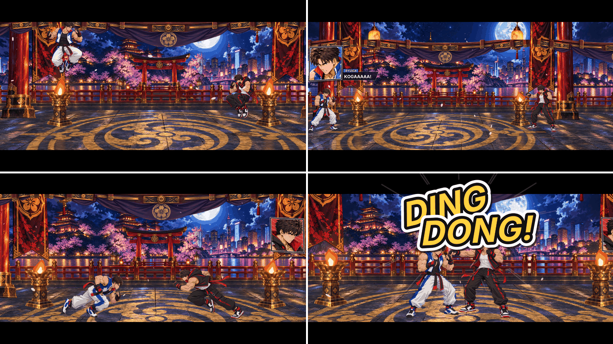

# Motor de cinemáticas na luta — padrão do modo história

Este é o terceiro motor da história, ao lado do [motor de páginas](motor-paginas.md) e do
[motor de conversas](motor-conversas.md). As páginas contam a história **entre** as lutas; as
conversas falam **durante** a luta, sem parar nada; a cinemática **transforma a luta em cena**
num momento certo: faixas pretas de cinema entram, o jogador perde o controle e um roteiro guia
os dois lutadores, põe falas nos quadros laterais, estoura onomatopeias de mangá na tela e pode
encerrar a luta ali. A estreia é o treino do Episódio 1 (jogador × rival); em qualquer outra
luta é o mesmo motor com outro arquivo.

## Como aparece na tela (o treino do Episódio 1)

1. Um dos dois chega a **25% de vida**: a cena começa. O controle trava, as **faixas pretas**
   entram em cima e embaixo (o quadro vira um 2,39:1 de cinema) e o HUD e o controle de toque
   somem junto.
2. No 2x2, quem estiver na vez **troca com o irmão** (a troca de verdade, sai um e entra o
   outro), para a cena ser entre Ryūga e Kōga.
3. Os dois **pulam para trás** e **recuam**, se afastando.
4. Ryūga grita **"KOGAAAAA!"** e Kōga responde **"RYŪGAAAAA!"** nos quadros da conversa (o
   irmão do jogador no quadro da esquerda, o rival no da direita; nas duas campanhas).
5. Os dois **saem correndo** um na direção do outro.
6. Antes de se encontrarem, a campainha: **"DING DONG!"** estoura grande no meio da tela
   (linhas de som, tremor, as palavras em escada), os dois param e a câmera dá um tranco de zoom.
7. As faixas saem e a luta termina **interrompida**: a história segue na página seguinte
   (Dafu: "Chega, chega!"; o quadro da porta com o DING DONG das cartas chegando).

Quem está apanhando, caído ou no meio de um golpe quando a cena começa termina isso antes de
obedecer (o pulo sai quando o lutador pode agir). Enquanto o gatilho de vida espera e enquanto
a cena roda, **ninguém cai**: o jogo segura o último ponto de vida, para um golpe grande não
pular a cena indo direto ao KO.



## O arquivo da cinemática

Cada luta da história aponta o arquivo dela no passo de luta do `episodio.json`, com o caminho
dentro de `historia/` (como a `conversa`). A cinemática fica na pasta do episódio:

```json
{ "tipo": "luta", "rotulo": "TREINO", "dupla": "jogador", "cpu": "rival", "repetirSeDerrota": false,
  "cinematica": "ep01/cinematica_treino.json" }
```

O arquivo tem o **gatilho** e a lista de **ações**, que rodam em sequência. Cada ação espera
terminar antes da próxima; com `"semEsperar": true` a próxima começa na hora (as duas rodam
juntas). O treino do Episódio 1, pronto, é `historia/ep01/cinematica_treino.json`:

```json
{
  "gatilho": { "vida": 0.25 },
  "acoes": [
    { "acao": "controle", "travar": true },
    { "acao": "faixas", "entrar": true, "semEsperar": true },
    { "acao": "mover", "quem": "ambos", "movimento": "titular" },
    { "acao": "mover", "quem": "ambos", "movimento": "pular-tras" },
    { "acao": "mover", "quem": "ambos", "movimento": "recuar" },
    { "acao": "esperar", "segundos": 0.3 },
    { "acao": "fala", "quem": "ryuga", "expressao": "bravo", "texto": "KOGAAAAA!", "segura": 0.5 },
    { "acao": "fala", "quem": "koga", "expressao": "bravo", "texto": "RYŪGAAAAA!", "segura": 0.5 },
    { "acao": "mover", "quem": "ambos", "movimento": "correr", "distancia": 110 },
    { "acao": "onomatopeia", "texto": "DING DONG!", "pos": [0.5, 0.34], "tamanho": 140, "tremor": 12,
      "rotacao": -8, "segundos": 2.2, "semEsperar": true },
    { "acao": "mover", "quem": "ambos", "movimento": "parar" },
    { "acao": "camera", "zoom": 1.12, "segundos": 0.2, "semEsperar": true },
    { "acao": "esperar", "segundos": 1.0 },
    { "acao": "camera", "zoom": 1.0, "segundos": 0.8, "semEsperar": true },
    { "acao": "esperar", "segundos": 0.8 },
    { "acao": "faixas", "entrar": false },
    { "acao": "terminarLuta", "vencedor": "interrompida" }
  ]
}
```

### Gatilho

| `gatilho` | Quando a cena começa |
|---|---|
| `{"vida": 0.25}` | o lutador da vez de qualquer lado chega a 25% da vida. `"lado": "jogador"` ou `"rival"` olha só um lado. Enquanto espera, ninguém cai |
| `"inicio"` | logo depois do "LUTEM!" (a intro e o READY/GO tocam normalmente) |
| `{"tempo": 20}` | 20 segundos de luta depois do "LUTEM!" |
| `"ko"` | a luta acabou (KO): a cena toca antes do resultado, e o resultado espera ela |

A cena nunca começa por cima de um Super, de um Ultra, de uma troca ou da Página Final: espera
eles terminarem. Cada cinemática toca uma vez por luta (se a derrota repete a luta, ela arma de
novo).

### Ações

| `acao` | Campos | O que faz | Espera |
|---|---|---|---|
| `controle` | `travar` (true/false) | trava ou devolve o controle do jogador; travado, o pad e a IA ficam de fora e só o roteiro move os lutadores | — |
| `faixas` | `entrar` (true/false), `altura` (px, padrão 92) | as faixas pretas entram ou saem (0,45 s); com elas o HUD e o controle de toque somem | a animação |
| `mover` | `quem` (`jogador`, `rival`, `ambos`), `movimento`, `distancia`, `segundos` | um movimento dos lutadores (tabela abaixo) | os dois terminarem |
| `fala` | `quem`, `expressao`, `texto`, `lado`, `segura` | uma fala nos quadros da conversa ([motor-conversas.md](motor-conversas.md)) | a fala sair da tela |
| `onomatopeia` | `texto`, `pos`, `tamanho`, `tremor`, `rotacao`, `cor`, `segundos` | um letreiro de mangá grande na tela (abaixo) | `segundos` |
| `esperar` | `segundos` | só o tempo passa (a luta segue parada no roteiro) | `segundos` |
| `camera` | `zoom` (0,8 a 1,6; 1 = o da luta), `segundos` | zoom extra da câmera, ancorado no chão (os pés não somem na faixa) | a transição |
| `terminarLuta` | `vencedor` (`interrompida`, `jogador`, `rival`) | encerra a luta pela cena: `interrompida` e `jogador`, a história segue; `rival` conta como derrota (repete a luta se o passo pedir) | — |

Toda ação aceita `"semEsperar": true`. Um movimento ou uma fala nunca seguram a cena mais de
8 s (um lutador preso numa queda não trava o jogo).

Se o roteiro acaba **sem** `terminarLuta`, a luta continua: o controle volta, as faixas saem e
a câmera volta ao normal sozinhas.

### Movimentos

Os movimentos saem do **motor de luta de verdade**: o roteiro aperta os comandos (pulo para
trás, backdash, dash para frente, troca), como as demos antigas (`DemoDirector`). A animação, a
física e as paredes são as da luta.

| `movimento` | O que faz | Acaba quando |
|---|---|---|
| `titular` | no 2x2, quem estiver na vez troca com o titular da dupla (o primeiro do passo de luta, o irmão nas duplas da história), sem esperar a recarga da troca | o titular está na vez (logo, se já estava) |
| `pular-tras` | pulo para trás, segurando para trás no ar (~155 px cada um) | pousar |
| `recuar` | backdash (~175 px cada um) | o recuo acabar |
| `correr` | dash para frente, segurando | o vão entre os dois corpos chegar a `distancia` (px) ou passar `segundos` (padrão 3) |
| `andar` | anda para frente | igual a `correr` |
| `parar` | solta tudo (cancela o movimento em andamento) | na hora |

### Falas

Usam os quadros laterais da conversa, com a mesma legenda digitada, os mesmos rostos e as
mesmas expressões (`historia/retratos/<quem>_<expressao>.png`). A luta não precisa ter arquivo
de conversa.

- **Lado**: os irmãos (`ryuga`, `koga`) não dizem o lado: o irmão do jogador fala no quadro da
  esquerda e o rival no da direita, nas duas campanhas. Qualquer outro personagem precisa de
  `"lado": "esquerda"` ou `"direita"`.
- `segura`: segundos na tela depois de digitada (padrão: a conta da conversa, 1,6 s ou mais
  para fala longa). Grito curto fica bem com 0,5.
- Quando a cena começa, a conversa da luta se cala (os quadros saem deslizando) e nenhuma
  reação ("impacto", "levou") fala por cima.

### Onomatopeias

Letreiro de mangá: miolo colorido, contorno preto e outro branco por fora, sombra, linhas de
som estourando do centro. Bate grande e assenta (cada palavra um pouco depois da anterior, em
escada: "DING" em cima, "DONG!" embaixo à direita), treme forte no começo e some no fim.

| Campo | Padrão | O que é |
|---|---|---|
| `texto` | — | o letreiro; cada palavra entra separada |
| `pos` | `[0.5, 0.42]` | centro na tela: `[0, 0]` topo esquerdo, `[1, 1]` base direita |
| `tamanho` | 140 | altura da letra (px da tela 1280x720) |
| `tremor` | 8 | tremor no começo (px) |
| `rotacao` | -6 | inclinação (graus); as palavras alternam ±5° em volta dela |
| `cor` | `#FFD23F` | cor do miolo |
| `segundos` | 1,6 | tempo na tela (os últimos 0,25 s somem) |

## Idiomas

Igual às páginas e às conversas: o texto em português é a chave da tradução em
`historia/idiomas/<idioma>.json`. Falas e onomatopeias de toda cinemática precisam da tradução
em todos os idiomas (o teste `traducoesCobremOsEpisodiosEOMenu` e o `CinematicaLutaTest`
avisam a que falta). Onomatopeia pode ficar igual em todos (`"DING DONG!": "DING DONG!"`).

## Passo a passo de uma cinemática nova

1. Escreva o roteiro no `ep<NN>/cinematica_<luta>.json` (gatilho e ações).
2. Aponte o arquivo no passo de luta: `"cinematica": "ep<NN>/cinematica_<luta>.json"`.
3. Personagem novo falando? Elenco do `temporada.json` e pelo menos o
   `historia/retratos/<id>_normal.png` ([motor-conversas.md](motor-conversas.md)).
4. Traduza falas e onomatopeias em `historia/idiomas/`.
5. Confira no PC:
   ```bash
   cd android
   gradle :story-core:test                 # arquivo, elenco, rostos e traduções
   gradle :pc-preview:runCinematica -Pcinematica=ep<NN>/cinematica_<luta>.json
   ```
   O `runCinematica` grava `build/cinematica/quadro_NNN.png` (10 por segundo) e `folha.png`
   (resumo), com o cenário, bonecos nas cores dos irmãos, faixas, falas e onomatopeias, e
   escreve no terminal a linha do tempo (quando cada movimento começa). `-Pirmao=koga` toca a
   campanha do Kōga, `-Pidioma=en` outro idioma, `-Pcenario=<pasta>` outro cenário. O
   movimento de verdade (com os sprites) se vê no jogo: `gradle :pc:run`.

## Onde fica cada coisa no código

| O quê | Onde |
|---|---|
| Motor (leitura, gatilho, linha do tempo, faixas, onomatopeias, zoom) | `android/story-core/.../historia/CinematicaLuta.java` |
| Falas da cena nos quadros (`dizer`, `calar`, rosto espelhado pelo `olhar.json`) | `android/story-core/.../historia/ConversaLuta.java` |
| Campo `cinematica` do passo de luta | `Episodio.Passo.cinematica` |
| O que a cena pede à luta (`CinematicaLuta.Palco`) e quando confere o gatilho | `GameView.palcoCinematica`, `GameView.updateCinematica` |
| Comandos dos lutadores (pulo, backdash, dash, troca) | `android/app/.../CinematicaDirector.java` |
| Troca para o titular sem recarga | `TeamSystem.tagToStarter` |
| Último ponto de vida seguro | `FighterState.lifeFloor`, `GameView.protegerVida` |
| HUD e controle de toque somem, faixas, quadros e onomatopeias (nessa ordem) | `GameView.renderFrame` |
| Fim da luta pela cena | `GameView.updateStoryFight` (`cinematicaFim`) |
| Testes | `story-core/.../CinematicaLutaTest.java` (arquivos e linha do tempo), `app/src/test/.../CinematicaDirectorTest.java` (movimentos no motor de luta) |
| Prévia no PC | `android/pc-preview/.../CinematicaPreview.java` (`gradle :pc-preview:runCinematica`) |
