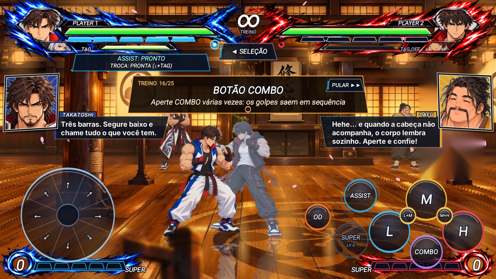

# Motor de conversas na luta — padrão do modo história

Este é o segundo motor da história, ao lado do [motor de páginas](motor-paginas.md) e do
[motor de cinemáticas](motor-cinematicas.md) (que também fala por estes quadros). As páginas
contam a história **entre** as lutas; as conversas contam **durante** a luta, sem parar nada:
o parceiro de tag esperando a vez, o adversário que aguarda do outro lado, o mestre assistindo
o treino. A estreia é o treino do Prólogo (Takatoshi e Dafu); nas lutas do torneio é o mesmo
motor com outro arquivo.

## Como aparece na tela

- **Um quadro de mangá em cada lateral**, logo abaixo das barras de vida: o lado do jogador
  à **esquerda**, o do adversário à **direita**. O quadro (pequeno, ~140x145) mostra o rosto
  de quem fala, com fundo na cor do personagem e linhas de foco.
- **Legenda em vez de balão**: uma faixa escura e estreita sai de baixo do quadro, com o nome
  numa plaquinha na cor do personagem e o texto em letra pequena (como nos jogos de luta). A
  faixa só tem a largura do texto (no máximo ~330 px, 3 linhas para as falas longas), então
  cobre pouco da luta. O texto é digitado (40 letras/s), fica na tela de 1,6 a 4,5 s depois
  de digitado (mais tempo para fala mais longa) e a faixa fecha de volta para o quadro.
  **Ninguém toca em nada e a luta não para.** (O balão branco cobria demais a tela do celular.)
- **Entrada e saída**: o quadro entra deslizando da borda, balança de leve enquanto a pessoa
  fala e sai deslizando um segundo depois que ela para (numa conversa de dois, os quadros não
  piscam entre as falas).
- **Expressões**: cada fala diz a cara de quem fala. Se a expressão muda na mesma pessoa, o
  quadro dá um "pop" com um clarão branco.
- **Duas pessoas do mesmo lado** (o parceiro de tag e o mestre, por exemplo): o quadro sai e
  entra de novo com o outro rosto.
- Nas lutas com conversa, os botões de teste (IA, DEBUG, VIDA, DUPLA, HISTÓRIA, TUTORIAL)
  somem: o canto direito é do quadro do adversário.



## Quando cada um fala

Há dois tipos de fala:

**Momentos** — falas certas em momentos certos. Entram na hora, no lugar do que estiver sendo
dito (uma reação curta ainda na tela termina antes). Se o momento tem várias falas, elas vêm
em sequência, como um diálogo.

| Momento | Quando | Exemplo |
|---|---|---|
| `inicio` | a luta começa (durante a intro dos lutadores) | o adversário que espera provoca, o parceiro responde |
| `vitoria` | o jogador venceu (depois do KO; a história espera a conversa acabar) | o parceiro comemora, o adversário reclama |
| `derrota` | o jogador perdeu | o parceiro chama para tentar de novo |
| id de uma lição (`andar`, `combo`...) | só no treino: a lição começou | o mestre explica |
| `fim` | só no treino: todas as lições cumpridas (o "treino completo" espera a conversa) | os dois comentam o dia |

**Reações** — uma fala sorteada (sem repetir a última) quando algo acontece. Só sai se
ninguém estiver falando e depois de 1,5 s de silêncio, para não virar falatório. Reação fica
menos tempo na tela (0,9 s depois de digitada).

| Reação | Quando |
|---|---|
| `impacto` | golpe forte do jogador que entrou sem defesa (H, ↓+H, golpe no ar, especiais, agarrão, SUPER, ULTRA) |
| `levou` | golpe do adversário que pegou o jogador |
| `licao` | só no treino: o jogador cumpriu a lição |

Momentos e reações novos (ex.: `troca` quando o jogador troca de lutador, `vida-baixa`) são
uma linha no `GameView.updateConversa` cada: o arquivo já aceita qualquer nome.

## O arquivo da conversa

Cada luta da história aponta o arquivo dela no passo de luta do `episodio.json`, com o caminho
dentro de `historia/`. A conversa fica na pasta do episódio:

```json
{ "tipo": "luta", "rotulo": "SEMIFINAL", "dupla": ["player_base", "p02"], "cpu": ["p05", "p06"],
  "conversa": "ep04/conversa_semifinal.json" }
```

```json
{
  "lados": { "parceira": "esquerda", "capitao_rival": "direita", "reserva_rival": "direita" },
  "momentos": {
    "inicio": [
      { "quem": "capitao_rival", "expressao": "bravo", "texto": "Seu irmão já caiu uma vez. Você é o próximo." },
      { "quem": "parceira", "expressao": "sorrindo", "texto": "Fala menos e luta." }
    ],
    "vitoria": [ { "quem": "parceira", "expressao": "rindo", "texto": "Eu sabia!" } ],
    "derrota": [ { "quem": "parceira", "expressao": "preocupado", "texto": "Levanta! Eu entro se precisar." } ]
  },
  "reacoes": {
    "impacto": [ { "quem": "reserva_rival", "expressao": "surpreso", "texto": "Essa pegou de verdade..." } ],
    "levou": [ { "quem": "parceira", "expressao": "preocupado", "texto": "Cuidado com a esquerda dele!" } ]
  }
}
```

(`parceira`, `capitao_rival` e `reserva_rival` são ids de exemplo: na luta de verdade, os
ids do elenco. A conversa do treino do Prólogo, pronta, é `historia/ep00/conversa_treino.json`.)

| Campo | O que é |
|---|---|
| `lados` | quem fala nesta luta e de que lado aparece (`esquerda` = time do jogador, `direita` = time do adversário). Todo mundo precisa estar no elenco do `temporada.json` (nome e cor vêm de lá) |
| `momentos` | `momento → lista de falas` em sequência |
| `reacoes` | `reação → lista de falas` para sortear uma |
| fala | `quem` (id do elenco), `expressao` (padrão `normal`; letras minúsculas sem acento) e `texto` (em português) |

O jogo confere o arquivo quando a luta começa: quem fala sem lado, fora do elenco, fala sem
texto ou lado inválido fazem a conversa não abrir (a luta segue sem ela, com um aviso no log).
O teste `ConversaLutaTest` confere todas as conversas apontadas pelos episódios.

## Rostos

Os rostos são **do elenco inteiro**, não de cada luta: o mesmo personagem fala em vários
episódios. Ficam em `android/app/src/main/assets/historia/retratos/<quem>_<expressao>.png`.
Uma expressão sem imagem usa a `normal`; sem nem a `normal`, o quadro mostra o nome.

Prontos: `dafu_normal`, `takatoshi_normal` e os irmãos adultos `ryuga_normal`, `ryuga_bravo`,
`koga_normal`, `koga_bravo`, recortados dos close-ups dos concepts `art/concepts/p01.png` e
`p03.png` (de frente = `normal`, de lado com cara fechada = `bravo`) com o fundo cinza tirado:
`python3 tools/historia/retratos_irmaos.py` refaz os quatro quando um concept muda.

**Rosto de lado**: o rosto que não é de frente diz para onde olha em
`historia/retratos/olhar.json` (`"ryuga_bravo": "esquerda"` = olha para a esquerda da
imagem). O quadro espelha o rosto que olharia para fora da tela, então a mesma imagem serve
dos dois lados (na cinemática, cada irmão fala do lado da tela onde está o lutador dele). Rosto de
frente não entra no arquivo.

Expressões padrão (use estas quando der, para reaproveitar as imagens):

| Expressão | Para |
|---|---|
| `normal` | falando normalmente |
| `sorrindo` | satisfeito, confiante, provocando de leve |
| `rindo` | gargalhada, comemoração |
| `surpreso` | espanto, impressionado |
| `bravo` | raiva, cobrança, grito de luta |
| `preocupado` | medo, aperto, sem graça |

### Gerar um rosto (ChatGPT)

Quadrado 1024x1024, PNG, da cabeça aos ombros, rosto no terço de cima. **Quem aparece à
esquerda olha para a direita da imagem e quem aparece à direita olha para a esquerda** (os
dois olham para o centro da tela). Se o personagem muda de lado em outra luta, o jogo usa a
mesma imagem; se o olhar ficar estranho, gere a versão espelhada como outra expressão.
Anexe o concept do personagem e, a partir da segunda expressão, a primeira que ficou boa.

```
Retrato de mangá colorido, no estilo de anime de luta dos anos 90 (traço de tinta preto e
grosso, cores chapadas e vibrantes, sombras duras, muito contraste). Exatamente o personagem
do concept anexado: mesmo rosto, cabelo, roupa e cores. Enquadramento da cabeça aos ombros,
rosto grande ocupando o terço de cima e o centro da imagem, cabeça inteira dentro da imagem.
Fundo liso de uma cor só, cinza claro, sem cenário. Sem texto, sem balões, sem moldura, sem
marca d'água. Quadrado 1024x1024.
```

Depois, uma linha com a expressão e o lado do olhar (ex.: "Gargalhada, boca bem aberta,
olhos fechados, virado para a esquerda."). Os prompts de Takatoshi e Dafu estão em
[../tutorial-plateia.md](../tutorial-plateia.md).

## Idiomas

Igual às páginas: o texto em português é a chave da tradução em `historia/idiomas/<idioma>.json`.
Toda fala nova precisa da tradução em todos os idiomas (o teste avisa a que falta).

## Passo a passo de uma luta nova com conversa

1. Escreva as falas no `ep<NN>/conversa_<luta>.json` (momentos `inicio`, `vitoria`, `derrota`
   e algumas reações de cada lado).
2. Aponte o arquivo no passo de luta: `"conversa": "ep<NN>/conversa_<luta>.json"`.
3. Personagem novo? Ponha no elenco do `temporada.json` (nome e cor) e gere pelo menos o
   `historia/retratos/<id>_normal.png`.
4. Traduza as falas em `historia/idiomas/`.
5. Rode `gradle :story-core:test` (confere arquivo, elenco, rostos e traduções).

Duração: uma fala de 50 letras fica uns 5 s na tela. Um `inicio` com duas ou três falas cabe
na intro e nos primeiros segundos da luta; mais que isso, o jogador já está apanhando.

## Onde fica cada coisa no código

| O quê | Onde |
|---|---|
| Motor (fila de falas, quadros, legenda, desenho) | `android/story-core/.../historia/ConversaLuta.java` |
| Falas pedidas pela cinemática (`dizer`, com o lado dela) e a conversa calada no começo da cena (`calar`) | `ConversaLuta.dizer`, `ConversaLuta.calar` ([motor-cinematicas.md](motor-cinematicas.md)) |
| Rosto espelhado pelo lado do olhar | `historia/retratos/olhar.json`, `ConversaLuta.espelhar` |
| Campo `conversa` do passo de luta | `Episodio.Passo.conversa` |
| Quando chama cada momento e reação | `GameView.onHistoriaLuta` (`inicio`), `GameView.updateConversa` (lições, `fim`, reações), `GameView.updateStoryFight` (`vitoria`/`derrota`) |
| Botões de teste escondidos | `GameView.testButtonsHidden`, `HudRenderer.State.hideTestButtons` |
| Posição e tamanho dos quadros e da legenda | `ConversaLuta.QUADRO_ESQ/DIR`, `LEGENDA_*` (coordenadas 1280x720) |
| Testes | `android/story-core/src/test/.../ConversaLutaTest.java` |
