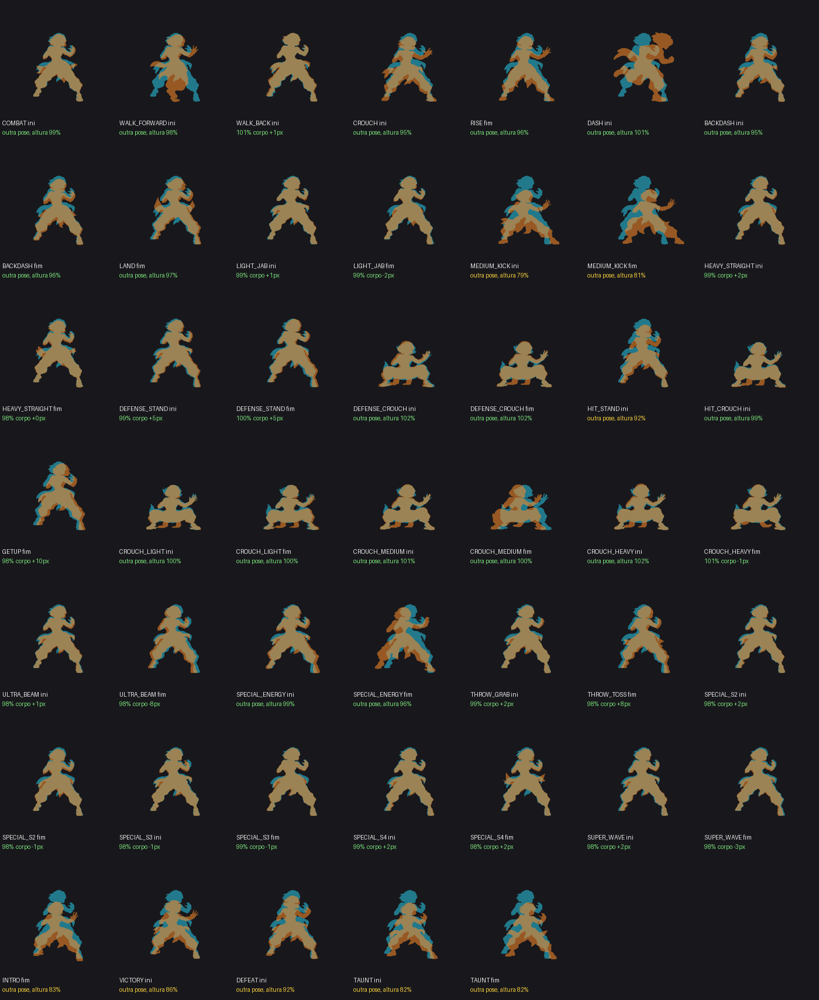

# Régua de tamanho — p02

Gerado por `python3 tools/sprites/regua.py p02 --relatorio` (explicação no topo do script). Referência: `art/keys/p02/inicio_*.png` no tamanho oficial (`tamanho.json`). **Fator** = tamanho do corpo no jogo ÷ tamanho da referência: 100% = certo, aviso fora de ±3%, erro fora de ±6%. **Cabeça** é a medida pela cabeça (não depende da pose), mostrada para conferir.

| | Clipe | Fator | Medido por | Cabeça | Receita do vídeo | Problemas |
|---|---|---|---|---|---|---|
| 🔴 | SPECIAL_ENERGY | 106% | cabeça em 7 quadros | 106% | fraca: quadros 6, 0, 90 = guarda do IDLE (nota 0.79) | corpo 106% do tamanho certo |
| 🟡 | DASH | 100% | receita forte | - | forte: 1º quadro = inicio_centro (nota 0.96) | folha do vídeo com 6 quadros, a do jogo com 12: a receita não reproduz a folha do jogo |
| 🟡 | DEFEAT | 98% | cabeça em 5 quadros | 98% | fraca: quadros 6, 0, 30 = guarda do IDLE (nota 0.75); reescala 1.06-1.19 | troca (ini): pose diferente da guarda, altura 92% (salto de pose, não de tamanho) |
| 🟡 | DEFENSE_STAND | 102% | imagem inicial no q7 (nota 0.89) | 98% | forte: 1º quadro = inicio_centro (nota 0.95) | troca (ini): corpo +5 px fora do lugar da guarda troca (fim): corpo +5 px fora do lugar da guarda |
| 🟡 | GETUP | 99% | imagem inicial no q11 (nota 0.84) | 100% | forte: 1º quadro = inicio_centro (nota 0.96) | troca (fim): corpo +10 px fora do lugar da guarda |
| 🟡 | HIT_STAND | 98% | cabeça em 3 quadros | 98% | fraca: quadros 6, 0, 12 = guarda do IDLE (nota 0.80); reescala 1.08-1.08 | troca (ini): pose diferente da guarda, altura 92% (salto de pose, não de tamanho) |
| 🟡 | INTRO | 100% | cabeça em 5 quadros | 100% | fraca: quadros 90, 84, 96 = guarda do IDLE (nota 0.63); reescala 1.06-1.24 | troca (fim): pose diferente da guarda, altura 83% (salto de pose, não de tamanho) |
| 🟡 | MEDIUM_KICK | 100% | cabeça em 7 quadros | 100% | manual: M não começa na imagem inicial; guarda do IDLE nos quadros 0, 6 e 90 concorda em 0,359 (nota 0,54) | troca (ini): pose diferente da guarda, altura 79% (salto de pose, não de tamanho) troca (fim): pose diferente da guarda, altura 81% (salto de pose, não de tamanho) |
| 🟡 | TAUNT | 100% | cabeça em 6 quadros | 100% | fraca: quadros 0, 6, 42 = guarda do IDLE (nota 0.62); reescala 1.18-1.22 | troca (ini): pose diferente da guarda, altura 82% (salto de pose, não de tamanho) troca (fim): pose diferente da guarda, altura 82% (salto de pose, não de tamanho) |
| 🟡 | THROW_TOSS | 100% | imagem inicial no q5 (nota 0.87) | 98% | forte: 1º quadro = inicio_centro (nota 0.95) | troca (fim): corpo +8 px fora do lugar da guarda |
| 🟡 | ULTRA_BEAM | 101% | imagem inicial no q8 (nota 0.90) | 99% | fraca: 1º quadro = inicio_centro (nota 0.96); reescala 1.00-1.30 | troca (fim): corpo -8 px fora do lugar da guarda |
| 🟡 | VICTORY | 98% | cabeça em 2 quadros | 98% | fraca: quadros 0, 6, 12 = guarda do IDLE (nota 0.63); reescala 1.13-1.19 | troca (ini): pose diferente da guarda, altura 86% (salto de pose, não de tamanho) |
| 🟢 | BACKDASH | 99% | imagem inicial no q0 (nota 0.83) | 102% | fraca: 1º quadro = inicio_centro (nota 0.86) | — |
| 🟢 | COMBAT | 101% | imagem inicial no q0 (nota 0.81) | 100% | forte: 1º quadro = inicio_centro (nota 0.92) | — |
| 🟢 | CROUCH | 100% | imagem inicial no q7 (nota 0.90) | 102% | fraca: quadros 0, 96, 90 = guarda do IDLE (nota 0.74) | — |
| 🟢 | CROUCH_HEAVY | 102% | imagem inicial no q0 (nota 0.93) | 101% | forte: 1º quadro = inicio_agachado (nota 0.96) | — |
| 🟢 | CROUCH_LIGHT | 100% | imagem inicial no q10 (nota 0.89) | 102% | fraca: 1º quadro = inicio_agachado (nota 0.86) | — |
| 🟢 | CROUCH_MEDIUM | 101% | imagem inicial no q0 (nota 0.95) | 100% | forte: 1º quadro = inicio_agachado (nota 0.94) | — |
| 🟢 | DEFENSE_AIR | 100% | receita forte | 109% | forte: 1º quadro = inicio_centro (nota 0.91) | — |
| 🟢 | DEFENSE_CROUCH | 102% | imagem inicial no q6 (nota 0.95) | 101% | forte: 1º quadro = inicio_agachado (nota 0.96) | — |
| 🟢 | FALL | 100% | receita forte | - | forte: 1º quadro = inicio_centro (nota 0.96) | — |
| 🟢 | GROUNDED | 100% | receita forte | - | forte: 1º quadro = inicio_centro (nota 0.96) | — |
| 🟢 | HEAVY_STRAIGHT | 101% | imagem inicial no q0 (nota 0.89) | 100% | forte: 1º quadro = inicio_centro (nota 0.95) | — |
| 🟢 | HIT_AIR | 100% | receita forte | - | forte: 1º quadro = inicio_centro (nota 0.96) | — |
| 🟢 | HIT_CROUCH | 100% | imagem inicial no q0 (nota 0.96) | 101% | forte: 1º quadro = inicio_agachado (nota 0.95) | — |
| 🟢 | IDLE | 102% | imagem inicial no q29 (nota 0.91) | 100% | forte: 1º quadro = inicio_centro (nota 0.92) | — |
| 🟢 | JUMP | 100% | imagem inicial no q0 (nota 0.96) | 100% | forte: 1º quadro = inicio_centro (nota 0.96) | — |
| 🟢 | JUMP_HEAVY | 100% | receita forte | 110% | forte: 1º quadro = inicio_centro (nota 0.90) | — |
| 🟢 | JUMP_HEAVY_DOWN | 100% | receita forte | 110% | forte: 1º quadro = inicio_centro (nota 0.90) | — |
| 🟢 | JUMP_LIGHT | 100% | receita forte | 108% | forte: 1º quadro = inicio_centro (nota 0.96) | — |
| 🟢 | JUMP_MEDIUM | 100% | receita forte | 107% | forte: 1º quadro = inicio_centro (nota 0.96) | — |
| 🟢 | KNOCKDOWN | 100% | receita forte | - | forte: 1º quadro = inicio_centro (nota 0.96) | — |
| 🟢 | LAND | 100% | receita forte | 102% | forte: 1º quadro = inicio_centro (nota 0.96) | — |
| 🟢 | LIGHT_JAB | 101% | imagem inicial no q10 (nota 0.87) | 98% | forte: 1º quadro = inicio_centro (nota 0.96) | — |
| 🟢 | RISE | 99% | imagem inicial no q0 (nota 0.96) | 101% | fraca: quadros 0, 96, 90 = guarda do IDLE (nota 0.74) | — |
| 🟢 | SPECIAL_S2 | 100% | imagem inicial no q0 (nota 0.95) | 98% | forte: 1º quadro = inicio_centro (nota 0.96) | — |
| 🟢 | SPECIAL_S3 | 101% | imagem inicial no q20 (nota 0.89) | 101% | forte: 1º quadro = inicio_centro (nota 0.94) | — |
| 🟢 | SPECIAL_S4 | 100% | imagem inicial no q0 (nota 0.93) | 98% | forte: 1º quadro = inicio_centro (nota 0.96) | — |
| 🟢 | SUPER_WAVE | 100% | imagem inicial no q0 (nota 0.96) | 100% | forte: 1º quadro = inicio_centro (nota 0.96) | — |
| 🟢 | THROW_GRAB | 100% | imagem inicial no q0 (nota 0.86) | - | forte: 1º quadro = inicio_centro (nota 0.95) | — |
| 🟢 | WALK_BACK | 102% | imagem inicial no q14 (nota 0.89) | 102% | forte: 1º quadro = inicio_centro (nota 0.94) | — |
| 🟢 | WALK_FORWARD | 101% | imagem inicial no q4 (nota 0.80) | 100% | fraca: 1º quadro = inicio_centro (nota 0.86) | — |

Trocas de animação (ciano = IDLE q0 ou agachado, laranja = ponta do clipe, raiz no mesmo ponto): [p02-trocas.png](p02-trocas.png)

