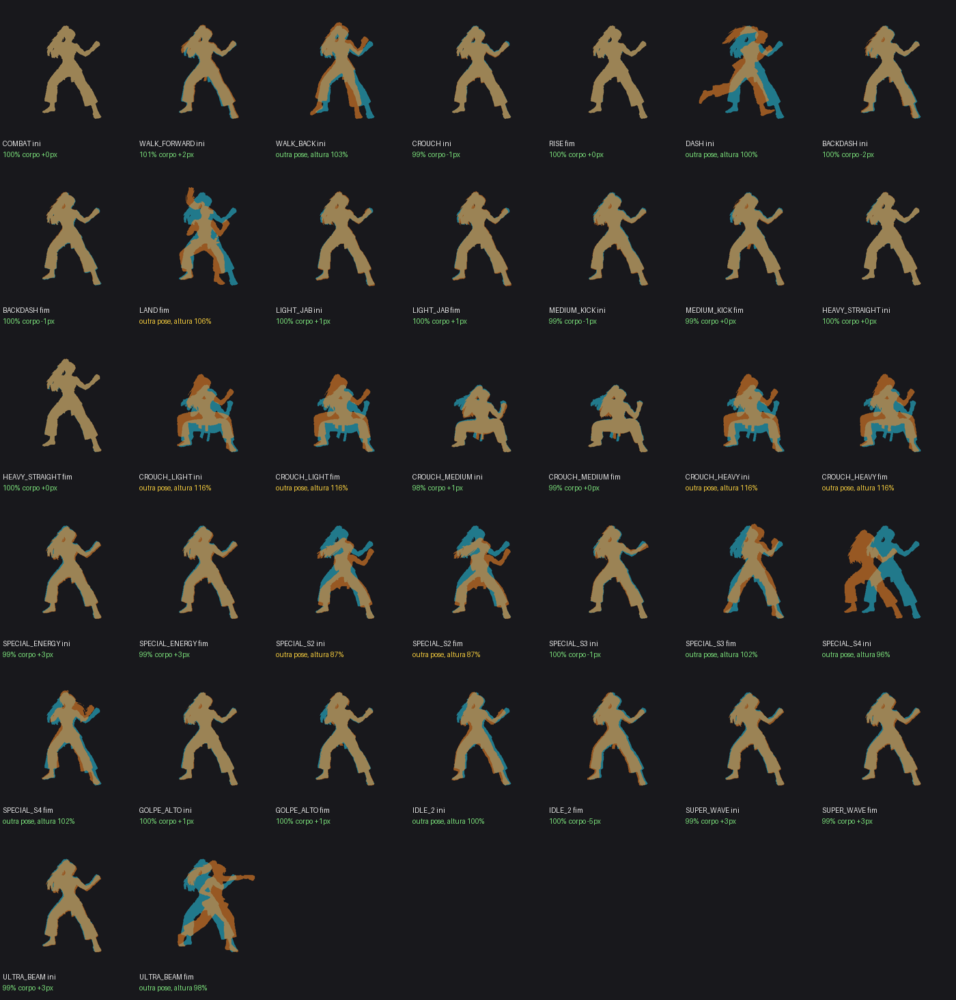

# Régua de tamanho — p15

Gerado por `python3 tools/sprites/regua.py p15 --relatorio` (explicação no topo do script). Referência: `art/keys/p15/inicio_*.png` no tamanho oficial (`tamanho.json`). **Fator** = tamanho do corpo no jogo ÷ tamanho da referência: 100% = certo, aviso fora de ±3%, erro fora de ±6%. **Cabeça** é a medida pela cabeça (não depende da pose), mostrada para conferir.

| | Clipe | Fator | Medido por | Cabeça | Receita do vídeo | Problemas |
|---|---|---|---|---|---|---|
| 🟡 | CROUCH | 100% | imagem inicial no q0 (nota 0.95) | 116% | forte: 1º quadro = inicio_centro_h3 (nota 0.97) | medidas discordam: cabeça dá 116% |
| 🟡 | CROUCH_HEAVY | 100% | imagem inicial no q0 (nota 0.91) | 91% | forte: 1º quadro = inicio_agachado (nota 0.98) | medidas discordam: cabeça dá 91% troca (ini): pose diferente da agachado, altura 116% (salto de pose, não de tamanho) troca (fim): pose diferente da agachado, altura 116% (salto de pose, não de tamanho) |
| 🟡 | CROUCH_LIGHT | 100% | imagem inicial no q0 (nota 0.95) | 98% | forte: 1º quadro = inicio_agachado (nota 0.99) | troca (ini): pose diferente da agachado, altura 116% (salto de pose, não de tamanho) troca (fim): pose diferente da agachado, altura 116% (salto de pose, não de tamanho) |
| 🟡 | IDLE_2 | 100% | imagem inicial no q31 (nota 0.89) | 98% | fraca: último quadro = inicio_centro (nota 0.89) | troca (fim): corpo -5 px fora do lugar da guarda |
| 🟡 | LAND | 100% | receita forte | - | forte: 1º quadro = inicio_centro (nota 0.97) | troca (fim): pose diferente da guarda, altura 106% (salto de pose, não de tamanho) |
| 🟡 | LIGHT_JAB | 101% | imagem inicial no q0 (nota 0.92) | 113% | forte: 1º quadro = inicio_centro (nota 0.96) | medidas discordam: cabeça dá 113% |
| 🟡 | SPECIAL_S2 | 100% | receita forte | 104% | forte: 1º quadro = inicio_centro (nota 0.97) | troca (ini): pose diferente da guarda, altura 87% (salto de pose, não de tamanho) troca (fim): pose diferente da guarda, altura 87% (salto de pose, não de tamanho) |
| 🟢 | BACKDASH | 99% | imagem inicial no q7 (nota 0.94) | 98% | forte: 1º quadro = inicio_centro (nota 0.97) | — |
| 🟢 | COMBAT | 100% | imagem inicial no q0 (nota 0.97) | 100% | forte: último quadro = inicio_centro_h3 (nota 0.97) | — |
| 🟢 | CROUCH_MEDIUM | 100% | receita forte | 110% | forte: último quadro = inicio_agachado_h3 (nota 0.98) | — |
| 🟢 | DASH | 100% | receita forte | - | forte: 1º quadro = inicio_centro (nota 0.97) | — |
| 🟢 | FALL | 100% | receita forte | - | forte: 1º quadro = inicio_centro (nota 0.97) | — |
| 🟢 | GOLPE_ALTO | 100% | imagem inicial no q0 (nota 0.91) | 102% | forte: 1º quadro = inicio_centro (nota 0.97) | — |
| 🟢 | HEAVY_STRAIGHT | 100% | imagem inicial no q78 (nota 0.98) | 99% | forte: 1º quadro = inicio_centro_h3 (nota 0.97) | — |
| 🟢 | IDLE | 100% | imagem inicial no q57 (nota 0.98) | 100% | forte: último quadro = inicio_centro_h3 (nota 0.97) | — |
| 🟢 | JUMP | 100% | imagem inicial no q0 (nota 0.97) | 103% | forte: 1º quadro = inicio_centro (nota 0.97) | — |
| 🟢 | MEDIUM_KICK | 100% | imagem inicial no q0 (nota 0.92) | 98% | forte: 1º quadro = inicio_centro (nota 0.97) | — |
| 🟢 | RISE | 100% | imagem inicial no q8 (nota 0.98) | 102% | forte: 1º quadro = inicio_centro_h3 (nota 0.97) | — |
| 🟢 | SPECIAL_ENERGY | 100% | imagem inicial no q0 (nota 0.91) | 98% | forte: 1º quadro = inicio_centro (nota 0.97) | — |
| 🟢 | SPECIAL_S3 | 100% | imagem inicial no q0 (nota 0.86) | 98% | forte: 1º quadro = inicio_centro (nota 0.97) | — |
| 🟢 | SPECIAL_S4 | 100% | receita forte | - | forte: 1º quadro = inicio_centro (nota 0.97) | — |
| 🟢 | SUPER_WAVE | 100% | imagem inicial no q0 (nota 0.91) | 94% | forte: 1º quadro = inicio_centro (nota 0.97) | — |
| 🟢 | ULTRA_BEAM | 100% | imagem inicial no q0 (nota 0.91) | 98% | forte: 1º quadro = inicio_centro (nota 0.97) | — |
| 🟢 | WALK_BACK | 98% | cabeça em 11 quadros | 98% | manual: vídeo do Flick cortado só no trecho andando (quadros 12-106): a ponta não é a guarda e a medida deu nota 0,80; 0,411 é a escala medida no vídeo inteiro pelo inicio_centro_h3 | — |
| 🟢 | WALK_FORWARD | 101% | imagem inicial no q0 (nota 0.84) | 98% | forte: 1º quadro = inicio_centro (nota 0.96) | — |

Trocas de animação (ciano = IDLE q0 ou agachado, laranja = ponta do clipe, raiz no mesmo ponto): [p15-trocas.png](p15-trocas.png)

