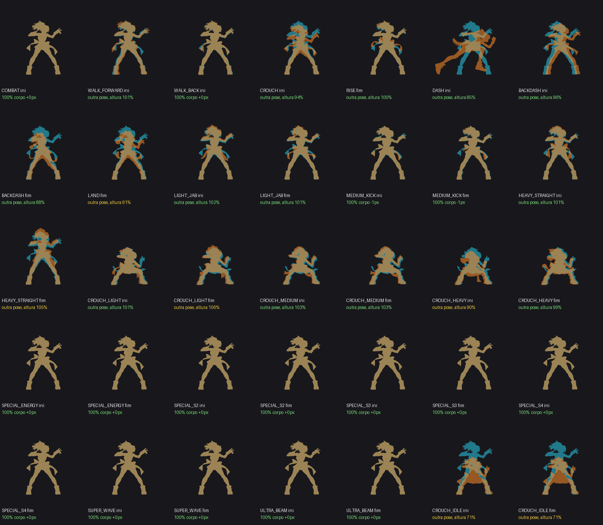

# Régua de tamanho — p16

Gerado por `python3 tools/sprites/regua.py p16 --relatorio` (explicação no topo do script). Referência: `art/keys/p16/inicio_*.png` no tamanho oficial (`tamanho.json`). **Fator** = tamanho do corpo no jogo ÷ tamanho da referência: 100% = certo, aviso fora de ±3%, erro fora de ±6%. **Cabeça** é a medida pela cabeça (não depende da pose), mostrada para conferir.

| | Clipe | Fator | Medido por | Cabeça | Receita do vídeo | Problemas |
|---|---|---|---|---|---|---|
| 🟡 | CROUCH_HEAVY | 100% | receita forte | - | forte: 1º quadro = inicio_agachado (nota 0.97) | troca (ini): pose diferente da agachado, altura 90% (salto de pose, não de tamanho) |
| 🟡 | CROUCH_IDLE | 100% | receita forte | - | forte: último quadro = inicio_centro (nota 0.95) | troca (ini): pose diferente da guarda, altura 71% (salto de pose, não de tamanho) troca (fim): pose diferente da guarda, altura 71% (salto de pose, não de tamanho) |
| 🟡 | CROUCH_LIGHT | 100% | receita forte | 100% | forte: 1º quadro = inicio_agachado (nota 0.97) | troca (fim): pose diferente da agachado, altura 106% (salto de pose, não de tamanho) |
| 🟡 | HEAVY_STRAIGHT | 100% | receita forte | 100% | forte: 1º quadro = inicio_centro (nota 0.95) | troca (fim): pose diferente da guarda, altura 105% (salto de pose, não de tamanho) |
| 🟡 | LAND | 100% | receita forte | - | forte: último quadro = inicio_centro (nota 0.95) | troca (fim): pose diferente da guarda, altura 91% (salto de pose, não de tamanho) |
| 🟢 | BACKDASH | 100% | receita forte | - | forte: último quadro = inicio_centro (nota 0.95) | — |
| 🟢 | COMBAT | 101% | imagem inicial no q0 (nota 0.96) | 104% | forte: 1º quadro = inicio_centro (nota 0.95) | — |
| 🟢 | CROUCH | 99% | imagem inicial no q6 (nota 0.80) | 100% | forte: último quadro = inicio_centro (nota 0.95) | — |
| 🟢 | CROUCH_MEDIUM | 100% | imagem inicial no q0 (nota 0.90) | 100% | forte: 1º quadro = inicio_agachado (nota 0.97) | — |
| 🟢 | DASH | 100% | receita forte | - | forte: último quadro = inicio_centro (nota 0.95) | — |
| 🟢 | FALL | 100% | receita forte | - | forte: último quadro = inicio_centro (nota 0.95) | — |
| 🟢 | IDLE | 100% | imagem inicial no q39 (nota 0.96) | 100% | forte: 1º quadro = inicio_centro (nota 0.95) | — |
| 🟢 | JUMP | 100% | imagem inicial no q0 (nota 0.96) | 95% | forte: último quadro = inicio_centro (nota 0.95) | — |
| 🟢 | LIGHT_JAB | 101% | imagem inicial no q17 (nota 0.85) | 100% | forte: último quadro = inicio_centro (nota 0.94) | — |
| 🟢 | MEDIUM_KICK | 101% | imagem inicial no q23 (nota 0.92) | 100% | forte: 1º quadro = inicio_centro (nota 0.95) | — |
| 🟢 | RISE | 100% | imagem inicial no q8 (nota 0.89) | 100% | forte: último quadro = inicio_centro (nota 0.95) | — |
| 🟢 | SPECIAL_ENERGY | 101% | imagem inicial no q0 (nota 0.96) | 104% | forte: 1º quadro = inicio_centro (nota 0.95) | — |
| 🟢 | SPECIAL_S2 | 101% | imagem inicial no q0 (nota 0.96) | 104% | forte: 1º quadro = inicio_centro (nota 0.95) | — |
| 🟢 | SPECIAL_S3 | 101% | imagem inicial no q0 (nota 0.96) | 104% | forte: 1º quadro = inicio_centro (nota 0.95) | — |
| 🟢 | SPECIAL_S4 | 101% | imagem inicial no q0 (nota 0.96) | 104% | forte: 1º quadro = inicio_centro (nota 0.95) | — |
| 🟢 | SUPER_WAVE | 101% | imagem inicial no q0 (nota 0.96) | 104% | forte: 1º quadro = inicio_centro (nota 0.95) | — |
| 🟢 | ULTRA_BEAM | 101% | imagem inicial no q0 (nota 0.96) | 104% | forte: 1º quadro = inicio_centro (nota 0.95) | — |
| 🟢 | WALK_BACK | 101% | imagem inicial no q0 (nota 0.90) | 100% | forte: 1º quadro = inicio_centro (nota 0.95) | — |
| 🟢 | WALK_FORWARD | 100% | receita forte | 100% | forte: 1º quadro = inicio_centro (nota 0.95) | — |

Trocas de animação (ciano = IDLE q0 ou agachado, laranja = ponta do clipe, raiz no mesmo ponto): [p16-trocas.png](p16-trocas.png)

