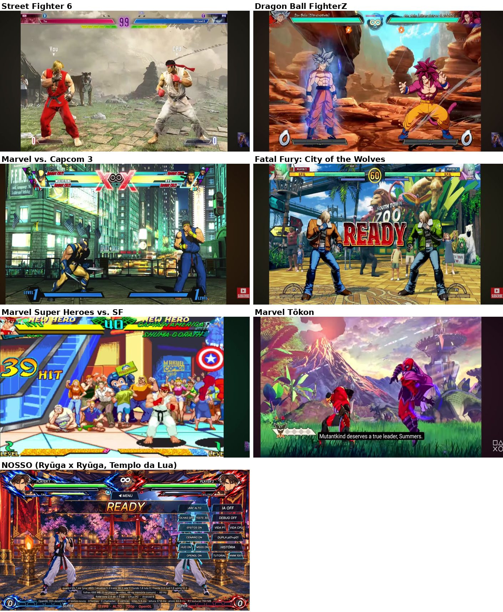
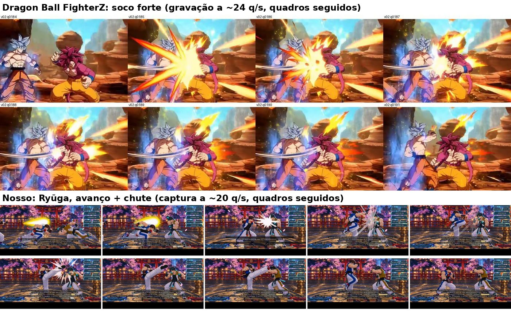

# Revisão da base: o nosso jogo contra seis referências

O objetivo é ajustar o **básico** de um jogo de luta "raiz", no nível de um Street Fighter 2, antes de qualquer mecânica própria. A ideia é simples: se a base for boa, o resto fica bom. O básico aqui é a tela, o cenário, o desenho do lutador, a animação, os golpes, o impacto, os efeitos, o HUD e o fluxo do round. SHINKAI, TAG, Breaker, assist e afins ficam de fora desta revisão.

A régua é o **Ryūga adulto** (`player_base`), que está sendo refeito com as animações definitivas.

**Peso das referências.** O **Dragon Ball FighterZ é a base principal**: quando as referências divergem, seguimos o que ele faz. Os outros cinco servem para confirmar o que é regra geral (o que todos fazem) e para cobrir o que o FighterZ não mostra nos vídeos (defesa, KO, sprite 2D).

## Por que a luta parece amadora

Esta seção trata do que **já está feito**, mas de um jeito que denuncia o amador. O que só **ainda não existe** fica fora da lista: som e música, poeiras sem arquivo, arte antiga de dano, queda, intro e vitória. Esses itens pesam, mas se resolvem fazendo; os de baixo continuam errados mesmo quando o resto ficar pronto.

### 1. O golpe não acontece na tela

O FighterZ, golpe forte (V02 q0184–q0191):
- no quadro do contato, a faísca já está no tamanho máximo e cobre **metade da tela**, com núcleo amarelo, estrela de 8–12 espinhos laranja-vermelhos e raios retos cruzando a tela;
- o rastro do soco (smear) **fica congelado** junto com a pose esticada;
- tudo fica parado ≈12 quadros, a faísca se quebra em chama e pontos pretos, e só então o atingido é empurrado.

Por ≈0,3 s o golpe **é** a tela inteira. MvC3, MSHvSF, SF6 e CotW fazem o mesmo, com 26–50% da altura da tela (MSHvSF até 2× o personagem).

O nosso (Ryūga, avanço + chute):
- a faísca é um **estouro branco pequeno, de ~1/6 da altura**, sem cor e sem direção;
- a perna ainda não está esticada no quadro da faísca, e a pose de impacto não é segurada pela arte;
- o atingido quase não muda de pose.

O golpe acerta, mas **não parece um golpe**. Este é o item que mais pesa.

### 2. Tudo grita ao mesmo tempo, e o principal sussurra

O FighterZ e os outros são econômicos no golpe comum: **pausa + faísca + pose**. Os extras ficam guardados para momentos que merecem:
- câmera de cinema só no lançador;
- tela escura só no Super e na esquiva;
- tremor só no close.

No nosso, todo golpe recebe tudo isto:
- soco de câmera e tranco (zoom 1,2–5%, 4–14 px);
- escurecimento do cenário no forte e no especial;
- o atingido **piscando branco** a pausa inteira e tremendo 9 px;
- **número de dano flutuando** sobre os lutadores ("11", "1107", "2202");
- faixas grandes no centro da tela (PUSHBLOCK!, PUNISH COUNTER);
- impact frame vermelho na punição;
- câmera de cinema também na parede e no KO.

É muito enfeite em volta de um núcleo fraco (o item 1). O jogo profissional faz o contrário: núcleo enorme e poucos extras. Isso também cria **escala**: quando o Super escurece a tela, o jogador sente, porque o golpe comum não escurece.

### 3. Linguagem de outro tipo de jogo

Número de dano flutuante e faixa grande no meio da tela a cada evento são linguagem de jogo de RPG/celular. Nenhuma das seis referências tem número de dano sobre os lutadores.

Nelas:
- o dano aparece na barra (amarela no SF6, vermelha no CotW);
- o contador de combo fica **do lado de quem bate**: no FighterZ, gigante em pincel, "N golpes";
- os eventos são textos pequenos, dourados e inclinados, empilhados no canto (FighterZ: "¡Primer ataque!", "¡Contraataque!");
- no fim do combo, uma nota ("¡Genial!").

### 4. Cada peça vem de um mundo diferente

No FighterZ **tudo é desenhado no mesmo estilo**: personagem em 2 tons com contorno tingido, faísca chapada, poeira em 2 tons nas cores do chão, texto em pincel. O CotW coloca manchas de nanquim na faísca para combinar com o contorno de nanquim dos lutadores.

No nosso, cada peça tem uma origem:
- lutador tirado de vídeo, com sombreado suave e sem contorno;
- faíscas recortadas de outros vídeos, com brilho realista;
- cenário pintado à parte;
- HUD com molduras de raio;
- textos na fonte do sistema.

Cada peça pode ser boa sozinha, mas juntas não parecem um jogo só. É por isso que o jogo parece "montado".

### 5. O lutador perde para o cenário

O FighterZ não escurece o fundo laranja saturado. Ele separa o lutador por **linha e matiz**: ≈3× mais contorno, cores frias ou complementares e sombra dura no formato da silhueta. Os outros cinco também fazem o lutador vencer o fundo em algum critério.

No nosso, o fundo vence em saturação, em preto e em detalhe (0,59 × 0,39 de saturação). O olho não sabe para onde olhar, e o lutador não tem contorno que o recorte.

### 6. Animação de vídeo e não de desenho

O FighterZ anima o corpo em **poses seguradas (≈10–12 por segundo)** e deixa só a aura e os efeitos a 60. É isso que dá a cara de anime e o "tranco" dos golpes.

O nosso mostra uma imagem do vídeo **por quadro de jogo**, ≈55–60 poses por segundo. O movimento fica liso e realista, com o mesmo peso do começo ao fim, e é o "genérico" que você sentiu nas animações refeitas do Ryūga. As poses do vídeo estão boas; falta escolher as poses-chave e segurá-las (seção E).

### 7. O tempo da luta está mole

- **A luta inteira roda a 92%** da velocidade (`RITMO_BASE = 0.92f`, `GameView.java:92`). As seis referências rodam a 100%.
- A pausa no acerto do golpe **fraco** (12 quadros) é igual à do **forte** no FighterZ (≈12). Sem diferença entre fraco e forte, nada pesa mais que nada.
- A **defesa** congela quase tanto quanto o acerto (8/10/12 contra 5–8 nas referências).

O resultado é uma luta que parece estar um pouco em câmera lenta o tempo todo.

### 8. A câmera não fica quieta

Zoom de 0,78 a 1,36 conforme a distância, mais soco e tranco em todo golpe. No FighterZ o zoom varia no máximo 3% no neutro, e a câmera só trabalha no close de cinema, que corta seco e volta seco. Câmera inquieta parece insegurança; câmera parada que corta na hora certa parece direção.

### O que fazer, na ordem

1. **Núcleo do golpe** (itens 1 e 6):
   - faíscas desenhadas no estilo do FighterZ (L, M, H, contra-ataque, defesa), grandes, no tamanho máximo no contato, com raios no forte;
   - smear congelado na pose de impacto;
   - poses-chave do Ryūga seguradas.
2. **Limpar o ruído** (itens 2, 3 e 8), só código:
   - tirar o número de dano flutuante, o soco/tranco/escurecimento dos normais e o flash branco do atingido;
   - textos de evento pequenos do lado de quem bate e contador de combo no estilo FighterZ;
   - zoom de neutro quase fixo.
3. **Tempo** (item 7): luta a 100% e pausa L 8 / M 11 / H 14, com pausa própria longa no lançador (≈25 no FighterZ). Defesa 5/6/7.
4. **Unidade visual** (itens 4 e 5):
   - contorno tingido de 2–3 px e sombreamento mais duro no lutador (sombreador);
   - sombra dura da silhueta no chão;
   - efeitos e HUD redesenhados na mesma linguagem;
   - fundo que não vence o lutador.

As seções abaixo detalham cada área com os números dos seis jogos.

## Como foi feito

- **Referências.** O usuário gravou a tela do celular com seis vídeos do YouTube: 11 gravações, ~2 min 13 s ao todo, 2400×1080 a ~24 quadros por segundo. Cada gravação foi analisada quadro a quadro com o mesmo roteiro ([roteiro-de-analise.md](roteiro-de-analise.md), seções A a M). As análises completas, com 88 folhas de imagens, estão em [`referencias/`](referencias/):

  | Jogo | O que aparece | Análise |
  |---|---|---|
  | Street Fighter 6 | Ken × Ryu, ROUND 1 até combo com golpe OD (sem Super) | [sf6.md](referencias/sf6.md) |
  | Dragon Ball FighterZ | Goku UI × Goku SSJ4: combos, lançador com câmera de cinema, Super | [dbfz.md](referencias/dbfz.md) |
  | Marvel vs. Capcom 3 | Wolverine × Ryu: READY/FIGHT, combo aéreo, dois Hypers | [mvc3.md](referencias/mvc3.md) |
  | Fatal Fury: City of the Wolves | Terry × Terry: ROUND/READY/FIGHT, contra-ataques, quedas | [cotw.md](referencias/cotw.md) |
  | Marvel Super Heroes vs. Street Fighter | Ryu, combo de 39 acertos, Hyper (**jogo em sprite**, o mais próximo do nosso) | [mshvsf.md](referencias/mshvsf.md) |
  | Marvel Tōkon: Fighting Souls | trailer do Ciclope Fênix (gameplay e cinemática separados) | [tokon.md](referencias/tokon.md) |

- **Nosso jogo.** Os números vêm do código, com arquivo:linha:
  - [nosso/impacto_efeitos_hud.md](nosso/impacto_efeitos_hud.md): pausa no acerto, câmera, faíscas, Super, som, HUD e round;
  - [nosso/ryuga_animacoes.md](nosso/ryuga_animacoes.md): cada animação do Ryūga, com imagens, tempos, velocidades e pulo.

  Além disso, rodou uma luta Ryūga × Ryūga capturada pela placa de vídeo (CPU contra CPU, 30 s, no Templo da Lua), medida com as mesmas réguas usadas nas referências.
- **Limites.**
  - A gravação a 24 quadros por segundo dá ±2,5 quadros de erro nas pausas, porque cada quadro dela vale ≈2,5 quadros do jogo a 60 Hz.
  - O vídeo do SF6 não mostra Super, KO nem vitória.
  - O do Tōkon é trailer: não tem HUD de vida e tem cortes de câmera.
  - O City of the Wolves pode estar com a velocidade alterada (o timer anda ≈1,5 s por unidade).
  - O que veio de conhecimento prévio, e não do vídeo, está marcado `[CONHECIMENTO]` nas análises.

## Resumo: as 12 diferenças que mais pesam, em ordem de impacto

| # | Item | O que os seis fazem | O nosso hoje | Ajuste proposto |
|---|---|---|---|---|
| 1 | **Lutador × fundo** | O lutador sempre vence o fundo em pelo menos um critério: • SF6: saturação 90% × 15–18%, bordas 6–8× mais nítidas • MvC3: 63% × 27–43%, fundo de um matiz só • CotW: 21% de pretos × 7–10% • FighterZ: ≈3× mais linhas • Tōkon: lutador 30–50 pontos mais escuro que o fundo pastel e mais saturado • MSHvSF: brilho e saturação 82–87 × 51–68, mais sombra opaca | O **fundo vence em tudo**: • saturação: Ryūga 0,39 × fundo 0,59 • pretos: 17% × 18,5% • bordas (detalhe): 25 × 30 • estandartes a 0,82 de saturação, tochas acesas e cerejeiras na altura da luta | **Como o FighterZ:** primeiro o lutador, com contorno tingido de 2–3 px, sombreamento mais duro, cores frias ou complementares e sombra dura da silhueta no chão. Depois, se ainda faltar, uma correção leve de cor do cenário por `stage.json` (saturação e contraste na faixa da luta). Nada de fogo nem luz forte atrás dos lutadores. |
| 2 | **Som** | Música o tempo todo, som de acerto por força, vozes (grito no forte, nome do especial/Super), locutor no ROUND/FIGHT/KO | 14 WAVs sintetizados, **sem música, sem voz, sem som por personagem**; os sons do Ultra procuram pastas que não existem e ficam mudos | Música por cenário. Sons de acerto separados para fraco, médio, forte, defesa e golpe no vazio. Vozes do Ryūga (≥6: L/M/H, especial, Super, dano, KO). Locutor. |
| 3 | **Render do lutador** | Contorno de 2–6 px a 1080p, preto (MvC3, CotW, MSHvSF) ou tingido pela cor do material (FighterZ, Tōkon). Sombreamento de 2 tons com borda dura. Contraluz azul-lavanda no Tōkon. O SF6 é exceção (sem contorno, separa por saturação/nitidez). | Sprite tirado de vídeo, sombreado suave e sem contorno. O lutador some no fundo cheio. | Passada de contorno no sombreador do lutador (2–3 px a 1080p, cor escura do próprio material) e uma contraluz fina do lado oposto à luz do cenário. Testar ligado/desligado no mesmo quadro. |
| 4 | **Animação: poses** | Animação **limitada**: ≈10–14 poses por segundo (MSHvSF 13, FighterZ 10–12, Tōkon 10–14). Antecipação de 1 desenho. **Pose de impacto exagerada e segurada** (3–6 quadros da gravação). 3–5 desenhos por golpe no MSHvSF. O SF6 é 3D a 60, mas também segura tudo no hitstop. | O vídeo é esticado até caber no frame data: o L tem **11 imagens em 11 quadros**, o M 18 em 18 e o H 30 em 32, ou seja, **≈55–60 poses por segundo**, cara de vídeo rotoscopado. A pose de impacto não é segurada pela arte; só o hitstop congela. O motor de animação não interpola. | Para cada golpe: escolher **3–6 poses-chave** (guarda → antecipação → impacto exagerado → 1–2 de volta) e segurar cada uma 2–4 quadros. A de impacto fica pela duração dos ativos. É a principal causa do "genérico" nas animações novas (detalhe abaixo). |
| 5 | **Pausa no acerto** | Cresce com a força e com a importância: • MvC3 ≈5 → 10 → 12 • SF6 ≈10 no acerto, ≈15 anti-aéreo/forte, ≈20 punição • FighterZ 12 no forte, 25 no lançador • Tōkon 7–8 • MSHvSF 5–8 • Defesa: 5–8 (SF6) ou ≈0 (MvC3) | Acerto: L 12, M 15, H 18 (base 8/10/12 + 4/5/6). Defesa: 8/10/12. **O fraco já é tão longo quanto o forte do MvC3**, e a defesa congela tanto quanto um acerto. | Acerto **L 8, M 11, H 14**. Punição +6, KO +16 (como está). Defesa **5/6/7**. A diferença entre os níveis é o que dá a escala de peso. |
| 6 | **Tremor e câmera nos golpes comuns** | MvC3, MSHvSF, FighterZ e Tōkon: **nenhum tremor** nos normais. SF6: só no contra-ataque (±0,5%, zoom +2,3%) e na parede/queda (±1%). CotW: ±2–3 px, às vezes nada. | Soco de câmera e tranco **em todo golpe**: zoom +1,2/2,5/5%, tranco 4/9/14 px, cenário escurecendo no H (70 por 3 quadros) e no especial (100 por 4). Impact frame vermelho na punição e em combo longo. | Tirar soco, tranco e escurecimento de L/M/H e dos especiais comuns. Manter tremor curto só em contra-ataque/punição, parede, queda forte e KO. **Câmera de cinema só no lançador**, no ritmo do FighterZ: corte seco para ≈1,7×, tremor diagonal por 5–6 quadros, 3 quadros parados, corte de volta. Impact frame só no Super, no Ultra e no KO. |
| 7 | **Faísca de acerto** | Nasce **no tamanho máximo no quadro do contato**, aponta no sentido do golpe, tem 26–50% da altura da tela (MSHvSF até 2× o personagem) e dura ≈170–300 ms em **duas fases** (explosão → cacos ou disco que somem). Cor e forma mudam por força e por tipo de acerto. | Faíscas recortadas de vídeo (168–260 ms, até ~370 u). **Não existe faísca do médio**: o fraco é ampliado 1,25×. Não dá para afirmar que nascem no tamanho máximo nem que apontam no sentido do golpe. | Três faíscas desenhadas próprias (L/M/H) e uma de contra-ataque, maior e com outra cor. Tamanho máximo no 1º quadro, orientadas pelo vetor do golpe, duas fases. A arte segue a mesma direção do contorno. |
| 8 | **Faísca de defesa** | Sempre **fria** e diferente da de acerto: cacos azul-ciano do tamanho do corpo (MvC3, ≈4 quadros), arco ciano (CotW, ≈7 quadros), estilhaços azuis (SF6, no hadoken) | Rodízio de três "estouros brancos com vento", 168–260 ms. A tinta azul-clara no defensor ajuda, mas a faísca não tem cor fria. | Faísca de defesa ciano, menor e mais rápida (4–6 quadros), em arco na frente de quem defende. |
| 9 | **Reações de dano** | Poses direcionais e por força: cabeça para trás, dobrar ao meio, desmoronar, voar até a parede (SF6). Rosto, tronco e agachado (CotW). Queda com giro, micro-quique, ~0,7–0,8 s no chão e levantar rápido. **Ninguém pisca branco** (só tinta de efeito, como a queimadura). | Um clipe só em pé e um agachado, esticados pelo hitstun, com **arte antiga**. O atingido **pisca branco** a pausa toda (+8 quadros) e treme até 9 px. | Pelo menos alto, baixo/tronco e forte em pé, mais agachado, ar e queda com quique. Tirar o flash branco (no máximo 1–2 quadros). Tremor do atingido 2–4 px. |
| 10 | **Tamanho na tela e zoom** | O personagem ocupa **56–63% da altura** (SF6 59–60, FighterZ 58–66, MvC3 56, CotW 63, Tōkon 48–57; MSHvSF 40 em tela de arcade). Pés a **89–97%**. Zoom quase fixo (SF6 ±9%, FighterZ ≤3%, os outros 0). | 27% a 47% (zoom 0,78–1,36, ×0,8 em 5 cenários). Na captura, ≈49% com os pés a 89%. A linha do chão vai de 77% a 85% conforme o zoom. | Zoom de neutro fixo para o personagem ficar em **≈55–58%** da altura, com no máximo ±10% de variação. Pés a **≈92%**. |
| 11 | **HUD** | **12–21% em cima**, só nos cantos embaixo. Barras finas. Dano recente que **segura durante o combo** e some de uma vez (SF6) ou escoa (vermelho por ≈1,2 s no CotW). Textos de evento **do lado de quem causou, na altura do peito**, empilhados, com cor por tipo. | ≈19% em cima, com molduras grandes de raio. Dano recente fica 0,18 s e desce em 0,55 s (some no meio do combo). Faixa de texto central de 58 px. Fonte do sistema em negrito inclinado. **No modo teste, coluna de botões e cinco linhas de diagnóstico ficam sobre a luta.** | Dano recente segura até o fim do combo +0,3 s e depois escoa em 0,5 s. Textos de evento do lado do atacante. Uma fonte própria. Build de jogador sem o modo teste (e, no modo teste, um botão que esconde tudo). |
| 12 | **Poeira e vida no chão** | Poeira em **toda** saída e chegada: dash, pulo, pouso, queda, investida (MvC3 branca cartoon, FighterZ cel em 2 tons, Tōkon nuvens de 0,5–0,7 s). Sombra forte: elipse preta **opaca** de 1,5× a largura do corpo (MSHvSF), sombra dura na forma da silhueta (FighterZ). | Poeira de pulo, de corrida e de dano **não têm arquivo e não tocam**. Pouso e dash usam sopros procedurais. Sombra de contato com alfa 70/255 (~27%). | Três poeiras desenhadas (pouso/pulo, dash/freio, queda). Sombra de contato mais escura (alfa 150–190) e um pouco maior. |

## As seções, uma a uma

As tabelas trazem o que foi medido em cada jogo. Os números entre colchetes nas análises completas apontam o quadro exato onde aparecem.

### A. Tela e câmera

| | SF6 | FighterZ | MvC3 | CotW | MSHvSF | Tōkon | **Nosso** |
|---|---|---|---|---|---|---|---|
| Altura do lutador em pé | 59–60% | 58–66% | ≈56% | ≈63% | ≈40% | 48–57% | 27–47% (≈49% na captura) |
| Pés (de cima) | ≈94% | 91–92% | 96–97% | 93–97% | ≈89% | 92–95% | 77–85% pelo código, 89% na captura |
| Distância inicial entre centros | ≈56% da largura | ≈48% | ≈53% | ≈44% | — | — | ≈53% |
| Zoom pela distância | ±9% | ≤3% | nenhum | nenhum | nenhum | segue o dash | 0,78–1,36 (±27%) |
| Câmera no pulo | sobe ≈38% e corta quem está no chão; céu sobe 12% (paralaxe) | — | sobe forte no combo aéreo; perto desce 17%, longe 3% | ≈3%; o lutador passa por cima do HUD | ≈15% no pulo; uma tela inteira no super pulo, revelando o andar de cima | ≈2% | segue o pulo |
| Tremor nos normais | 0 | 0 (só no close de cinema: ±46 px por 5–6 q) | 0 (pausas idênticas pixel a pixel) | ±2–3 px às vezes | 0 | 0 | tranco 4/9/14 px + zoom 1,2/2,5/5% |
| HUD | 0–12,5% em cima, cantos embaixo | por cima dos pés | 0–21% em cima, 85–98% embaixo | topo + cantos embaixo | 15% em cima, 8% embaixo | só um medidor no canto | ≈19% em cima, ≈10% embaixo, + modo teste |

**Princípios:**
- Personagem grande (mais da metade da tela).
- Câmera parada no neutro; ela trabalha só quando a ação pede (pulo, combo aéreo, parede).
- Peso do golpe na pausa e na faísca, nunca no tremor da tela.
- HUD fino nas bordas.

### B. Cenário

Nenhuma referência escurece ou desfoca o cenário inteiro. O lutador se destaca por **um critério escolhido e mantido**:

- **Saturação** (SF6, MvC3): o fundo fica com a cor contida e o lutador com a cor forte.
- **Preto** (CotW, MSHvSF): o lutador concentra os pretos, com contorno, sombra chapada e sombra no chão.
- **Linha e matiz** (FighterZ): o fundo não tem contorno e o lutador tem cor fria ou complementar.
- **Valor** (Tōkon): fundo pastel claro, lutador escuro e saturado, contraluz.

Outras regras que aparecem em todos:
- **Detalhe denso só atrás**, longe da altura dos lutadores; blocos grandes de cor chapada no alto (MSHvSF).
- **Elementos animados lentos**: público em ciclo de ≈8 poses/s (MSHvSF), sem brilhar mais que os lutadores.
- **O cenário reage aos eventos grandes**: escurece na esquiva e no Super (FighterZ), fica cinza no Super (Tōkon), tem o fundo trocado no Hyper (MvC3, MSHvSF).

**Nosso.** No Templo da Lua a faixa da luta tem estandartes muito saturados, tochas acesas, cerejeiras rosa e um chão de redemoinhos dourados de alto contraste logo embaixo dos pés. O fundo vence o lutador em saturação, pretos e detalhe (tabela do resumo). Nos cenários refeitos nesta temporada (Terraço, Imperial, Yin Lu) a pintura é igualmente rica: o mesmo cuidado vale para eles.

**Ajuste:**
- Uma **correção de cor do cenário no motor**, aplicada a todas as camadas do cenário e não aos lutadores, com parâmetros por cenário no `stage.json`: saturação, contraste e brilho na faixa da luta.
- Regra de arte para cenários novos: na faixa de 40% a 95% da altura, sem fogo, luz forte nem cores mais saturadas que os lutadores.

### C. Render do personagem

| | Contorno | Sombreamento | Outro |
|---|---|---|---|
| SF6 | sem contorno; contorno colorido só em estados (verde Drive, dourado OD) | 3D realista estilizado | separa por saturação e nitidez |
| FighterZ | 2–3 px, espessura variável, **tingido pela cor local** | 2 tons, borda dura, 3º tom só nas dobras | sombra no chão dura, quase preta |
| MvC3 | preto, 2–3 px | chapado, borda dura, **hachura de nanquim** | — |
| CotW | preto, **3–6 px**, variável | sombra chapada em preto, hachura, brilhos em traço | público com traço fino e degradê (de propósito, para ficar atrás) |
| MSHvSF | 1 px nativo (≈5 px a 1080p) | 2–3 tons | sombra elíptica preta opaca |
| Tōkon | escuro fino, 2–3 px | 2 tons, corte duro | **contraluz azul-lavanda (#8FB8D4)** no lado da sombra |
| **Nosso** | **nenhum** | suave (vem do vídeo) | contorno de energia só no SHINKAI |

**Ajuste:** contorno no sombreador (escuro e tingido) mais contraluz. Isso mexe no OpenGL do lutador, não na arte, e deve ser testado em todos os personagens antes de virar padrão.

### D. Animação por estado

| | Referências | Ryūga hoje (ficha completa em [nosso/ryuga_animacoes.md](nosso/ryuga_animacoes.md)) |
|---|---|---|
| Idle | SF6: quica ≈6% da altura a cada ≈0,5 s e nunca para; faixa e cabelo se mexem | 30 imagens × 4,98 tiques = 2,49 s por ciclo (≈12 poses/s); a amplitude depende da arte |
| Andar | pés plantados; passo marcado | 170 u/s para frente (46 imagens, 1 a cada 3,8 u) e 140 u/s para trás (37 imagens) |
| Dash/backdash | pose alongada de 1–2 desenhos + **poeira** na parada (MSHvSF) | corrida a 620 u/s (12 imagens). **Backdash: 28 imagens, mas só ~15 aparecem**; o pouso e a volta à guarda são cortados pelo idle |
| Pulo | pré-pulo de 4 q e pouso de 3 q (SF6); poeira no pouso | pré-pulo 3 q, **42 q no ar**, ápice 263,5 u (~1,09× a altura), pouso 3 q; sem poeira de pulo |
| Defesa | pose firme + faísca fria | em pé nova; agachada e no ar com **arte antiga** |
| Dano | direcional e por força | um clipe em pé e um agachado (arte antiga), esticados pelo hitstun |
| Queda/levantar | giro, micro-quique, 0,7–0,8 s no chão, levantar em ~0,3 s (CotW); do chão ao golpe 0,58 s (SF6) | arte antiga; queda com quique ~0,9 s até levantar |
| Intro/vitória | cartela própria (CotW), cromado (SF6) | arte antiga; tela de vitória só do `player_base` |

### E. Golpes normais: por que as animações novas parecem "genéricas"

As poses do vídeo estão boas. O que falta é o **ritmo de desenho animado de luta**. Ponto a ponto:

1. **Poses demais, todas com o mesmo peso.** Nas referências em 2D, o golpe tem 3–5 desenhos: guarda → antecipação (1 desenho) → impacto (exagerado, segurado) → 1–2 de volta. No nosso, cada quadro de jogo tem um desenho do vídeo (L: 11 em 11; M: 18 em 18; H: 30 em 32). O olho vê um movimento "real" e contínuo, sem acento, e é isso que parece genérico.
2. **O impacto não é exagerado nem segurado.** No MSHvSF o corpo do lançador chega a 1,45× a altura e a pose fica 3–6 quadros da gravação. No FighterZ o rastro do golpe congela junto com a pose. No nosso, a pose de impacto é só mais um quadro do vídeo, e no M a imagem de impacto declarada (5) **nunca é mostrada**.
3. **Imagens que não aparecem.** No 2L e no jL somem 9 de 20 imagens; no S1, 8 de 33. No Super, as 9 imagens da volta à guarda duram 0,06 tique cada (nunca aparecem) e a imagem do disparo fica parada os últimos 27 quadros. São defeitos de montagem, não da arte.
4. **Forte, médio e fraco precisam ser visivelmente diferentes**: tamanho do movimento, rastro, faísca, som e pausa. Hoje só a pausa e o tamanho da faísca mudam.
5. **Corpo inteiro.** Nas referências o quadril gira, o ombro entra e o pé de apoio gira junto no forte. Conferir isso pose por pose nos vídeos do Ryūga ao escolher as poses-chave.

**Ajuste concreto para o Ryūga**, sem refazer os vídeos:
- Para cada golpe, marcar no `golpes.json` quais imagens são as poses-chave e por quantos quadros cada uma fica. O motor já estica o clipe; ele passa a **segurar** imagens em vez de passar por todas.
- Regra inicial:

  | Golpe | Antecipação | Impacto (segurado) | Volta |
  |---|---|---|---|
  | L | 1 pose | 1 pose, pelos ativos | 2 poses |
  | M | 2 poses | 1 pose | 2 poses |
  | H | 2–3 poses | 1 pose, ativos + 2–4 q | 3 poses |

- Escolher como pose de impacto o quadro mais extremo do vídeo (braço ou perna mais esticado, tronco mais torcido). Se der, exagerá-lo um pouco: o motor já faz esticar/cisalhar.

### F. Especiais e projéteis

- **Lançamento.** Antecipação curta; no SF6 o hadoken tem 4 quadros de carga.
- **O projétil.** Esfera com ≈32% da altura do personagem (SF6), cruza a tela em ≈1 s. Na defesa vira estilhaços azuis.
- **Efeitos desenhados por cima.** Os especiais têm efeito de assinatura desenhado: arco azul de pincelada e crescente de fogo (CotW); rastros de arma em 3 faixas (MvC3); fogo em 4 camadas chapadas, do vermelho-escuro ao quase branco (#C8471B, #FE7B1E, #FDEA24, #FEFEB4, Tōkon).
- **Nosso.** Os poderes vêm dos vídeos (S1, S2, S3, Super) e já têm efeito. Falta conferir, em cada um, se o efeito nasce cheio no 1º quadro e se some com duas fases, como as faíscas.

### G. Super (só a apresentação)

| | Sequência |
|---|---|
| MvC3 | Flash no lutador e cenário −70–80% em 1–3 quadros; mundo congelado; tela preta ≈300 ms; close ≈0,8 s; **fundo trocado** por raios azuis ou estrela escura; saída por tela branca → cinza → cacos (~0,5 s). Hyper do Wolverine ≈2,9 s. |
| MSHvSF | Labareda branca no sprite (≈170 ms); corte de ≈0,6 s com retrato e círculos, timer congelado; fundo trocado por linhas coloridas; acertos a cada 2–3 quadros com flashes de 1 quadro (fundo branco, silhueta branca, X gigante). |
| FighterZ | ≈4,2 s: fundo de 73% para 36% de brilho em 3 quadros; carga; corte para o cenário vazio; close inclinado; flash de 1 quadro; cenário vermelho; 5 quadros de tela branca; fumaça. |
| Tōkon | Pinceladas laranja cobrem a tela em 1 quadro; cartão de revista inclinado com o nome (≈0,8 s); **mundo em cinza com os lutadores coloridos**; feixe ≈1,3 s depois; tela branca com nanquim. |
| **Nosso** | Super de 1,0 s, escuro 190, zoom até 1,36×; retrato de entrada só no p15; Ultra com página de mangá. |

**Princípio:** o Super acontece "em outro mundo". O cenário é trocado ou apagado (preto, cinza, linhas), o lutador fica sozinho e o efeito pode ser enorme. **Ajuste, seguindo o FighterZ:** o Super do Ryūga vira uma sequência encenada de 3–4 s:
1. fundo de 73% para 36% de brilho em 3 quadros;
2. carga;
3. corte;
4. close inclinado;
5. flash de 1 quadro;
6. cenário de outra cor;
7. tela branca e fumaça.

Um cartão com o nome do golpe pode entrar no começo (Tōkon).

### H. Reação ao acerto

| | Referências | Nosso |
|---|---|---|
| Cor no atingido | ninguém pisca branco; só tinta do efeito (queimadura, OD) | flash branco a pausa toda + 8 quadros; tinta azul na defesa |
| Tremor do atingido | quase nada (FighterZ ≤2 px; SF6: treme a câmera, não o lutador) | até 9 px, alternando a cada quadro; 2,5 px na defesa |
| Empurrão | só **depois** da pausa (FighterZ: ≈4% da largura em 3 quadros, desacelerando) | 24/32/44 px no acerto e 30/38/50 na defesa, em 8 quadros |
| Queda | giro, micro-quique, 0,7–0,8 s no chão, levantar 0,25–0,35 s | quique, ~0,9 s até levantar |

### I. Impacto, quadro a quadro

A ordem de um golpe forte que acerta é a mesma em todas as referências:

1. Antecipação (pose de carga).
2. **Contato:** a faísca nasce no tamanho máximo, a pose de impacto aparece e os dois congelam.
3. **Pausa** (L ≈5–10, M ≈10–12, H/especial ≈12–15, punição ≈20 quadros a 60 Hz): a faísca se quebra em cacos/disco, e às vezes os raios cruzam a tela por 1–2 quadros (FighterZ).
4. **Fim da pausa:** só então vem o empurrão, desacelerando, e a reação de dano.
5. A faísca some e o texto de evento (se houver) entra do lado do atacante.

**O contra-ataque precisa mudar várias coisas juntas** (SF6: quatro canais): faísca maior e de outra cor, faixa de texto, tremor curto com zoom, reação mais longa e pausa maior.

**Nosso:** o contra-ataque comum **não ganha nem pausa nem texto**; só a punição ganha. Ajuste: contra-ataque comum com +2 de pausa, faísca de contra-ataque e texto "COUNTER" do lado de quem bateu.

### J. Efeitos visuais

| Efeito | Referências | Nosso | Ajuste |
|---|---|---|---|
| Faísca L/M/H | desenhada, máxima no contato, direcional, 2 fases, 26–50% da altura | vídeo recortado; **médio inexistente** | 3 faíscas próprias + contra-ataque |
| Faísca de defesa | fria (ciano/azul), em arco ou cacos, 4–7 quadros | estouro branco | ciano, 4–6 quadros |
| Poeira | em toda saída e chegada, desenhada no estilo | pulo, corrida e dano **sem arquivo** | 3 poeiras desenhadas |
| Rastro/smear | desenhado e **congelado na pose de impacto** (FighterZ), arcos e fitas de arma (MvC3) | rastro só no dash; smear só nos fortes | smear de 1–2 quadros em M/H, congelado na pausa |
| Sombra no chão | opaca ou dura | elipse alfa 70 | alfa 150–190 |

### K. HUD e textos

| | Vida | Dano recente | Textos de evento | Tipografia |
|---|---|---|---|---|
| SF6 | barra fina | amarelo durante o combo, some de uma vez (0,6–0,7 s num acerto isolado) | faixa na borda do lado do atacante (COUNTER HIT dourado, PUNISH COUNTER laranja, ≈1,8 s) | cromado no ROUND/FIGHT |
| MvC3 | barras finas inclinadas (~3% da altura), ancoradas no centro | vermelho do lado do retrato | quadrinho, entram em zoom 2×→1× em ~3 quadros; cor por tipo (contador vermelho, elogio azul, perigo rosa); contador do lado de quem ataca | itálico com contorno |
| CotW | esvazia da ponta para o centro, textura de meio-tom | vermelho segura ≈1,2 s e escoa | na altura do peito, do lado de quem causou, empilhados, 1,4–1,9 s, saem achatando; azul sistema, vermelho dano, amarelo contagem | cartaz |
| FighterZ | — | — | contador gigante em pincel (12–15% da altura), eventos dourados inclinados empilhados, nota no fim do combo | pincel |
| MSHvSF | amarelas, ≈39% da largura cada | vermelho | "NN HIT" aparece só no 2º acerto e entra deslizando (~100 ms); "MARVELOUS" no fim | degradê amarelo-laranja |
| **Nosso** | 389×18 px | branco/âmbar 0,18 s, desce em 0,55 s | faixa central de 58 px (READY, GO, K.O., PUNISH COUNTER) | fonte do sistema em negrito inclinado |

**Ajuste:**
- Dano recente segura até o fim do combo.
- Contador e textos do lado do atacante, com entrada em escala e cor por tipo.
- Fonte própria.
- No modo teste, poder esconder os botões e as linhas de diagnóstico.

### L. Som

As referências têm música contínua, efeitos com picos no impacto e no ROUND/FIGHT, e vozes. No MvC3 a música fica em ≈−19 dB e os picos chegam a −11/−12 dB. No FighterZ o volume cai para −37 dB por ~250 ms antes do golpe de close, um silêncio que valoriza o impacto. O nosso tem 14 efeitos sintetizados e nenhuma música (ver o resumo, item 2).

### M. Fluxo do round

| | Abertura | KO |
|---|---|---|
| SF6 | ROUND 1 cromado com respingo; **4 quadros de tela em preto e branco** com FIGHT branco gigante; FIGHT cromado ≈1,25 s; sai ampliado 2× em 3 quadros | — |
| CotW | cartela ROUND 1 com varredura amarela (≈1,5 s), READY ≈0,9 s, FIGHT que explode ≈0,46 s; **≈3 s até o controle** | — |
| FighterZ | ¿PREPARADOS? ≈1,7 s, LUCHAD ≈0,65 s | — |
| MvC3 | READYYYY!/FIGHHHHT!! montados letra a letra; o controle volta antes do FIGHT sair | — |
| **Nosso** | intro ~4,16 s, READY 1,09 s, GO! 0,72 s (**≈6 s até o controle**) | K.O. 90 quadros, câmera lenta de 42 quadros a 35%, clarão 210 |

**Ajuste:** ≈3 s até o controle (encurtar a intro dentro da luta e deixar a longa só no primeiro round) e um choque de contraste no FIGHT, como o SF6.

## Plano de ajuste da base

Em ordem, cada etapa medida antes/depois com a mesma luta Ryūga × Ryūga capturada:

1. **Números, só código.**
   - Pausa no acerto L 8 / M 11 / H 14 e defesa 5/6/7.
   - Tirar soco de câmera, tranco e escurecimento dos normais.
   - Contra-ataque comum com texto e +2 de pausa.
   - Tirar o flash branco do atingido.
   - Tremor do atingido 2–4 px.
   - Sombra de contato mais escura.
   - Dano recente segurando até o fim do combo.
   - Zoom de neutro fixo em ≈55–58% de altura, com os pés a ≈92%.
2. **Lutador × fundo**, motor e um pouco de sombreador.
   - Correção de cor do cenário por `stage.json` (saturação e contraste na faixa da luta).
   - Contorno e contraluz no lutador.
   - Medir de novo: o lutador precisa vencer o fundo em saturação ou em preto.
3. **Animação do Ryūga.**
   - Poses-chave seguradas em L, M, H, 2L, 2M, 2H, jL, jM, jH.
   - Corrigir as imagens que não aparecem (M, 2L, jL, S1, Super, backdash).
4. **Efeitos desenhados:** faíscas L/M/H, contra-ataque e defesa ciano; três poeiras.
5. **Som:** música, efeitos por força, vozes do Ryūga, locutor.
6. **Arte que falta no Ryūga:** reações de dano (alto, tronco, forte, ar), queda/levantar, defesa agachada e no ar, intro e vitória, no novo padrão.
7. **HUD e round:** textos de evento do lado do atacante, fonte própria, abertura de ≈3 s, modo teste escondível.

As etapas 1 e 2 dependem só de código e dão para fazer já. A 3 usa as imagens que já existem. As etapas 4 a 6 precisam de arte e de som novos.
