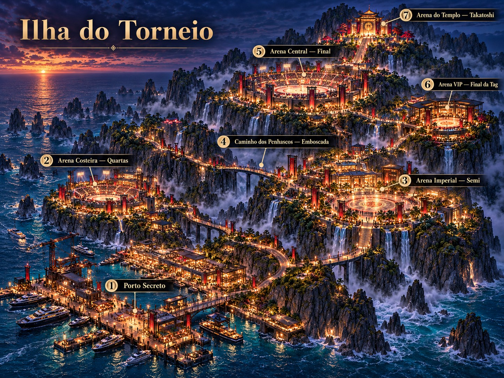

# Cenários da Ilha do Torneio: prompts

O torneio acontece numa ilha: penhascos de pedra escura pontiagudos saindo do mar,
cobertos de mata, com cachoeiras e névoa, iluminados por milhares de luzes douradas e
estandartes vermelhos. Os concepts estão em `art/concepts/cenarios/` (vieram do Drive,
`game-luta-gpt/concepts/cenarios`) e o mapa mostra onde fica cada cenário:



| Nº no mapa | Cenário (`id`) | Concept | Luta |
| --- | --- | --- | --- |
| 1 | Porto Secreto (`porto_secreto`), **pronto** | `porto_secreto.jpg` | DESAFIO (ep03, A Chegada): p07 + p08 desafiam o jogador no cais, antes do torneio |
| 2 | Arena Costeira (`arena_costeira`), **pronto** | `arena_costeira.jpg` | QUARTAS DE FINAL (ep04) |
| 3 | Arena Imperial (`arena_imperial`), **pronto** | `arena_imperial.jpg` | SEMIFINAL (ep06) |
| 4 | Caminho dos Penhascos (`caminho_penhascos`), **pronto** | `caminho_penhascos.jpg` | EMBOSCADA (ep05) |
| 5 | Arena Central (`arena_central`), **pronto** | `arena_central.jpg` | FINAL 2x2 (ep07) |
| 6 | Arena VIP (`arena_vip`) | `arena_vip.jpg` | "Final da Tag": o DUELO FINAL 1x1 entre os parceiros, a regra escondida (ep08) |
| 7 | Arena do Templo (`arena_templo`) | `arena_templo.jpg` | o Campeão, Takatoshi (chefe final) |

O caminho sobe a ilha: o porto fica no pé, as arenas vão subindo pelos penhascos e o
templo do Takatoshi fica no pico. Por isso **a ilha toda aparece no fundo dos cenários**:
do porto se vê o templo lá no alto; do templo se vê o mar e as outras arenas lá embaixo.

Como montar cada um (preparar, visualizar no PC, ajustar o `stage.json`): `README.md`
desta pasta. As regras são as mesmas dos outros cenários: tudo **de frente**, sem
perspectiva, piso **visto de cima**, PNG com **fundo transparente** e topo inteiro com
margem nas peças altas (senão o corte aparece no super pulo).

## Regra geral

Cole antes de cada prompt. No ChatGPT, anexe o concept do cenário (e o `mapa_ilha.jpg`
nas peças de fundo) e diga "use a imagem anexada só como referência de estilo, clima,
cores e arquitetura; a composição é a pedida no texto".

```
Arte de cenário para jogo de luta 2D em estilo anime, mesmo traço de um mangá de luta
moderno (estilo SNK / King of Fighters), na Ilha do Torneio: uma ilha tropical de
penhascos de pedra escura altos e pontiagudos (como as montanhas de Zhangjiajie e as
pedras da baía de Ha Long), cobertos de mata verde-escura, com cachoeiras e névoa, no
crepúsculo: o sol se pondo no mar, céu azul-marinho e roxo com nuvens, e a ilha iluminada
por luzes quentes douradas, lanternas e holofotes. Arquitetura de luxo que mistura templo
asiático e resort moderno: pedra escura, concreto, vidro, madeira escura, detalhes
dourados e estandartes vermelhos com o emblema do torneio em dourado. Contraste entre o
azul da noite e o dourado e vermelho das luzes, cores ricas, contorno limpo e sombreamento
em cel-shading. Sem personagens, sem pessoas, sem animais, sem texto legível, sem marca
d'água.
```

O **emblema do torneio** aparece nos estandartes e no piso das arenas. Use sempre a mesma
descrição: "o emblema do torneio, como nos estandartes da referência: um medalhão
redondo dourado com uma roda ornamentada de oito raios dentro de um anel duplo".

**Plateia**: as arenas são lotadas nos concepts. A única exceção ao "sem pessoas" são as
arquibancadas **distantes**: "plateia como uma massa de silhuetas pequenas e escuras
contra as luzes, sem rostos e sem detalhes". Nada de gente nas peças perto da câmera
(pilares, braseiros, primeiro plano): ficaria parada e grande demais. Se um dia a plateia
de perto for animada, ela entra como `ator` (veja `docs/tutorial-plateia.md`).

**Primeiro plano**: nos cenários abertos da ilha, objetos colados na câmera (`frente_esq`,
`frente_dir`) não funcionaram: borrados e sem onde se apoiar, com a câmera afastada eles
aparecem soltos no meio do piso. O porto e a Arena Costeira ficaram sem eles; nos próximos
cenários não precisa gerar essas duas imagens.

**Profundidade e apoio** (aprendido no porto e nas arenas):
- **O mar é deitado** (`agua` com `"imagem": "mar_plano.jpg"`, do fim do piso até 8500,
  veja `docs/stage-engine.md`). O `mar.png` em pé fica só para a faixa do horizonte. Era a
  diferença entre as arenas e os cenários que funcionavam: lá sempre há coisas entre o piso e
  o fundo (portal, viaduto, muro, cidade); aqui, atrás do piso só tem água, e a água em pé
  fazia a arquibancada parecer de brinquedo diante de ondas gigantes. A `mar_plano.jpg` é
  provisória (`montar_porto.textura_mar`, das ondas de perto do `mar.png`); o ideal é gerar
  uma no GPT: "mar à noite visto exatamente de cima, ondas pequenas com espuma, reflexos
  dourados, sem horizonte, sem céu, as quatro bordas continuam o padrão".
- **Escala: os lutadores são a régua, e a plateia também.** Na arte do GPT as pessoas da
  arquibancada têm 1/30 do tamanho de um lutador: é um estádio visto de muito longe. Logo
  atrás do ringue, mesmo aumentada, a arquibancada parecia maquete. Agora o chão da arena
  continua do ringue até ela (`"ate"` no `chao`) e ela fica lá no fundo (Central a 3500,
  Costeira e Imperial a 2500, com o palácio e as árvores), onde gente pequena faz sentido.
  Com uma arquibancada desenhada de perto (poucas fileiras, gente grande), daria para ela
  voltar a ficar logo atrás do ringue.
- **Estádio côncavo não se repete.** A arquibancada da Central é a tigela inteira do estádio:
  repetida lado a lado, virava uma onda de curvas. Fica uma só (`"repetir": "nao"`),
  centrada na arena (x 0,606 a 3500 de profundidade; o mundo vai de 0 a 2600) e esticada na largura na montagem
  (`LARGURA_ESTADIO`) para cobrir a câmera em qualquer posição. Só repete o que é reto.
- **Paisagem gigante fica lá no fundo, junto do mar.** A ilha, a encosta, os penhascos, as
  arenas e o templo ao longe ficam a 8600–8800 (o mar a 9000), com `"apoio": 9000`, e o
  tamanho na tela vem do `topo`/`base`. Mais perto (a encosta estava a 2600), uma montanha
  enorme se mexia como um objeto pequeno e abria uma faixa de mar embaixo dela no pulo.
  Coisas pequenas sobre a água (os barcos) ficam na própria distância, em cima do mar
  deitado; o `apoio` só é preciso onde o mar ainda for a imagem em pé.
- O que está longe (a ilha, os penhascos, as arenas e o templo ao longe) recebe a névoa da
  distância na montagem (`montar_porto.afastar`: menos cor e contraste, puxando para o
  azul-arroxeado do céu) e fica pequeno. Com a mesma cor e nitidez das peças de perto, a
  ilha parecia uma maquete.
- A base de cada peça de longe fica na linha d'água da profundidade dela, com a névoa de
  baixo opaca. Apagar essa névoa mostrava o mar por baixo e a peça parecia voar.
- Peça de longe que não se repete não pode terminar num corte reto: a borda vira um
  pedaço de montanha solto no céu. Como ela está lá no fundo e quase não anda para os lados,
  o lado que o GPT cortou fica sempre fora da tela (o `x` no stage.json, conferido com a
  varredura); espelhar a peça para fechar o lado deixava uma montanha simétrica, de
  brinquedo. A faixa de penhascos vai baixando nas pontas até sumir na água
  (`montar_porto.afinar_pontas`).
- A base das montanhas é sólida (`montar_porto.solidificar`): a névoa do pé vinha meio
  transparente e deixava ver a montanha de trás por baixo da da frente.
- Arquibancadas e prédios ficam encostados no fim do piso: atrás dele só tem o mar, e
  qualquer vão aparece no super pulo (a arquibancada voando sobre a água). Os lados também
  contam: uma peça que não se repete (o palácio) deixa o mar no nível da praça quando a
  câmera anda; atrás dela vai uma peça contínua (as arquibancadas).
- Peças penduradas (a treliça de refletores) ficam na mesma profundidade de quem as segura
  (as pilastras); em profundidades diferentes elas se separam e flutuam no pulo.
- Para conferir: `gradle :pc-preview:runStage --args="app/src/main/assets/stages/<id>
  --varredura folha.png"` grava os dois cantos e o meio, com a câmera perto, afastada e no
  alto do super pulo.

O jogo faz: fogo dos braseiros, brilho das lanternas e holofotes, reflexo no piso
molhado, a água das piscinas e do mar (brilhos), neblina, folhas caindo. Não precisa (e é
melhor não) pôr na arte. As **cachoeiras** são da arte (o jogo não anima cachoeira).

## Peças comuns da ilha

Geradas **uma vez** e copiadas para a pasta de cada cenário. Assim o céu, o mar e os
penhascos são os mesmos em toda a ilha. No Drive ficam em `cenarios/torneio/` (soltas na
pasta; cada cenário tem a sua subpasta, como `cenarios/torneio/porto_secreto/`).

| Arquivo | Formato | Fundo | Prompt |
| --- | --- | --- | --- |
| `ceu.jpg` | horizontal | opaco | Céu de crepúsculo sobre o mar: na faixa de baixo, perto do horizonte, laranja e dourado do pôr do sol, com o sol meio escondido tocando a borda de baixo, no terço esquerdo da imagem; subindo, nuvens roxas e azul-marinho com a borda de baixo iluminada de laranja; no alto, azul-noite escuro com algumas estrelas. Só o céu: sem mar, sem montanhas, sem chão. |
| `ceu_lua.jpg` | horizontal | opaco | Peça para **editar o `ceu.jpg`**: "o mesmo céu, com uma lua cheia grande e brilhante no terço de cima, à direita, com halo azulado". Usado nos cenários do alto da ilha (Arena Central, Arena do Templo), como nos concepts. |
| `mar.png` | horizontal, larga e baixa | **transparente** | O mar visto de frente até o horizonte, ocupando só a metade de baixo da imagem: água azul-escura com o reflexo dourado do sol poente fazendo um caminho de luz no terço esquerdo, e dezenas de rochedos de pedra escura altos e pontiagudos saindo da água, de vários tamanhos, mais apagados e azulados quanto mais longe, com névoa no pé. O horizonte é uma linha reta. Tudo acima do horizonte e dos rochedos é transparente. As bordas esquerda e direita continuam no mesmo nível, para a imagem poder se repetir. |
| `penhascos.png` | horizontal | **transparente** | Faixa contínua de penhascos de pedra escura altos e pontiagudos vista de frente, cobertos de mata verde-escura, com duas ou três cachoeiras finas caindo, névoa branca no pé e, aqui e ali, pequenos caminhos de pedra e pontes iluminados por lanternas douradas e pavilhões com telhado asiático acesos. A base é uma faixa reta de névoa. Sem céu: tudo acima dos penhascos é transparente. Continua igual nas duas bordas, para se repetir lado a lado. |
| `estandarte.png` | **vertical** | **transparente** | Mastro alto de metal escuro com detalhes dourados, vista de frente, com um estandarte comprido de tecido vermelho pendurado numa travessa no alto, com o emblema do torneio grande em dourado no meio e borda dourada. Uma luminária dourada acesa no topo do mastro. O topo aparece inteiro, com margem transparente acima e dos lados. A base do mastro (um bloco de pedra escura) toca a borda de baixo. Fundo transparente. |

## 1. Porto Secreto (`porto_secreto`)

O episódio novo da chegada: os iates chegam à ilha à noite e, no cais, antes de entrar no
torneio, alguém desafia o jogador. A luta é **no cais de concreto molhado**, entre caixas
de equipamento e cordas, com a água do porto atrás, os iates e o junco de velas vermelhas
e, lá no fundo, a ilha inteira acesa subindo até o templo.

Composição (profundidades sugeridas): caixas 150, postes 300, terminal 420 (à esquerda),
guindaste 900, grade do cais 650 (fim do piso), água 650 a 2600 (`agua`, com brilhos e o
reflexo dos barcos), barcos 1400, ilha 5000, `mar.png` 9000, `ceu.jpg`. Piso molhado:
`reflexoLutadores` ~0,3, `reflexoLuzes` ~0,6. Como ficou de verdade: veja as notas no fim
desta seção.

| Arquivo | Formato | Fundo | Prompt |
| --- | --- | --- | --- |
| `ilha.png` | horizontal | **transparente** | A Ilha do Torneio vista do porto, de longe e de frente: penhascos de pedra escura altos e pontiagudos subindo da esquerda para a direita, cobertos de mata, cheios de névoa e cachoeiras, com caminhos e pontes acesos em zigue-zague subindo a encosta, um estádio redondo iluminado por holofotes na metade da subida e, no pico, à direita, um templo asiático dourado aceso com uma escadaria longa iluminada descendo dele. A base é uma linha reta de névoa (o pé da ilha na água). Sem céu: tudo acima da ilha é transparente. |
| `barcos.png` | horizontal | **transparente** | Barcos ancorados vistos de lado, na mesma linha: à esquerda, dois iates de luxo brancos modernos com luzes acesas nas janelas e no casco; à direita, um junco chinês de madeira escura com três velas vermelhas grandes abertas. A linha d'água é uma linha reta embaixo, sem a água. Fundo transparente. |
| `guindaste.png` | **vertical** | **transparente** | Guindaste de porto de metal escuro visto de frente, com a lança longa para a direita e um contêiner vermelho pendurado nos cabos, luzes de sinalização acesas na estrutura. O topo aparece inteiro, com margem transparente acima e dos lados. A base toca a borda de baixo. Fundo transparente. |
| `terminal.png` | **vertical** | **transparente** | Fachada de um terminal de chegada de luxo de dois andares visto **exatamente de frente**, sem perspectiva: térreo de vidro com luz quente lá dentro e três pórticos de detector de metais iluminados na entrada, guarda-sóis vermelhos; no andar de cima uma varanda com corrimão de metal e lanternas de papel penduradas, palmeiras em vasos. Telhado plano de vigas escuras com o topo inteiro e margem transparente acima e dos lados. Sem pessoas. A base toca a borda de baixo. Fundo transparente. |
| `grade.png` | horizontal | **transparente** | Borda de um cais de concreto vista de frente, em linha reta: guarda-corpo baixo de metal escuro com postes curtos, a cada intervalo um poste de amarração (cabeço) de ferro e uma luminária baixa de luz dourada; embaixo, a lateral de concreto do cais com pneus de proteção pendurados. Continua igual nas duas bordas, para se repetir lado a lado. Fundo transparente. |
| `poste.png` | **vertical** | **transparente** | Poste de luz alto de metal escuro do cais, vista de frente, com uma luminária redonda de luz quente no topo e um estandarte vertical vermelho com o emblema do torneio em dourado preso no meio do poste. O topo aparece inteiro, com margem transparente. A base toca a borda de baixo. Fundo transparente. |
| `caixas.png` | horizontal | **transparente** | Pilha de equipamento no cais vista de frente, apoiada no chão: caixas de transporte rígidas pretas e cinza-escuras com cantos de metal, empilhadas em alturas diferentes, um rolo grande de corda de navio e uma rede de pesca dobrada em cima. A base toca a borda de baixo. Fundo transparente. |
| `frente_esq.png` | horizontal | **transparente** | Objetos soltos de cais, isolados, vistos de frente e um pouco de baixo, como se estivessem colados na câmera: duas caixas de transporte rígidas pretas empilhadas com cantos de metal. **Só os objetos**: sem chão, sem fundo. A base toca a borda de baixo; acima e dos lados, margem transparente. Contorno dourado das luzes do cais. |
| `frente_dir.png` | horizontal | **transparente** | Objetos soltos de cais, isolados, vistos de frente e um pouco de baixo, como se estivessem colados na câmera: um cabeço de amarração de ferro com uma corda grossa enrolada e uma luminária baixa de cais apagada. **Só os objetos**: sem chão, sem fundo. A base toca a borda de baixo; acima e dos lados, margem transparente. Contorno dourado das luzes do cais. |
| `chao.jpg` | quadrado | opaco | Piso de cais visto **exatamente de cima** (vista ortográfica, sem perspectiva): grandes placas de concreto cinza-escuro molhado, todas do mesmo tamanho, em fileiras retas, com juntas finas, duas faixas de pintura amarela gasta correndo de um lado ao outro e algumas grelhas de ferro de escoamento. No centro, o emblema do torneio pintado grande no concreto, em dourado gasto. Iluminação uniforme, sem reflexos de luzes e sem sombras de objetos. As bordas esquerda e direita continuam o padrão. |
| `chao_cais.jpg` | quadrado | opaco | Peça para **editar o `chao.jpg`**: "a mesma imagem, só sem o emblema do centro, com o concreto continuando no lugar dele". |

Dicas do porto:
- As faixas amarelas do piso precisam correr **da esquerda para a direita** (paralelas à
  borda do cais): deitadas pelo jogo, elas viram as linhas do cais no concept.
- Os barcos ficam sem a água: a água é a camada `agua` do jogo, que pisca e reflete os
  barcos (`reflexo` na camada dos barcos).
- O detector de metais do terminal é a "segurança" da chegada: combina com a cena do
  desafio (o adversário pode estar esperando logo depois dos pórticos).

### Notas do Porto Secreto

As imagens do GPT passam pelo `montar_porto.py`, com a pasta das peças comuns e a do porto:

```bash
pip install pillow numpy
python tools/stage/montar_porto.py --comum pasta/torneio --entrada pasta/torneio/porto_secreto
```

- **Piso**: o `chao.png` e o `chao_cais.png` vieram certos (de cima, as faixas amarelas
  nas mesmas linhas nas duas), mas o GPT refez o concreto na edição. Como no Beco do
  Brucy, o `chao_cais` vira a peça que se repete, com as bordas fundidas, e o emblema do
  `chao.png` é colado no centro com borda suave. O piso vai de −600 a 650 (a grade).
- **Grade**: veio com a lateral do cais (concreto e pneus) embaixo do guarda-corpo. Essa
  lateral fica de costas para a câmera e é cortada.
- **Ilha**: não se repete (é uma só, à direita do sol). Pequena (de 0,13 a 0,46 da tela) e
  com a névoa da distância; as bordas dos lados são esfumadas e a névoa de baixo fica
  opaca, apoiada no mar. Atrás dela, à direita, os `penhascos.png` continuam a ilha.
- **Mar e céu**: o `mar.png` desce até 0,8 da tela (no super pulo aparece mar, e não um
  vazio) com o horizonte em 0,40, e o reflexo do sol fica embaixo do sol do `ceu.jpg`.
  A água do porto (`agua`, de 660 a 9000) só põe os brilhos e o reflexo dos barcos.
- **Composição** (profundidades): caixas 170, postes 300 (com o estandarte balançando:
  `bandeira_poste.png`, separado pelo `separar_bandeiras.py`), terminal 430 e guindaste
  520 em cima do cais (alternando a cada 2,6 telas: o guindaste à direita na câmera de
  repouso, o terminal aparece quando a câmera anda), grade 650, barcos 1400 (com reflexo),
  ilha 5000, penhascos 6500, mar 9000, céu.
- **Sem primeiro plano**: as caixas e o cabeço com a luminária (`frente_esq`, `frente_dir`)
  ficavam a −250, desfocados, mas com a câmera afastada apareciam soltos no meio do cais.
  O script ignora os dois; as caixas de trás (a 170) continuam.
- O ep03 (A Chegada) usa este cenário na luta DESAFIO, e ele entra no sorteio do Arcade.

## 2. Arena Costeira (`arena_costeira`): quartas

A primeira arena, na encosta de baixo, à beira-mar: um ringue redondo claro com anéis
vermelhos, arquibancada lotada em volta, torres de holofote com estandartes, e o mar com
os rochedos ao lado. No jogo, a arquibancada fica atrás do ringue e é **baixa**: por cima
dela se vê o mar até o horizonte com o pôr do sol, o que dá o "costeira". A encosta da ilha
aparece só do lado direito.

Composição: ringue (piso) até 600, barreira 600, holofotes 300, arquibancada 900,
encosta 2200 (só à direita, sem repetir), `penhascos.png` 4000, `mar.png` 9000 (com
`agua` entre 1500 e 8000 para os brilhos), `ceu.jpg`.

| Arquivo | Formato | Fundo | Prompt |
| --- | --- | --- | --- |
| `arquibancada.png` | horizontal, larga e baixa | **transparente** | Arquibancada de uma arena de luta à beira-mar vista **exatamente de frente**, em linha reta: degraus de concreto claro subindo, lotados de plateia como uma massa de silhuetas pequenas e escuras contra as luzes, sem rostos e sem detalhes; embaixo, um muro com painéis de LED vermelhos acesos (sem texto) e portões escuros; no alto, um corrimão de vidro com luzes douradas. A arquibancada é baixa: ocupa só a metade de baixo da imagem, o resto é transparente. Continua igual nas duas bordas, para se repetir lado a lado. |
| `encosta.png` | horizontal | **transparente** | Encosta da ilha vista de frente, saindo do lado direito da imagem: penhasco de pedra escura com mata, uma escadaria de pedra iluminada subindo em zigue-zague, dois pavilhões de vidro e madeira acesos com estandartes vermelhos e, lá no alto, as luzes de outra arena. O lado esquerdo da imagem é transparente (ali aparece o mar). A base é uma faixa reta de névoa. Sem céu. |
| `holofote.png` | **vertical** | **transparente** | Torre de holofote de arena vista de frente: estrutura de treliça de metal escuro alta, com uma grade de refletores retangulares acesos no topo e um estandarte vermelho comprido com o emblema do torneio em dourado preso na torre. O topo aparece inteiro, com margem transparente. A base toca a borda de baixo. Fundo transparente. |
| `barreira.png` | horizontal | **transparente** | Mureta baixa em volta do ringue de uma arena, vista de frente, em linha reta: blocos de concreto escuro com uma faixa de painéis de LED vermelhos acesos (sem texto) e um friso dourado em cima. Continua igual nas duas bordas, para se repetir lado a lado. Fundo transparente. |
| `frente_esq.png` | horizontal | **transparente** | Primeiro plano isolado, colado na câmera: a ponta de uma grua de câmera de TV de metal preto com a câmera, vista de baixo, em silhueta contornada pelas luzes douradas. **Só o objeto**: sem chão, sem fundo. A base toca a borda de baixo; acima e dos lados, margem transparente. |
| `frente_dir.png` | horizontal | **transparente** | Primeiro plano isolado, colado na câmera: um trecho de corrimão de vidro com um poste de metal e uma luminária baixa acesa, e uma palmeira pequena num vaso de pedra, em silhueta contornada pelas luzes douradas. **Só os objetos**: sem chão, sem fundo. A base toca a borda de baixo; acima e dos lados, margem transparente. |
| `chao.jpg` | quadrado | opaco | Piso de ringue de arena visto **exatamente de cima** (vista ortográfica, sem perspectiva): concreto polido claro, bege-acinzentado, com um grande círculo central desenhado por dois anéis vermelhos finos e um anel dourado, e o emblema do torneio discreto no centro, em dourado. Fora do círculo, o mesmo concreto com juntas retas finas. Iluminação uniforme, sem sombras de objetos. As bordas esquerda e direita continuam o padrão. |
| `chao_liso.jpg` | quadrado | opaco | Peça para **editar o `chao.jpg`**: "a mesma imagem, só sem o círculo, os anéis e o emblema do centro, com o concreto continuando no lugar deles". |

### Notas da Arena Costeira

As imagens do GPT passam pelo `montar_costeira.py`:

```bash
pip install pillow numpy
python tools/stage/montar_costeira.py --comum pasta/torneio --entrada pasta/torneio/arena_costeira
```

- **Piso**: o GPT desenhou a arena inteira vista de cima, com a mureta curva e os
  estandartes nas bordas da esquerda e da direita. Como o jogo repete o piso para os lados,
  a mureta sairia pintada no chão. Fica só a faixa de lajotas do meio do `chao_liso.png`
  (entre duas juntas com as mesmas fileiras), repetida três vezes. O GPT iluminou mais o
  centro: a luz é medida no `chao_liso` (desfocada e, coluna a coluna, pela mediana) e
  tirada das duas imagens, senão cada emenda ficava com um degrau de luz. O círculo
  vermelho com o emblema do `chao.png` é colado no centro (as duas têm a mesma grade de
  lajotas). O piso vai de −600 a 600 e o círculo ocupa quase toda a profundidade: a luta
  é dentro dele.
- **Encosta**: a borda da direita e a névoa de baixo são esfumadas, como a ilha do porto.
- **Composição** (profundidades): holofotes 320 (perto, a cabeça de luz fica acima da tela
  na câmera de repouso), arquibancada 605 (encostada no fim do piso, 0,27 da tela: por cima
  dela aparecem o mar, os rochedos e o pôr do sol), holofotes 615 (logo atrás da
  arquibancada, a base escondida por ela; a 1050 eles ficavam plantados no mar), encosta 2600 (à direita, sem repetir), penhascos 6500, mar
  9000 (com brilhos), céu.
- **Sem a mureta**: a `barreira.png` repetia o muro de LED que a arquibancada já tem embaixo
  (duas faixas vermelhas). O muro da arquibancada é a mureta do ringue. Antes ela ficava a
  900, com um vão de mar até o piso: no super pulo ela voava sobre a água.
- **Sem primeiro plano**: a grua de câmera e o vaso com o corrimão de vidro ficavam soltos
  no ar, borrados, e com a câmera afastada o corrimão aparecia no meio do ringue. Ficaram
  de fora (o script ignora `frente_esq` e `frente_dir`). Numa arena aberta, com o piso
  inteiro à mostra, objeto colado na câmera não tem onde se apoiar.
- O ep04 usa este cenário nas QUARTAS DE FINAL (`"cenario": "arena_costeira"` no passo da
  luta do torneio), e ele entra no sorteio do Arcade.

## 3. Arena Imperial (`arena_imperial`): semifinal

Uma grande praça de pedra polida com uma mandala vermelha e dourada no chão, em frente a um
palácio de vidro e madeira com uma escadaria larga e cachoeiras caindo dos dois lados.
Arquibancadas laterais, estandartes vermelhos em pórticos altos, lanternas e árvores de
folhas vermelhas. Mais "imperial" e mais rica que a Costeira.

Composição: lanternas 150, pórticos com estandarte 300, árvores vermelhas 500, praça
(piso) até 700, arquibancadas 850 (esquerda e direita, alternando), palácio 1300 (centro,
sem repetir), neblina 1400 (no pé das cachoeiras), `penhascos.png` 3500, `mar.png` 9000,
`ceu.jpg`. Folhas vermelhas caindo: `petalas` em vermelho (`#C8202A`). Piso polido:
`reflexoLutadores` ~0,3.

| Arquivo | Formato | Fundo | Prompt |
| --- | --- | --- | --- |
| `palacio.png` | horizontal | **transparente** | Palácio de arena visto **exatamente de frente** e simétrico, sem perspectiva: um pavilhão grande de vidro e madeira escura com telhado asiático plano de beirais retos, aceso por dentro com luz dourada, sobre um terraço de pedra; descendo dele, uma escadaria larga de pedra clara iluminada, e dos dois lados da escadaria, cachoeiras caindo de um paredão de pedra escura com mata. Dois estandartes vermelhos altos com o emblema do torneio nas laterais. Duas árvores de folhas vermelhas no terraço. A base é uma linha reta embaixo. Sem céu: transparente acima do telhado. |
| `arquibancada_lateral.png` | horizontal | **transparente** | Arquibancada coberta de uma arena vista de frente: degraus subindo, lotados de plateia como massa de silhuetas pequenas e escuras sem rostos, sob uma cobertura de madeira escura com beiral asiático, colunas com estandartes vermelhos e um camarote envidraçado aceso no alto. O topo aparece inteiro, com margem transparente acima e dos lados. A base é uma linha reta embaixo. |
| `portico.png` | **vertical** | **transparente** | Pórtico alto de metal preto e moldura dourada visto de frente, com um estandarte vermelho comprido esticado dentro da moldura, com o emblema do torneio em dourado, e uma luminária dourada acesa no topo. O topo aparece inteiro, com margem transparente. A base (um pedestal de pedra escura) toca a borda de baixo. Fundo transparente. |
| `arvore_vermelha.png` | quadrado | **transparente** | Árvore ornamental de copa larga com folhas vermelho-vivo (bordo japonês), tronco escuro retorcido, plantada num canteiro baixo de pedra escura, vista de frente. A base toca a borda de baixo. Fundo transparente. |
| `lanterna.png` | **vertical** | **transparente** | Luminária de praça vista de frente: um pilar baixo e quadrado de pedra escura com uma lanterna de vidro e metal dourado no topo, **apagada** (o jogo acende). A base toca a borda de baixo. Fundo transparente. |
| `frente_esq.png` | horizontal | **transparente** | Primeiro plano isolado, colado na câmera: a ponta de um telhado de madeira escura de um pavilhão de restaurante, com o beiral e uma viga, visto de baixo, em silhueta contornada por luz dourada. **Só o objeto**: sem chão, sem fundo. Margem transparente embaixo e dos lados; o telhado sai pela borda de cima. |
| `frente_dir.png` | horizontal | **transparente** | Primeiro plano isolado, colado na câmera: um galho de árvore de folhas vermelhas e um trecho de corrimão de pedra com uma lanterna baixa, em silhueta contornada por luz dourada. **Só os objetos**: sem chão, sem fundo. A base toca a borda de baixo; acima e dos lados, margem transparente. |
| `chao.jpg` | quadrado | opaco | Piso de praça visto **exatamente de cima** (vista ortográfica, sem perspectiva): grandes placas quadradas de pedra polida cinza-escura, todas do mesmo tamanho, com juntas finas douradas. No centro, uma grande mandala circular incrustada: anéis vermelhos e dourados concêntricos, um padrão geométrico vermelho em volta e o emblema do torneio no meio. Iluminação uniforme, sem reflexos e sem sombras. As bordas esquerda e direita continuam o padrão das placas. |
| `chao_placas.jpg` | quadrado | opaco | Peça para **editar o `chao.jpg`**: "a mesma imagem, só sem a mandala do centro, com as placas continuando no lugar dela". |

### Notas da Arena Imperial

As imagens do GPT passam pelo `montar_imperial.py`:

```bash
pip install pillow numpy
python tools/stage/montar_imperial.py --comum pasta/torneio --entrada pasta/torneio/arena_imperial
```

- **Piso**: o `chao.png` e o `chao_placas.png` vieram levemente em perspectiva (as linhas
  verticais abrem 6,4% de cima para baixo). As duas são endireitadas (transformação
  bilinear em volta do centro) e cortadas entre duas linhas com losango (x 240 e 1431 na
  imagem endireitada): a mandala cabe inteira e os losangos cortados ao meio se completam
  na emenda. O piso vai de −600 a 700.
- **Palácio**: no fim da praça (690), para a escadaria sair direto dela (mais
  longe, aparecia uma faixa de mar entre a praça e a escada).
- **Composição** (profundidades): lanternas de praça 150 (o jogo acende), pórticos com
  estandarte 300, árvores vermelhas 520 (dos dois lados do palácio), palácio 690,
  arquibancadas 700 (contínuas, espelhadas, atrás do palácio e no fim da praça, que vai
  até 700: sozinho, o palácio deixava o mar no nível da praça dos lados), penhascos 6500, mar, céu do
  pôr do sol. Folhas vermelhas caindo (`petalas` em `#C8202A`). Pedra polida:
  `reflexoLutadores` 0,25.
- O ep06 usa este cenário na SEMIFINAL, e ele entra no sorteio do Arcade.

## 4. Caminho dos Penhascos (`caminho_penhascos`): emboscada

Fora das arenas, à noite: passarelas de metal e pontes suspensas sobre um abismo, presas
em andaimes nos penhascos, com o mar batendo lá embaixo e névoa subindo. Ruínas de arcos
de pedra antigos, postes com estandartes, caixas de equipamento abandonadas. É o lugar
certo para uma emboscada: só tem a passarela, e em volta é o vazio. Substitui o plano
antigo do "beco dos fundos do templo" (`docs/historia/torneio.md`).

Composição: andaimes 250, guarda-corpo 450 (fim do piso, a passarela é estreita), névoa
do abismo 600 a 900 (duas `neblina`, subindo de baixo), ponte suspensa 1500, ruínas 1100
(à direita), penhascos com o abismo 2500, arena VIP acesa ao longe 6000 (só à direita),
`mar.png` 9000, `ceu.jpg`. Sem reflexo forte (metal e madeira secos): `reflexoLutadores`
~0,1. Vento: `petalas` em cinza-claro bem apagadas, como gotículas de névoa, é opcional.

| Arquivo | Formato | Fundo | Prompt |
| --- | --- | --- | --- |
| `abismo.png` | horizontal | **transparente** | Abismo entre penhascos visto de frente: paredões de pedra escura pontiagudos dos dois lados e no fundo, com mata nas fendas e uma cachoeira caindo, descendo até o mar agitado com espuma branca bem lá embaixo, cheio de névoa branca subindo. Andaimes de metal com lâmpadas presos nos paredões. A borda de cima são os topos dos penhascos; acima deles é transparente. Ocupa a imagem de ponta a ponta. |
| `ponte.png` | horizontal | **transparente** | Ponte suspensa estreita de metal escuro vista **exatamente de lado**, em linha reta, de uma borda à outra: piso de grade de metal com corrimão, duas torres de treliça com cabos de aço descendo em curva, lâmpadas douradas a intervalos iguais no corrimão e um estandarte vermelho em cada torre. Embaixo da ponte é transparente. Fundo transparente. |
| `ruinas.png` | horizontal | **transparente** | Ruínas antigas de pedra cinza em cima de um penhasco, vista de frente: dois arcos grandes de pedra rachados, com musgo e trepadeiras, colunas quebradas, lanternas modernas e um estandarte vermelho do torneio presos nas pedras, luz dourada iluminando de baixo. A base é a borda reta do penhasco. Fundo transparente. |
| `arena_longe.png` | horizontal | **transparente** | Ao longe, no alto de um penhasco à direita, um pavilhão de luxo de vidro e metal escuro todo aceso por dentro, com estandartes vermelhos gigantes com o emblema do torneio pendurados na fachada e holofotes no telhado. Pequeno e distante, com névoa no pé. O lado esquerdo da imagem é transparente. Sem céu. |
| `andaime.png` | **vertical** | **transparente** | Torre de andaime de metal escuro vista de frente: tubos e travessas em X, uma plataforma no meio com uma caixa de equipamento, um poste com um holofote pequeno aceso e um estandarte vermelho do torneio amarrado. O topo aparece inteiro, com margem transparente. A base toca a borda de baixo. Fundo transparente. |
| `guarda_corpo.png` | horizontal | **transparente** | Guarda-corpo de passarela de metal visto de frente, em linha reta: corrimão de metal escuro na altura da cintura, postes a intervalos iguais com uma lâmpada vertical dourada acesa em cada um, cabos de aço entre os postes e, embaixo do corrimão, uma placa de metal perfurado. Dá para ver através entre os cabos (transparente). Continua igual nas duas bordas, para se repetir lado a lado. |
| `frente_esq.png` | horizontal | **transparente** | Primeiro plano isolado, colado na câmera: duas caixas de equipamento de metal empilhadas, com cantos reforçados, e um rolo de cabo elétrico, vistos de baixo, em silhueta contornada por luz dourada. **Só os objetos**: sem chão, sem fundo. A base toca a borda de baixo; acima e dos lados, margem transparente. |
| `frente_dir.png` | horizontal | **transparente** | Primeiro plano isolado, colado na câmera: um poste de passarela de metal com uma lâmpada vertical dourada acesa e um pedaço de corrimão, visto de baixo, em silhueta. **Só o objeto**: sem chão, sem fundo. A base toca a borda de baixo; acima e dos lados, margem transparente. |
| `chao.jpg` | quadrado | opaco | Piso de passarela visto **exatamente de cima** (vista ortográfica, sem perspectiva): placas de grade de metal escuro antiderrapante, todas do mesmo tamanho, em fileiras retas, presas por vigas de aço com parafusos, e algumas tábuas de madeira escura gastas entre as placas. No centro, uma placa de metal maior e lisa, redonda, com o emblema do torneio estampado em relevo. Iluminação uniforme, sem sombras de objetos. As bordas esquerda e direita continuam o padrão. |
| `chao_grade.jpg` | quadrado | opaco | Peça para **editar o `chao.jpg`**: "a mesma imagem, só sem a placa redonda do centro, com a grade continuando no lugar dela". |

Dicas do caminho:
- No concept as pontes atravessam o abismo em perspectiva. No jogo a câmera olha de
  frente: a luta é numa passarela que corre de lado a lado da tela, e a ponte suspensa do
  fundo também precisa vir **de lado**, reta, para se repetir.
- O `abismo.png` é o que dá o vazio. Ele fica logo atrás do guarda-corpo e desce abaixo
  da linha do piso; confira no visualizador se o mar lá embaixo aparece quando a câmera
  afasta.

### Notas do Caminho dos Penhascos

As imagens do GPT passam pelo `montar_caminho.py`:

```bash
pip install pillow numpy
python tools/stage/montar_caminho.py --comum pasta/torneio --entrada pasta/torneio/caminho_penhascos
```

- **Piso**: a grade da passarela veio simétrica em volta da placa do emblema, e o
  `chao_grade.png` com a mesma grade. Do centro da viga com placa de rebites em x 189 ao
  centro da viga igual em x 1484 o padrão se repete: as duas imagens são cortadas ali e a
  emenda cai no meio de uma viga (nada é fundido). O piso vai de −600 a 520 (o
  guarda-corpo): a passarela é mais estreita que os outros pisos.
- **Abismo**: a 1500, grande (de −0,3 a 0,72 da tela) e espelhado. A faixa de pedra que o
  GPT pôs embaixo fica escondida atrás do piso; o mar lá embaixo aparece logo acima do
  guarda-corpo. A ponte suspensa fica na frente dele (1350) e atravessa a tela inteira
  (cópias encostadas e espelhadas: sozinha, ela terminava no ar dos dois lados), e uma
  neblina clara (1250) sobe do abismo. Atrás de tudo, a arena VIP ao longe (5000), os
  penhascos, o mar e o céu com a lua (`ceu_lua`: a emboscada é à noite).
- **Composição** (profundidades): andaimes 330 (com o estandarte balançando:
  `bandeira_andaime.png`, separado pelo `separar_bandeiras.py`), guarda-corpo 520, ruínas
  1100 (à direita, a cada 2,4 telas), ponte 1350, abismo 1500. Gotinhas de névoa passam com
  o vento (`petalas` claras e pequenas). Sem reflexo forte (metal e madeira secos).
- Sem primeiro plano: o `frente_esq` e o `frente_dir` são ignorados.
- O ep05 usa este cenário na EMBOSCADA (`"cenario": "caminho_penhascos"`), e ele entra no
  sorteio do Arcade.

## 5. Arena Central (`arena_central`): final

O estádio principal, no meio da ilha: um coliseu de pedra e concreto com arquibancadas em
vários andares lotadas, uma estrutura de treliça de luzes por cima do ringue com
estandartes enormes pendurados, holofotes cruzando o céu e, no alto, o templo do
Takatoshi aceso sob a lua. É o maior palco: mais gente, mais luz, mais vermelho.

Composição: pilastras 300, treliça 380 (faixa no alto, como o teto do dojo, com `luzes`
de holofote), barreira 650 (fim do piso), arquibancada 1100 (repetida, com `corAcima`
escuro para o super pulo mostrar o anel de cima), templo ao longe 7000 (centro-direita),
`penhascos.png` 4000, `mar.png` 9000, `ceu_lua.jpg`. Primeiro plano: o camarote VIP na
frente (corrimão de vidro, mesas), desfocado.

| Arquivo | Formato | Fundo | Prompt |
| --- | --- | --- | --- |
| `arquibancada.png` | horizontal | **transparente** | Arquibancada principal de um coliseu moderno vista **exatamente de frente**, em linha reta: três andares de degraus lotados de plateia como massa de silhuetas pequenas e escuras sem rostos, separados por faixas de camarotes envidraçados acesos em dourado, grandes estandartes vermelhos com o emblema do torneio pendurados entre os andares, e no alto um anel de holofotes. Embaixo, a mureta do ringue com painéis de luz vermelha (sem texto). O topo aparece inteiro, com margem transparente. Continua igual nas duas bordas, para se repetir lado a lado. |
| `trelica.png` | horizontal, larga e baixa | **transparente** | Estrutura de treliça de luzes de palco vista de frente e um pouco de baixo, no terço de cima da imagem: vigas de treliça de metal preto cruzando de lado a lado, com refletores de palco pendurados (apagados, o jogo acende) e dois estandartes vermelhos compridos com o emblema do torneio pendurados nela. A borda de baixo é irregular (os refletores e os estandartes) e o resto é transparente. Continua igual nas duas bordas. |
| `pilastra.png` | **vertical** | **transparente** | Pilastra alta e quadrada de concreto escuro de estádio, vista de frente, com uma faixa de luz dourada vertical embutida e um estandarte vermelho comprido com o emblema do torneio em dourado preso na frente. No topo, uma luminária. O topo aparece inteiro, com margem transparente. A base toca a borda de baixo. Fundo transparente. |
| `barreira.png` | horizontal | **transparente** | Mureta do ringue de um estádio, vista de frente, em linha reta: concreto escuro com friso dourado no alto e, a intervalos iguais, pequenos postes pretos com luzes douradas. Continua igual nas duas bordas, para se repetir lado a lado. Fundo transparente. |
| `templo_longe.png` | horizontal | **transparente** | Bem ao longe, no pico de uma montanha de pedra pontiaguda, um templo asiático de vários telhados dourado e vermelho todo aceso, com uma escadaria longa iluminada descendo e cachoeiras dos lados, pequeno e com névoa em volta. O resto da imagem é transparente. Sem céu, sem lua. |
| `camarote.png` | horizontal | **transparente** | Primeiro plano isolado, colado na câmera, só na faixa de baixo da imagem: corrimão de vidro de um camarote VIP com postes de metal, uma mesa baixa com taças e uma luminária de vela, e um vaso de pedra com uma planta, vistos de baixo, em silhueta contornada por luz dourada. **Só os objetos**: sem pessoas, sem chão, sem fundo. A base toca a borda de baixo; acima, transparente. |
| `chao.jpg` | quadrado | opaco | Piso de ringue de estádio visto **exatamente de cima** (vista ortográfica, sem perspectiva): pedra polida bege-clara, com um grande círculo central: anel externo vermelho, anel dourado ornamentado com um padrão geométrico e, no centro, o emblema do torneio grande em vermelho e dourado. Fora do círculo, a mesma pedra com juntas retas finas. Iluminação uniforme, sem sombras. As bordas esquerda e direita continuam o padrão. |
| `chao_liso.jpg` | quadrado | opaco | Peça para **editar o `chao.jpg`**: "a mesma imagem, só sem o círculo e o emblema do centro, com a pedra continuando no lugar deles". |

Dica: o `camarote.png` pode ser um só (não dividir em esquerda e direita): ele atravessa a
parte de baixo da tela, como no concept, e é desfocado na preparação. Se tampar demais os
pés dos lutadores, ele fica só a −250 com `periodo` grande, aparecendo quando a câmera anda.

### Notas da Arena Central

As imagens do GPT passam pelo `montar_central.py` (o `camarote.png` é ignorado: objeto
colado na câmera):

```bash
pip install pillow numpy
python tools/stage/montar_central.py --comum pasta/torneio --entrada pasta/torneio/arena_central
```

- **Piso**: o `chao_liso.png` não veio liso: tem o círculo grande saindo pelas bordas e as
  linhas vermelhas em cruz, como o `chao.png`. As duas imagens têm a mesma grade de
  lajotas; entre as juntas x 341 e 1331 só há lajotas e o círculo do emblema inteiro, e é
  ali que as duas são cortadas (o padrão de lajotas fecha com a cópia do lado). A ponta da
  linha vermelha que entra pelas bordas é coberta com as lajotas ao lado. O piso vai de
  −600 a 600 e o círculo ocupa quase toda a profundidade.
- **Arquibancada**: o GPT pintou um pedaço do piso do ringue embaixo dela (cortado).
- **Composição** (profundidades): pilastras com estandarte 300 e a treliça de luzes na mesma
  profundidade (presa nas pilastras; a 420 ela flutuava no super pulo), mureta 600, arquibancada 640 (logo atrás da
  mureta, alta, 0,42 da tela; mais longe ela voava no super pulo), templo do Takatoshi ao longe 6000 (aparece por cima da arquibancada quando a
  câmera afasta e no super pulo), penhascos, mar e o céu com a lua.
- O ep07 usa este cenário na FINAL, e ele entra no sorteio do Arcade.

## 6. Arena VIP (`arena_vip`): a "Final da Tag", o duelo 1x1

Um salão de luxo meio aberto, só para os magnatas: um ringue redondo de pedra preta polida
com um friso dourado, o emblema vermelho e dourado no centro e uma faixa vermelha
atravessando, cercado de **piscinas** com luz vermelha embaixo d'água, braseiros acesos,
colunas pretas com estandartes vermelhos, camarotes de dois andares com cortinas
vermelhas e, pelo lado aberto, o mar e os penhascos no pôr do sol. É o lugar da regra
escondida: os parceiros lutam entre si para os magnatas assistirem.

Composição: braseiros 150 (com `fogos`), colunas 330, ringue (piso) até 520, piscina 520
a 820 (`agua` vermelha e escura, com brilhos e o reflexo do salão), salão do fundo 850,
teto 300 e 700 (faixas no alto, com os spots como `luzes`), paisagem pelo vão 3000 (só à
esquerda), `mar.png` 9000, `ceu.jpg`. Pedra preta polida: `reflexoLutadores` ~0,45,
`reflexoLuzes` ~0,7.

| Arquivo | Formato | Fundo | Prompt |
| --- | --- | --- | --- |
| `salao.png` | horizontal | **transparente** | Fundo de um salão de luxo visto **exatamente de frente**, em linha reta: dois andares de camarotes abertos com mesas, poltronas e luminárias de vela, cortinas de veludo vermelho e painéis de treliça vermelha, colunas pretas lisas e um friso dourado entre os andares, tudo aceso com luz quente dourada. Sem pessoas. No lado esquerdo da imagem, um vão aberto entre colunas (transparente) por onde se veria a paisagem. O topo aparece inteiro, com margem transparente acima. A base é uma linha reta (a borda da piscina). |
| `teto.png` | horizontal, larga e baixa | **transparente** | Anel de teto de um salão de luxo visto de frente e de baixo, no terço de cima da imagem: uma viga circular de metal preto com um friso de luz vermelha e uma fileira de spots de luz pendurados (apagados, o jogo acende), estandartes vermelhos com o emblema do torneio pendurados dela. A borda de baixo é irregular e o resto é transparente. Continua igual nas duas bordas. |
| `coluna.png` | **vertical** | **transparente** | Coluna alta e lisa de pedra preta polida, vista de frente, com um estandarte vermelho comprido com o emblema do torneio em dourado pendurado ao lado, de uma barra dourada no alto. O topo aparece inteiro, com margem transparente. A base toca a borda de baixo. Fundo transparente. |
| `braseiro.png` | quadrado | **transparente** | Braseiro de luxo visto de frente: um pedestal quadrado e baixo de pedra preta polida com friso dourado e, em cima, uma tigela rasa de bronze escuro **vazia e sem fogo** (o jogo desenha o fogo). A base toca a borda de baixo. Fundo transparente. |
| `paisagem.png` | horizontal | **transparente** | Vista pelo vão de um salão, ao longe: penhascos de pedra escura pontiagudos com mata e névoa, pavilhões acesos e uma ponte iluminada, com cachoeiras caindo para o mar. Ocupa só a metade esquerda da imagem; a metade direita é transparente. A base é uma faixa reta de névoa. Sem céu. |
| `frente_esq.png` | horizontal | **transparente** | Primeiro plano isolado, colado na câmera: um sofá baixo de couro escuro de camarote com uma mesinha com taças e uma luminária de vela, e um vaso com uma planta de folhas vermelhas, vistos de baixo, em silhueta contornada por luz dourada e vermelha. **Só os objetos**: sem pessoas, sem chão, sem fundo. A base toca a borda de baixo; acima e dos lados, margem transparente. |
| `frente_dir.png` | horizontal | **transparente** | Primeiro plano isolado, colado na câmera: um trecho de corrimão de vidro com um poste de metal dourado e uma luminária de vela, visto de baixo, em silhueta. **Só o objeto**: sem chão, sem fundo. A base toca a borda de baixo; acima e dos lados, margem transparente. |
| `chao.jpg` | quadrado | opaco | Piso de ringue de luxo visto **exatamente de cima** (vista ortográfica, sem perspectiva): pedra preta polida com veios cinza, em placas grandes com juntas finas douradas. No centro, um grande círculo com friso dourado duplo e, no meio, o emblema do torneio em vermelho e dourado; uma faixa vermelha reta atravessa o círculo de cima a baixo da imagem, passando pelo emblema. Iluminação uniforme, sem reflexos e sem sombras. As bordas esquerda e direita continuam o padrão das placas. |
| `chao_placas.jpg` | quadrado | opaco | Peça para **editar o `chao.jpg`**: "a mesma imagem, só sem o círculo, o emblema e a faixa vermelha, com as placas continuando no lugar deles". |

Dicas da VIP:
- A faixa vermelha do piso precisa correr **de cima para baixo** na imagem: deitada pelo
  jogo, ela vira o caminho que vem do fundo até o centro do ringue, como no concept.
- As piscinas são a camada `agua` (vermelho escuro perto, quase preto longe): o jogo faz a
  água e o reflexo do salão (`reflexo` na camada `salao`). Não ponha água na arte.
- Os magnatas assistindo podem entrar depois como `atores` nos camarotes do `salao.png`
  (reação de aplaudir no K.O.), como o Dafu e o Takatoshi no Shūshinkan.

## 7. Arena do Templo (`arena_templo`): o Campeão, Takatoshi

O pico da ilha: uma praça de pedra molhada com um círculo dourado incrustado, em frente a
um templo de vários telhados com uma porta redonda dourada, uma escadaria enorme subindo
até ele e cachoeiras caindo dos terraços dos dois lados. Braseiros grandes acesos em
pedestais com estandartes, árvores de folhas vermelhas e a lua cheia sobre o templo. É a
última luta: o mais solene, menos "resort" e mais templo.

Composição: pedestais com braseiro 200 (com `fogos`), árvores vermelhas 450, praça (piso)
até 650, mureta 650, templo 1500 (centro, sem repetir), galerias laterais 1200 (esquerda e
direita), neblina 1600 (cachoeiras), `penhascos.png` 3500, `mar.png` 9000, `ceu_lua.jpg`.
Pedra molhada: `reflexoLutadores` ~0,3, `reflexoLuzes` ~0,6. Folhas vermelhas caindo:
`petalas` em vermelho.

| Arquivo | Formato | Fundo | Prompt |
| --- | --- | --- | --- |
| `templo.png` | horizontal | **transparente** | Templo no pico de uma montanha visto **exatamente de frente** e simétrico, sem perspectiva: um templo asiático de três telhados sobrepostos com beirais curvos dourados, colunas vermelhas, e no centro da fachada uma grande porta redonda dourada com um padrão de anéis; dos dois lados, estandartes vermelhos altos com o emblema do torneio. Descendo do templo, uma escadaria de pedra larga e longa iluminada por pequenas chamas nas laterais, e dos dois lados da escadaria, terraços de pedra de onde caem cachoeiras largas. Árvores de folhas vermelhas nos terraços. A base é uma linha reta embaixo (o pé da escadaria). Sem céu: transparente acima do telhado. |
| `galeria.png` | horizontal | **transparente** | Galeria aberta de templo vista de frente: um pavilhão comprido de madeira escura e vidro aceso por dentro, com telhado plano de beiral reto, corrimão de madeira na frente e estandartes vermelhos, sobre um paredão de pedra com cachoeiras finas. O topo aparece inteiro, com margem transparente. A base é uma linha reta embaixo. |
| `pedestal.png` | **vertical** | **transparente** | Pedestal alto e quadrado de pedra escura com friso dourado, visto de frente, com um estandarte vermelho comprido com o emblema do torneio em dourado na face da frente e, em cima, uma tigela grande de bronze dourado **vazia e sem fogo** (o jogo desenha o fogo). O topo aparece inteiro, com margem transparente. A base toca a borda de baixo. Fundo transparente. |
| `arvore_vermelha.png` | quadrado | **transparente** | Árvore bonsai grande de folhas vermelho-vivo (bordo japonês), tronco escuro retorcido, num vaso largo de pedra escura, vista de frente. A base toca a borda de baixo. Fundo transparente. |
| `mureta.png` | horizontal | **transparente** | Borda da praça de um templo vista de frente, em linha reta: mureta baixa de pedra escura com balaústres, pequenas lanternas de pedra com chamas a intervalos iguais e dois degraus de pedra no meio. Continua igual nas duas bordas, para se repetir lado a lado. Fundo transparente. |
| `frente_esq.png` | horizontal | **transparente** | Primeiro plano isolado, colado na câmera: um trecho de cerca de madeira escura com um poste e uma lanterna pequena acesa, e um galho de bonsai de folhas vermelhas, vistos de baixo, em silhueta contornada por luz dourada. **Só os objetos**: sem chão, sem fundo. A base toca a borda de baixo; acima e dos lados, margem transparente. |
| `frente_dir.png` | horizontal | **transparente** | Primeiro plano isolado, colado na câmera: a base de um pedestal de pedra escura com friso dourado e a ponta de um estandarte vermelho, vistos de baixo, em silhueta. **Só o objeto**: sem chão, sem fundo. A base toca a borda de baixo; acima e dos lados, margem transparente. |
| `chao.jpg` | quadrado | opaco | Piso de praça de templo visto **exatamente de cima** (vista ortográfica, sem perspectiva): grandes lajotas de pedra cinza-escura molhada, todas do mesmo tamanho, em fileiras retas, com juntas finas. No centro, um grande emblema circular de anéis concêntricos dourados incrustado na pedra (como a porta redonda do templo), com o emblema do torneio no meio. Iluminação uniforme, sem reflexos e sem sombras de objetos. As bordas esquerda e direita continuam o padrão das lajotas. |
| `chao_lajotas.jpg` | quadrado | opaco | Peça para **editar o `chao.jpg`**: "a mesma imagem, só sem o emblema do centro, com as lajotas continuando no lugar dele". |

Dica: os braseiros do concept são os pedestais com fogo. O fogo, as brasas e o reflexo
deles no piso molhado são do jogo, então a tigela vem vazia. As pequenas chamas da
escadaria do `templo.png` podem vir na arte (são pequenas e distantes, quase não se mexem).

## Ordem sugerida

1. ~~As peças comuns (céu, mar, penhascos, estandarte): aparecem em todos.~~ Prontas, no Drive.
2. ~~Arena Costeira e Caminho dos Penhascos~~ Prontos (quartas do ep04 e emboscada do ep05).
3. ~~Porto Secreto, junto com o episódio da chegada.~~ Pronto (ep03).
4. ~~Imperial e Central~~ Prontas (semifinal do ep06 e final do ep07). Falta a VIP.
5. Arena do Templo, quando o Takatoshi virar lutador.

Quando um cenário estiver pronto, é só pôr `"cenario": "<id>"` no passo da luta no
`episodio.json` (como o `dojo_yinlu` e o `beco_brucy` no ep02).
